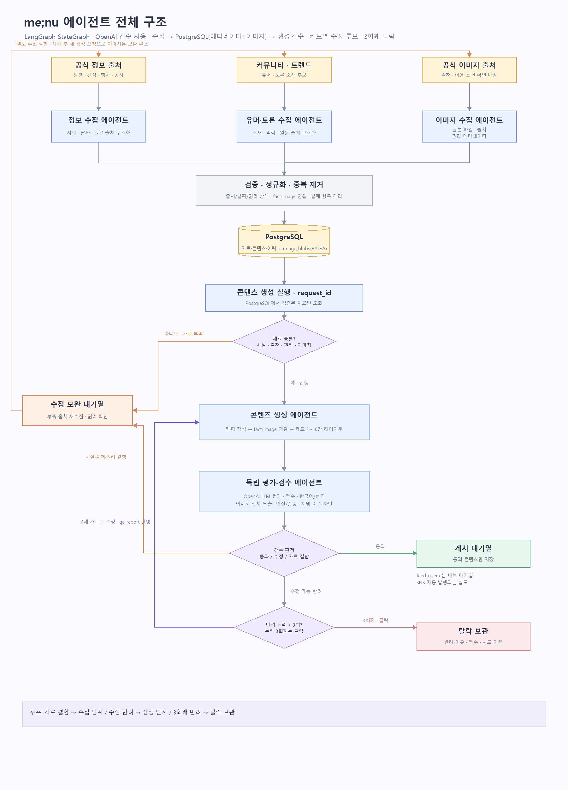
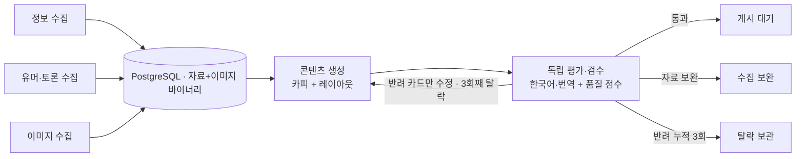

# me;nu 애니 콘텐츠 에이전트

애니메이션 정보·이미지 수집부터 카드뉴스 생성, 별도 평가·검수, 게시 대기/탈락 보관까지 LangGraph로 연결한 프로젝트입니다.



## 에이전트 구성



상세한 구조, 점수표, 라우팅, 알려진 제한 사항은 [에이전트 아키텍처](docs/AGENT_ARCHITECTURE.md)를 보세요. 역할별 폴더 사용법은 [`src/ani_menu_agent/agents/README.md`](src/ani_menu_agent/agents/README.md)에 있습니다.

## 빠른 시작

```powershell
uv sync --all-groups
Copy-Item .env.example .env
# 기본 저장소는 로컬 SQLite입니다. 팀 PostgreSQL을 쓸 때만 backend와 접속 URL을 바꿉니다.
uv run ani-menu doctor
uv run ani-menu sources
```

`.env`에는 사용자가 보유한 API 자격 증명을 로컬에서 설정합니다. 키를 저장소나 문서, 로그에 올리지 마세요.

## 실행 흐름

크롤링과 생성은 별도 실행입니다. 페이지 후보를 찾고 공식 페이지를 수집·추출한 다음 `crawl-ingest`로 자료를 DB에 적재합니다. 이후 적재된 `request_id`를 이용해 카드뉴스를 생성·검수합니다.

```powershell
uv run ani-menu discover --limit 20 --region-policy kr_first
uv run ani-menu collect-page --source <source_id> --url <official_page_url>
uv run ani-menu extract-page data\collected\pages\<capture>.json -o data\input\<package>.json
uv run ani-menu crawl-ingest data\input\<verified_package>.json
uv run ani-menu generate-db <request_id> --kind information
```

작품별 출처 공백과 DB 적재 현황은 `uv run ani-menu work-coverage`로 확인합니다. 이 진단은 출처가 부족한 작품을 보강 대상으로 찾기 위한 것이며, 작품별 콘텐츠 생성량을 균등 배분하거나 상한을 두지 않습니다. 자세한 기준은 [작품별 출처 커버리지](docs/WORK_COVERAGE.md)를 참고하세요.

11개 유형별 자동 생성 근거는 `uv run ani-menu generation-readiness`에서 확인합니다. 이 명령은 유형별 승인된 자동 출처와 검증 팩트/유머 신호를 보여줍니다. 발견 후보는 미검증 자료라 생성 근거로 세지 않으며, 생성 실행도 출처 상태·작품 `menu_work_id`·유형-출처 연결을 다시 확인합니다. 현재 활성 자동 출처가 발견용 RSS뿐이면 공식 원문 확인 전에는 정보 콘텐츠를 생성하지 않습니다.

오프라인 구조 시험은 `uv run ani-menu graph-smoke`, 전체 테스트는 `uv run pytest`입니다. fixture 시험은 실제 콘텐츠 언어 검수나 게시 승인을 대신하지 않습니다. API 키가 없으면 최종 reviewer는 통과 판정을 내리지 않고 검수를 대기합니다. 로컬 개발은 SQLite에 저장하고, 팀 PostgreSQL은 명시적으로 backend를 선택했을 때만 사용합니다. 이미지는 SHA-256으로 중복 저장을 막습니다.

카드 생성을 시작하기 전에 기존 초안·게시 대기·탈락 보관 콘텐츠를 확인합니다. 같은 공식 원문 URL이거나 같은 작품에서 출처 제목 또는 핵심 사실이 겹치는 고확도 중복은 `duplicate_skipped`로 기록하고 새 카드 생성과 피드 적재를 건너뜁니다. SQLite 임시 저장소를 쓸 때는 실행 환경에서 `ANI_MENU_DATABASE_BACKEND=sqlite`와 `ANI_MENU_DATABASE_PATH=data/ani_menu_local.sqlite3`를 지정합니다.

## 주요 문서

- [에이전트 아키텍처·점수·재시도](docs/AGENT_ARCHITECTURE.md)
- [카드 제작 및 이미지 잘림 가드레일](docs/CARD_GUARDRAILS.md)
- [DB 저장·보존 정책](docs/DATA_STORAGE.md)
- [이미지 출처·권리 정책](docs/SOURCE_POLICY.md)
- [수집 사이트 목록](docs/SOURCES.md)

## 구성

- `src/ani_menu_agent/agents/`: 수집·생성·검수 역할
- `docs/`: 아키텍처, 저장 구조, 출처 및 카드 제작 정책
- `tests/`: 단위 및 그래프 경로 검증
