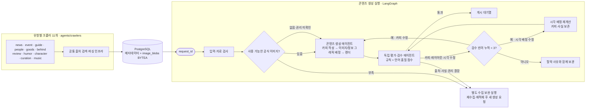
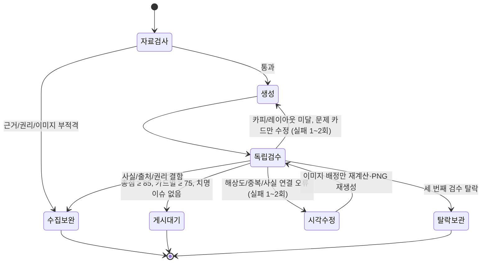

# me;nu 콘텐츠 에이전트 아키텍처

## 요약

상위 에이전트 역할은 유형별 크롤러 11개, 기존 콘텐츠 생성 에이전트 1개, 기존 독립 평가·검수 에이전트 1개로 총 13개입니다. 정보·유머·이미지 모듈은 유형별 크롤러가 재사용하는 공통 기능이며 별도 상위 역할로 중복 계산하지 않습니다. 크롤링/적재 실행과 콘텐츠 생성 실행은 분리되어 있으며, 생성은 `request_id`로 DB에 저장된 자료만 읽습니다.

## 구성요소와 파일

| 역할 | 구현 | 동작 |
|---|---|---|
| 유형별 크롤러 11개 | `agents/crawlers/{news,event,guide,people,goods,behind,review,humor,character,curation,music}.py` | 유형에 연결된 자동수집 승인 출처에서 후보를 수집하고 공통 수집 인프라를 호출 |
| 공통 출처 수집 모듈 | `discovery.py`, `sources/` | 유형별 크롤러가 공유하는 RSS/API/HTML 조회·파싱 기능 |
| 이미지 처리 | `agents/image/`, `collect-page` | 이미지 페이지 캡처·다운로드·출처/권리 메타데이터 관리; 별도 상위 에이전트 역할이 아닌 공통 기능 |
| 콘텐츠 생성 | `agents/content_generation/graph.py`, `generation.py`, `layout_engine.py` | 카드 카피와 fact/image ID 연결, 3~10장 배치 |
| 평가·검수 | `agents/reviewer/` | 결정론적 검사와 독립 LLM 언어 평가를 묶어 승인·반환·보완·보관 |
| 오케스트레이터 | `graph.py`, `nodes.py`, `state.py` | 권리 사전검사, 독립 그래프 연결, bounded retry와 최종 라우팅 |
| 저장소 | `storage.py` | 수집 레코드, 초안/카드, 평가 점수, 게시 대기열, 탈락 사유 저장 |

각 역할별 책임과 폴더 사용법은 [`src/ani_menu_agent/agents/README.md`](../src/ani_menu_agent/agents/README.md)를 확인합니다.

유형별 출처 매핑, 실행 방법 및 실제 후보 적재 결과는 [`TYPE_CRAWLER_AGENTS.md`](TYPE_CRAWLER_AGENTS.md)를 확인합니다.

## 실행 순서

1. crawl-type --content-type <type>가 유형별 크롤러 11개 중 하나를 실행하고, 해당 유형에 매핑된 자동 수집 출처에서 후보를 모읍니다. 후보별 원문을 다시 확인해 인용문 기반 팩트·날짜·출처를 구조화하고 이미지 수집/권리 정책을 적용합니다. 유머는 trend_only 출처의 의견·토론 신호로 분리해 사실 검증을 요구하지 않습니다.
2. `crawl-ingest`가 구조화한 출처·fact·image 메타데이터와 원본 이미지 바이너리를 PostgreSQL에 적재합니다. HTML 페이지 수집은 `og:image`·반응형 원본 후보를 우선하고, 목록에서 발견한 동일 공식 도메인의 상세 페이지를 최대 4개까지 추가 확인합니다. 이미지 바이트는 SHA-256 키로 `image_blobs` 테이블에 저장되고, 메타데이터에는 원본 페이지 URL이 연결됩니다.
3. 별도 생성 실행이 `request_id`로 검증된 자료를 조회합니다. 생성 중 웹 크롤링이나 이미지 재다운로드는 하지 않습니다.
4. 생성 에이전트가 3~10장 카드 카피를 쓰고, 카드마다 연결할 사실과 시각 모드를 지정합니다. 사용 가능한 공식 이미지는 카드 간 중복 없이 한 번씩 쓰고, 남는 페이지는 자체 타이포그래피·정보 그래픽으로 채워 같은 원본을 반복하지 않습니다. 원본 이미지는 전체 표시(`contain`/`contain_blur`)를 기본으로 하고, 페이지마다 1308×1632px(327:408 비율, 4배) PNG를 개별 렌더링해 DB BLOB으로 적재합니다. 이 시점에 텍스트와 카드 메타데이터도 `generated_pending_review` 상태로 DB에 저장합니다. 검수 에이전트는 이 레코드를 갱신하며, 통과 콘텐츠만 피드 대기열에 넣습니다. 피드는 카드들을 하나로 이어 붙이지 않고 페이지 순서대로 좌우 캐러셀에 연결합니다.
5. 독립 검수 에이전트가 코드 기반 치명 오류와 언어 평가를 함께 판정합니다.
6. 통과만 게시 대기열로 갑니다. 사실·출처·권리·다운로드 결함은 크롤러 보완 상태로 반환합니다. 카피 반려는 해당 카드만 수정하고, 시각 배정 반려는 이미지 선택과 레이아웃만 다시 계산해 PNG를 재생성합니다. 어떤 재수정이든 독립 검수로 다시 들어가며, 반려가 누적 세 번째면 탈락 사유와 함께 보관합니다. 수집 실행 단계에서 상세 페이지를 미리 확장하므로 생성 전 이미지 부족 반환을 줄입니다.

## 평가 점수 기준

| 차원 | 최대 | 평가 방식 |
|---|---:|---|
| 근거와 정보 정확성 | 25 | 공식 출처, 검증된 사실, fact-source 연결, 행사 필수 조건 |
| 이미지 적합성·출처/권리 | 15 | 공식성, 출처/상태, 카드 사실과 이미지의 관련성, 중복·다운로드 상태; 위험 감수 이미지는 12점 상한, 원본 이미지 없이 자체 그래픽만 사용한 덱은 8점 |
| 이미지 전체 노출 | 10 | 무크롭 fit, 배율 1.0, 오프셋 0, 주요 피사체 경계 |
| 가독성과 레이아웃 | 15 | 프레임 초과, 글자량, 제목 길이, 외국어 이미지의 한국어 설명 |
| 한국어 자연스러움·번역·팬덤 흥미 | 20 | 검수 LLM이 카드별 자연스러움·번역·명료성·팬덤 흥미도·흐름을 0~5점으로 채점 후 환산. 첫 장 훅과 마지막 장 회수력을 별도로 주의 깊게 평가 |
| 구성과 문체 | 5 | 카드 중복, 불필요한 안내 문구, 카드 수·마무리 문체 |
| 안전·존중 | 10 | 검수 LLM이 카드별 차별·혐오·성적 대상화·괴롭힘·위협 여부와 존중 표현을 평가 |

정식 통과는 총점 85/100 이상이며 모든 카드가 75/100 이상이어야 합니다. 네 언어 항목 중 어느 하나라도 카드별 3/5 미만이거나 안전·존중 항목이 4/5 미만이면 총점과 무관하게 수정 반환합니다. 차별·혐오·성적 대상화·성희롱·미성년자 성적 대상화·특정 대상 괴롭힘/위협·현실 폭력 조장은 `SAFETY_HARMFUL_CONTENT` hard blocker로 처리합니다. 배점은 근거 25, 이미지 적합성/권리 15, 이미지 전체 노출 10, 가독성/레이아웃 15, 한국어/번역 20, 구성/문체 5, 안전/존중 10점입니다. 각 카드 점수는 해당 카드의 언어·안전 평가와 결정론적 규칙 점수 중 낮은 값으로 계산합니다.

점수로 상쇄할 수 없는 치명 차단 항목은 근거 미검증/출처 오류, 권리 미확인, 이미지 사실 불일치, 원본 이미지 잘림·확대·이동, 박스 초과, 카드 수 오류, 차별·혐오·성적 대상화·성희롱·미성년자 성적 대상화·특정 대상 괴롭힘/위협·현실 폭력 조장입니다. 안전·존중 점수는 카드별 4/5 미만이면 수정 반환합니다. 사실·이미지 근거 결함은 수집 보완으로 보냅니다. 수정 가능한 카피·레이아웃·안전 표현 오류는 생성으로 되돌립니다.

## 수정 루프와 상태

`max_revision=3`은 허용되는 누적 검수 실패 횟수입니다. 첫째·둘째 반려는 수정 후 재평가하고, 세 번째 반려에서 탈락 보관합니다. 카드 번호가 지정된 카피 오류는 해당 카드만 수정하며, 다른 카드 카피를 보존합니다. 레이아웃 오류는 해당 레이아웃을 다시 계산합니다. 수정할 카드 번호를 특정할 수 없는 전역 카피 오류에 한해 전체 덱 수정으로 돌아갑니다. 에이전트는 검수 이유를 `qa_report`에 전달합니다.

## 언어 검수와 시각 검수의 범위

검수 프롬프트는 카드별 한국어 어순/조사/말투, 번역투, 독자 명료성, 카드 간 흐름을 따로 채점합니다. 일본어 이미지에 실린 행사명·응모 조건처럼 의미 전달이 필요한 경우 카드에 한국어 설명이 있는지도 코드 가드레일로 확인합니다.

현재 검수 LLM 입력은 이미지 픽셀 자체가 아니라 이미지 설명, OCR 텍스트, 출처/관련 사실 메타데이터, 레이아웃 정보입니다. 코드 레벨에서 확대·오프셋·프레임 넘침을 막지만, 최종 카드 PNG를 실제로 렌더링해 픽셀 단위로 잘림·가독성을 확인하는 별도 비전 QA는 아직 구현되지 않았습니다. 따라서 “검수 에이전트가 렌더 결과까지 눈으로 확인한다”고 간주해서는 안 됩니다.

## 실행 및 운영 주의

- 크롤링/DB 적재와 콘텐츠 생성을 나눠 실행합니다. `generate-db`는 설정된 저장소 자료를 소비합니다. PostgreSQL URL이 없는 현재 로컬 개발환경에서는 `data/ani_menu_local.sqlite3`를 임시로 사용하며, PostgreSQL URL을 설정하면 저장소 계층이 PostgreSQL로 전환됩니다. manifest/fixture 실행은 테스트 및 오프라인 구조 확인용입니다.
- LLM 키가 없으면 언어 품질 판단을 할 수 없으므로 게시 승인 없이 `review_api_required`로 대기합니다.
- 오프라인 `review_fixture`는 그래프 테스트 전용이며, 가상의 리뷰 결과가 좋아도 실제 피드로 게시할 수 없습니다.
- 비용은 생성/검수 LLM 호출별 usage metadata를 저장해 추적합니다. 정확한 비용은 실제 선택 모델의 가격 설정에 따라 달라질 수 있습니다.
- 테스트: `uv run pytest`; 오프라인 구조 확인: `uv run ani-menu graph-smoke`.

## 관련 문서

- [카드 제작 가드레일](CARD_GUARDRAILS.md)
- [DB 저장 및 보존](DATA_STORAGE.md)
- [출처와 이미지 사용 정책](SOURCE_POLICY.md)
- [수집 사이트 목록](SOURCES.md)
