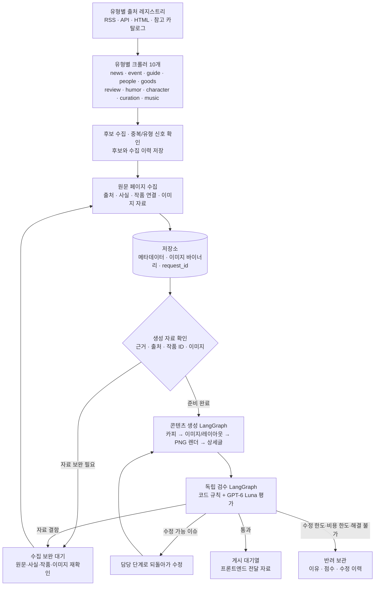

# me;nu 애니메이션 콘텐츠 에이전트 안내

## 1. 시스템 한눈에 보기

me;nu 에이전트는 애니메이션 관련 출처에서 후보와 근거 자료를 모으고, 작품 ID와 이미지를 연결해 카드뉴스와 상세글을 만든 뒤 독립 검수하는 콘텐츠 파이프라인이다. 수집과 생성은 분리되어 있으며, 생성 단계는 `request_id`로 저장된 자료 묶음을 불러온다.

현재 시스템에는 **유형별 크롤러 역할 10개**, **공통 콘텐츠 생성 에이전트 1개**, **독립 검수 에이전트 1개**가 있다. 크롤러 10개가 각각 별도 크롤링 엔진을 갖는 방식은 아니다. 유형별 에이전트는 담당 유형과 출처·신호를 선언하고, 공통 수집 그래프와 어댑터를 공유한다. 이미지 수집·선별·렌더링도 별도 유형 에이전트가 아니라 공통 처리 모듈이 맡는다.

## 2. 유형별 크롤러와 출처

유형은 `news`(소식), `event`(행사), `guide`(작품 가이드), `people`(인물), `goods`(굿즈), `review`(리뷰), `humor`(유머·토론·비하인드), `character`(캐릭터), `curation`(큐레이션), `music`(음악)으로 나뉜다. 비하인드는 별도 유형이 아니라 `humor`에 포함한다.

크롤러는 `config/sources.json`과 `config/source_type_map.json`의 유형 연결을 읽는다. 하나의 출처가 여러 유형에 연결될 수 있다. 출처 정보에는 역할(예: 1차·편집/보도·참고·트렌드), 수집 방식, 활성 상태와 수집 조건이 들어간다. 크롤러는 해당 유형에 연결되고 현재 실행 조건을 만족하는 출처만 선택한다.

공통 수집 흐름은 다음과 같다.

1. 출처 상태, 출처 역할, 어댑터 지원 여부를 확인한다.
2. RSS, REST API, 검색 어댑터 또는 HTML 페이지에서 후보를 수집한다.
3. URL·중복·유형별 신호와 출처 정책을 확인하고 후보를 저장한다.
4. 후보를 생성 대상으로 처리할 때 원문을 캡처하고 사실·이미지·작품 매칭 자료를 구성한다.
5. 기사 목록에서 발견한 후보라면, 등록된 유형별 1차 출처 연결을 찾아 원문을 확보한다. 발견 기사 자체를 자동으로 1차 사실 근거로 취급하지 않는다.

커뮤니티 자료는 유머·토론의 의견 신호로 분리하며, 확인된 사실처럼 쓰지 않는다. 비하인드는 출처에서 뒷받침되는 정보형 근거를 사용한다.

## 3. 자료 수집과 작품 ID

원문 수집기는 HTML 본문·메타데이터·이미지 링크를 읽고, RSS/API 전용 어댑터도 사용한다. 원문과 이미지에는 각각 출처 URL 및 수집 관계를 보존한다. 이미지 파일은 다운로드·형식·크기·중복·출처 메타데이터를 확인한 뒤 작품과 콘텐츠 자료에 연결한다. 원문에 필요한 이미지가 부족하면 작품 ID가 확인된 동일 작품의 카탈로그 이미지를 보완 후보로 사용할 수 있다. 굿즈나 행사 자산과 일반 작품 이미지는 자산 유형·설명에 따라 구분한다.

작품 매칭은 최종 작품 ID가 있는 `data/reference/menu_works.csv`를 기준으로 한다. 시즌·극장판 제목은 `menu_work_entries.csv`, 확인된 별칭은 `menu_work_aliases.csv`, 외부 카탈로그 연결은 `menu_work_external_entries.csv` 등을 참조한다. 원문 제목을 우선하고, 본문에 우연히 언급된 다른 작품을 주 작품으로 붙이지 않는다. 협업이나 큐레이션처럼 여러 작품이 실제 주제인 경우에만 복수 작품 연결을 허용한다.

카탈로그에서 제목이 연결되지 않으면 제한된 LLM 매칭 보조가 작동할 수 있다. 새로운 별도 작품은 원문 제목과 Kitsu 제목이 정확히 확인되고 기존 작품·시즌·극장판·별칭과 충돌하지 않을 때 다음 작품 ID로 등록한다. 모호하거나 중복 가능성이 있으면 임의 등록하지 않고 검토 대상으로 남긴다.

수집 사실은 출처에 연결된 구조화 레코드로 저장된다. 글 작성과 검수는 이 근거를 기준으로 하며, 이미지의 캡션·OCR 문구도 일반 원문 사실과 구분해 출처 정보를 유지한다. RE:CAL 행사/음악 상세 이미지 OCR은 설정된 소스의 제한된 이미지에만 적용한다.

## 4. 콘텐츠 생성 에이전트

콘텐츠 생성은 `request_id`에 연결된 자료를 읽고 LangGraph 하위 그래프에서 진행한다.

| 단계 | 기능 |
|---|---|
| 카피 작성 | 출처 사실과 fact ID를 바탕으로 표지·본문·마무리 카드의 문구를 구조화한다. |
| 레이아웃 구성 | 카드별로 어떤 이미지 자산을 쓸지 연결하고 이미지 비율 및 페이지 역할에 맞춰 배치 정보를 만든다. |
| 시각 계획·보완 | GPT-6 Luna가 이미지 미리보기와 카드 내용을 바탕으로 레이아웃 방향을 고를 수 있다. 검수에서 지정된 카드만 교체·재배치 경로로 돌아간다. |
| PNG 렌더링 | Pillow 기반 렌더러가 원본 이미지, 배경 처리, 그라데이션·블러 등을 합성한다. |
| 상세글 작성 | 별도 상세 본문과 사용 근거 fact/source ID를 구성한다. 상세글 끝에는 원문·이미지 출처 및 AI 활용 안내를 포함한다. |

카드 문구는 **최종 PNG에 그리지 않는다.** DB에는 페이지별 카드 텍스트, 이미지 ID, 좌표·레이아웃 등의 정보를 저장하고 PNG는 텍스트가 없는 배경판으로 저장한다. 프론트엔드는 구조화된 카드 텍스트를 HTML로 표시한다. 현재 구성에서는 HTML 텍스트를 카드 하단 영역에 둔다. 세로형 이미지는 화면의 큰 영역을 채우고 가장자리를 같은 이미지에서 만든 배경 처리와 자연스럽게 연결한다. 가로형은 위쪽 이미지 영역과 아래쪽 텍스트 영역을 사용한다.

## 5. 독립 검수와 수정 라우팅

검수는 생성 그래프와 분리된 LangGraph에서 수행한다. 작성 에이전트와 검수 에이전트는 역할과 프롬프트가 분리되어 있다.

- **코드 검수:** 근거·출처 연결, 작품 ID, 카드 수와 데이터 구조, 이미지 다운로드·렌더·중복·해상도 같은 기계적으로 판정할 수 있는 항목을 확인한다.
- **LLM 검수:** 한국어 표현과 번역, 카드 흐름, 유형 적합성, 이미지와 콘텐츠의 주제·구성 관계, 상세글의 사실 지원, 안전·존중 표현을 평가한다.
- **판정:** 규칙 이슈와 점수를 함께 사용한다. 사실·출처·권리·안전 등 차단 이슈는 높은 점수로 덮지 않는다. 수정 가능한 문구·상세글·레이아웃 이슈는 담당 단계로 돌아간다. 원문이나 이미지 자료 결함은 생성 에이전트가 꾸며서 해결하지 않고 수집 보완 경로로 반환한다.

기본 설정은 카드 **3~10장**, 콘텐츠당 LLM 추정 비용 **최대 미화 $0.04**, 수정 시작 전 비용 예약액 **$0.01**, 환경 설정상의 수정 상한 **3회**다. 상한이나 비용 한도에 도달하면 검수 이유·점수·수정 이력과 함께 반려 보관한다.

## 6. 사용 모델

모델은 에이전트마다 별도로 배정되어 있지 않다. 여러 역할이 환경변수로 설정되는 공통 언어·비전 모델을 공유하며, 역할별로 프롬프트와 입력 자료를 다르게 준다.

| 모델 | 현재 역할 | 실제 기본 설정 |
|---|---|---|
| GPT-6 Luna | 카피·팩트 구조화, 상세글, 독립 언어/이미지 검수, 작품 매칭 보조, 모호한 링크 검토, RE:CAL 일부 이미지 OCR, 시각 레이아웃 계획 | `ANI_MENU_MODEL=gpt-6-luna`; 레이아웃 변수 기본값도 `gpt-6-luna` |
| 이미지 편집 모델 | 배경 영역의 제한 편집 또는 업스케일 파생본 생성 | 설정 이름은 `gpt-image-2.5-sunburst`. 편집·업스케일 기능은 기본 비활성화이며 이미지 모델 예산 기본값은 $0이므로 일반 생성에서 호출되지 않음 |

검수 LLM에는 카드별 PNG 위에 문구를 임시로 합성한 미리보기 이미지를 보내 시각 평가에 사용한다. 이 임시 미리보기는 저장되는 최종 PNG를 변경하지 않는다. GPT-6 Luna는 이미지를 판단하고 레이아웃 방향을 정할 수 있지만, PNG의 일반 렌더링은 이미지 모델이 아니라 코드가 한다. 현재 파이프라인은 애니 원작 이미지를 새로 생성하는 이미지 생성 경로를 기본 사용하지 않는다.

## 7. 외부 도구와 라이브러리

| 도구/라이브러리 | 용도 |
|---|---|
| LangGraph | 크롤러, 생성, 검수와 재시도·반환 경로를 상태 그래프로 구성 |
| LangChain OpenAI / OpenAI SDK | GPT-6 Luna 대화·구조화 출력 및 선택적 이미지 편집 API 호출 |
| HTTPX | 웹 페이지와 API 요청, 이미지 파일 다운로드 |
| BeautifulSoup4 / lxml | HTML 요소·링크·메타데이터·이미지 URL 파싱 |
| feedparser | RSS/Atom 피드 파싱 |
| Trafilatura | 기사 본문 추출 보조 |
| DDGS | 검색 기반 후보 발견 어댑터 |
| Pillow | 이미지 열기·축소·합성·블러·그라데이션·PNG 렌더 및 OCR 입력 전처리 |
| Pydantic / Pydantic Settings | 입력·출력 스키마, 모델 구조화 응답과 환경 설정 검증 |
| RapidFuzz | 작품명 후보의 문자열 유사도 검색 보조 |
| Typer / Rich | `ani-menu` 명령행 인터페이스와 터미널 출력 |
| SQLite / PostgreSQL (`psycopg`) | 로컬 임시 저장 및 PostgreSQL 저장 백엔드 |
| LangSmith | 선택적 실행 추적. 기본 설정에서는 tracing 비활성화 |

수집은 등록된 소스 어댑터의 HTTP·RSS·API·정적 HTML 파싱으로 처리한다. 현재 의존성 구성에는 Scrapling이나 Playwright 기반 브라우저 자동화가 포함되어 있지 않으며, 사이트 JavaScript를 브라우저처럼 실행하는 구조도 아니다. 링크의 정적 목적지 추출이나 특정 페이지의 이미지 OCR은 각 어댑터 규칙에 따라 제한적으로 수행한다.

## 8. 저장소와 프론트엔드 전달물

저장 계층은 `AgentRepository`가 담당하며 설정에 따라 SQLite 또는 PostgreSQL을 선택한다. `.env.example`의 로컬 기본값은 SQLite이고, 배포 환경에서 PostgreSQL URL을 설정하면 PostgreSQL 백엔드를 선택할 수 있다.

- **원문/수집 자료:** 후보, 출처, 캡처 본문, 사실, 작품 매칭 근거
- **이미지:** 메타데이터와 출처는 이미지 자산 레코드에, 원본/렌더 파일 바이너리는 `image_blobs` 저장소에 둔다.
- **초안:** `request_id`, 카드별 텍스트·이미지 ID·레이아웃, 상세글, PNG 참조
- **검수:** 점수, 규칙 코드, 페이지별 이슈, 담당 수정 단계, 토큰·비용 사용량
- **결과:** 통과 콘텐츠는 내부 `feed_queue`, 실패는 반려 보관, 자료 문제는 수집 보완 상태로 관리

프론트엔드에는 페이지 순서가 있는 카드 문구와 이미지/레이아웃 참조를 제공한다. PNG에는 문구가 없고, HTML용 카드 텍스트와 상세글은 별도 필드로 전달된다. 통과 콘텐츠는 내부 게시 대기열에 적재되며 이 에이전트가 SNS에 자동 게시하지 않는다.

## 9. 주요 코드와 실행 진입점

| 영역 | 코드 |
|---|---|
| 전체 상태 그래프·라우팅 | `src/ani_menu_agent/graph.py`, `nodes.py`, `state.py` |
| 유형 크롤러 10개·공통 수집 그래프 | `src/ani_menu_agent/agents/crawlers/` |
| 후보 발견과 출처별 수집 | `discovery.py`, `sources/page_collector.py`, `sources/` |
| 작품 카탈로그·매칭 | `work_catalog.py`, `work_match_fallback.py`, `work_catalog_registration.py` |
| 생성 그래프·카피·상세글·렌더링 | `agents/content_generation/`, `generation.py`, `layout_engine.py` |
| 독립 검수 | `agents/reviewer/`, `review_rules.py`, `quality.py` |
| DB 접근 | `storage.py` |
| 유형·출처 설정 | `config/source_type_map.json`, `config/sources.json` |

주요 CLI 명령은 `uv run ani-menu crawl-type --content-type <type>`(유형 후보 수집), `crawl-generate`(후보의 원문 수집부터 생성·검수), `generate-db`(기존 `request_id` 자료로 생성), `source-discover`(새 출처 후보 탐색), `db-status`(저장 상태 확인)이다. 실제 선택 가능한 인수와 실행 설정은 각 명령의 `--help` 및 환경변수에 따른다.

## 10. 발표 시 핵심 설명

이 시스템은 단순히 한 번의 프롬프트로 글을 만드는 챗봇이 아니다. 유형별 크롤러가 출처 후보를 찾고, 별도의 자료 파이프라인이 원문·사실·이미지·작품 ID를 연결한다. 콘텐츠 생성 그래프가 그 근거를 카드와 상세글로 구조화하고, 독립 검수 그래프가 다시 평가한다. 수정 가능한 결함은 작성 담당 단계로 되돌아가고, 근거 자료 결함은 수집 단계로 반환한다. 최종 전달물은 **이미지만 담긴 PNG와 별도로 저장된 HTML 문구·상세글·출처 메타데이터**다.
