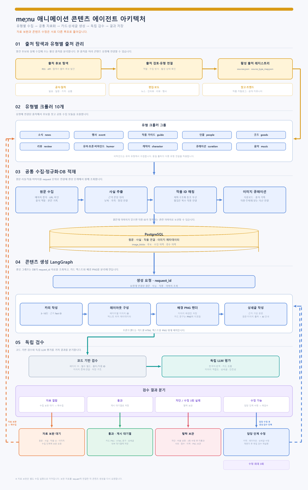

# me;nu 애니메이션 콘텐츠 에이전트 구조

> 유형별 출처에서 콘텐츠 후보와 근거 자료를 모으고, 작품 정보를 연결한 뒤 카드뉴스와 상세글을 생성·검수하는 현재 시스템의 동작 구조입니다.

## 1. 시스템 구성

에이전트는 크게 **유형별 수집**, **공통 콘텐츠 생성**, **독립 검수** 단계로 구성됩니다. 유형별 크롤러는 10개이며, 공통 생성 에이전트와 독립 검수 에이전트가 각 1개씩 동작합니다. 이미지 수집·출처 확인·렌더링은 별도 유형 크롤러가 아니라 공통 처리 모듈이 맡습니다.

| 단계 | 담당 | 역할 |
|---|---|---|
| 유형별 수집 | 10개 크롤러 | 유형에 연결된 출처에서 후보를 발견하고 유형별 신호를 확인합니다. |
| 공통 자료 처리 | 출처 수집기·이미지 큐레이터·작품 카탈로그 | 원문, 사실 문장, 이미지, 출처·권리 메타데이터와 작품 ID를 정리합니다. |
| 콘텐츠 생성 | 콘텐츠 생성 LangGraph | DB의 `request_id` 자료를 바탕으로 카드 문구, 페이지 구성, 이미지 연결, 상세글을 만듭니다. |
| 독립 검수 | 검수 LangGraph | 코드 규칙과 별도 LLM 평가로 사실·출처·이미지·한국어 문장·안전성을 확인합니다. |
| 결과 저장 | PostgreSQL | 통과 콘텐츠, 탈락 보관, 보완 대기와 이미지 바이너리를 구분해 저장합니다. |

### 10개 콘텐츠 유형

`news` 소식 · `event` 행사 · `guide` 작품 가이드 · `people` 인물 · `goods` 굿즈 · `review` 리뷰 · `humor` 유머·토론·비하인드 · `character` 캐릭터 · `curation` 큐레이션 · `music` 음악

비하인드 전용 크롤러는 두지 않습니다. 출처가 확인된 제작 비하인드, 메이킹, 오마주 등의 소재는 유머 유형에서 다룹니다.

## 2. 출처와 후보 수집

유형별 출처 연결은 `config/sources.json`과 `config/source_type_map.json`에 둡니다. 하나의 출처가 여러 콘텐츠 유형을 지원할 수 있으며, 크롤러는 해당 유형에 연결되고 현재 수집 설정과 어댑터 조건을 충족하는 출처만 사용합니다.

출처는 용도에 따라 구분합니다.

- **공식·1차 출처:** 발표 사실, 일정, 가격 등 원문 근거 확인
- **편집·보도 출처:** 리뷰, 인터뷰, 행사·굿즈 기사 등 편집 콘텐츠 확인
- **참고 카탈로그:** 작품·인물 정보와 같은 작품의 이미지 보완
- **트렌드 출처:** 유머 유형에서 공개 커뮤니티 신호 수집
- **발견 전용 출처:** 후보를 찾는 데 사용하며, 그 자체로 사실 근거나 생성 승인 출처가 되지는 않음

출처 탐색 기능은 새 출처 후보를 기록합니다. 후보는 검토와 유형 연결을 거쳐 활성 출처 레지스트리에 반영된 뒤 유형별 수집에서 사용됩니다. 후보 발견과 생성 근거 승인은 별개의 단계입니다.

각 유형 크롤러는 공통 수집 그래프를 사용합니다.

1. 유형에 맞는 활성 출처·수집 어댑터·작품 조건을 확인합니다.
2. RSS·API·HTML 등 출처별 방식으로 후보를 가져옵니다.
3. 중복, URL, 출처 역할, 유형별 신호를 확인합니다.
4. 후보와 출처 이력을 DB에 기록합니다.
5. 생성 요청이 이어지면 원문 페이지를 캡처하고 사실·이미지 자료를 별도 정리합니다.

커뮤니티 유머 신호는 사실 기사처럼 검증된 사실로 취급하지 않고, 의견·토론 소재로 분리합니다.

## 3. 작품 ID 연결과 자료 적재

작품 연결은 등록된 작품 카탈로그를 기준으로 합니다. 원문 제목과 구조화된 작품 참조를 우선 확인하고, 후보 본문에 언급된 다른 작품명을 무조건 추가하지 않습니다. 작품이 명확하지 않으면 임의로 ID를 부여하지 않습니다. 새 작품은 활성 Kitsu 카탈로그에서 정확하고 유일한 제목이 확인될 때 카탈로그에 등록한 뒤 연결합니다. 작품 간 공식 협업처럼 복수 작품이 실제 주제인 경우에는 여러 작품 ID를 연결할 수 있습니다.

원문에서 사실 문장과 이미지 URL을 추출합니다. 이미지 큐레이터는 이미지 다운로드 상태, 출처·권리 근거, 크기, 중복 여부와 카드 사용 가능성을 기록합니다. 원문 이미지가 부족하면 작품 ID가 정확히 연결된 카탈로그 이미지로 보완할 수 있습니다. 특정 상품·행사 이미지와 일반 작품 이미지는 자산 종류와 설명을 이용해 구분합니다.

콘텐츠 생성은 원문 크롤링과 분리되어 있습니다. 생성 단계는 `request_id`로 검증된 자료를 조회하므로 원문, 사실, 이미지, 작품 연결이 해당 요청에 함께 적재되어 있어야 합니다.

## 4. 콘텐츠 생성과 프론트엔드 전달

생성은 LangGraph 안에서 다음 역할을 수행합니다.

1. **카피 작성:** 검증 자료와 연결된 fact ID를 이용해 3~10장의 카드 문구를 작성합니다.
2. **레이아웃 구성:** 이미지별 가로·세로 비율을 고려해 화면 배치를 정하고 카드마다 이미지 ID와 텍스트 영역을 연결합니다.
3. **시각 보완:** 검수에서 이미지 교체·레이아웃 수정이 지정된 경우 해당 페이지를 다시 구성합니다.
4. **렌더링:** 원본 이미지를 이용해 카드별 배경 PNG를 만듭니다.
5. **상세글 작성:** 근거 fact ID에 연결된 별도 상세 문장을 작성합니다.

카드의 제목·본문은 PNG에 그려 넣지 않습니다. DB에는 페이지별 카드 문구, 이미지 ID, `text_overlay_box` 등 배치 정보가 구조화되어 저장되고 PNG는 배경 이미지로 저장됩니다. 현재 레이아웃은 모든 카드의 HTML 텍스트 영역을 아래쪽에 둡니다. 세로형 이미지는 화면 대부분을 채우고 가장자리를 블러 배경과 이어지게 하며, 가로형 이미지는 위쪽 영역에 놓고 텍스트는 아래에 배치합니다. 최종 문구 렌더링은 프론트엔드가 페이지별 HTML로 수행합니다.

자세히 보기 상세글에는 본문 뒤에 원문 출처와 사용 이미지 출처, AI 활용 안내를 붙여 전달합니다.

**이미지 모델의 현재 역할:** 기본 설정에서 GPT-6 Luna는 문구 작성·레이아웃 방향 계획·검수에 사용됩니다. 이미지 픽셀을 새로 생성하는 모델은 기본 생성 경로에 연결되어 있지 않습니다. 이미지 편집과 업스케일 기능은 설정으로 분리되어 있으며 현재 기본값은 비활성화, 이미지 모델 비용 예산은 0입니다. 실제 모델은 환경 설정으로 바뀔 수 있습니다.

## 5. 독립 검수와 결과 분기

검수 에이전트는 생성 에이전트와 분리된 그래프에서 결과를 다시 봅니다.

- **코드 검수:** 사실·출처 연결, 출처 승인, 작품 ID, 이미지 존재·출처·해상도·중복, 페이지 수, 본문 구조 등 결정 가능한 규칙을 확인합니다.
- **LLM 검수:** 한국어 자연스러움과 번역, 카드 흐름, 유형 적합도, 이미지 주제·구성, 상세글의 사실 지원·완전성, 안전·존중 표현을 평가합니다.
- **판정:** 점수와 함께 blocker·수정·보완 분기를 적용합니다. 높은 점수만으로 사실·출처·안전상의 중대한 결함을 덮을 수 없습니다.

| 검수 결과 | 다음 경로 |
|---|---|
| 통과 | 내부 게시 대기열(`feed_queue`)에 저장합니다. SNS에 자동 게시하지 않습니다. |
| 카드 문구·상세글·레이아웃 수정 | 담당 단계가 수정하고 독립 검수를 다시 받습니다. 기본 수정 상한은 설정값 `ANI_MENU_MAX_REVISION`이며 기본값은 3입니다. |
| 원문·사실·작품 ID·권리·이미지 자료 보완 필요 | 검수 점수를 낮춰 통과시키지 않고 수집 보완 상태로 반환합니다. |
| 수정 한도 또는 콘텐츠별 비용 상한 도달 | 반려 이유, 점수, 검수 이력을 함께 보관합니다. |

정책 기본값은 콘텐츠당 LLM 추정 비용 최대 $0.04, 카드 3~10장입니다. 콘텐츠 LLM 비용 한도와 수정 비용 예약액은 생성 흐름의 라우팅에도 적용됩니다.

## 6. 저장소와 주요 데이터

로컬 개발은 설정에 따라 SQLite를 사용하고, PostgreSQL 연결 주소가 설정된 환경은 PostgreSQL 저장소를 사용할 수 있습니다. 이미지 바이너리는 `image_blobs`에 저장하고, 카드·상세글·출처·사실에는 이미지와 근거를 참조하는 ID를 둡니다.

| 데이터 | 저장 내용 |
|---|---|
| 출처·수집 기록 | 후보, 원문 캡처, 출처별 상태, 수집·검증 메타데이터 |
| 콘텐츠 자료 | 사실 문장, 작품 ID와 매칭 근거, 이미지 메타데이터 |
| 생성 콘텐츠 | 카드별 텍스트·이미지 연결·레이아웃, 상세글, 렌더된 PNG |
| 검수 기록 | 점수, 규칙 코드, 페이지별 이슈, 담당 수정 경로, 사용량 |
| 결과 큐 | 통과 대기열, 수집 보완 대기, 반려 보관 |

## 7. 코드 위치

- 유형별 크롤러: `src/ani_menu_agent/agents/crawlers/`
- 출처 탐색·수집: `src/ani_menu_agent/discovery.py`, `src/ani_menu_agent/sources/`
- 작품 연결: `src/ani_menu_agent/work_catalog.py`, `src/ani_menu_agent/work_catalog_registration.py`
- 이미지 선별·레이아웃: `src/ani_menu_agent/agents/image/`, `src/ani_menu_agent/image_selection.py`, `src/ani_menu_agent/layout_engine.py`
- 콘텐츠 생성: `src/ani_menu_agent/agents/content_generation/`
- 독립 검수: `src/ani_menu_agent/agents/reviewer/`, `src/ani_menu_agent/review_rules.py`, `src/ani_menu_agent/quality.py`
- 전체 흐름·라우팅: `src/ani_menu_agent/graph.py`, `src/ani_menu_agent/nodes.py`
- DB 입출력: `src/ani_menu_agent/storage.py`
