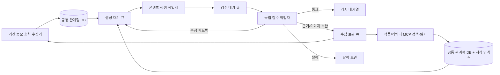

# me;nu 수집·생성·검수 파이프라인 개편안

## 이번 개편에서 지킬 결정

- 기간이 중요한 행사·전시·팝업·예약·판매 상품·방영/공개 일정은 출처 기반으로 반복 수집해 관계형 DB에 적재한다.
- 캐릭터·작품 정보·레전드 회차·제작 비하인드 등 오래 활용할 자료는 작품 단위 지식으로 축적한다. MCP는 출처를 자동으로 전부 긁는 크롤러가 아니라, 검색·페이지 읽기 도구를 에이전트가 호출하는 연결 방식이다. 출처별 목록 수집은 일반 크롤러가, MCP는 질의형 자료 탐색이 맡는다.
- 크롤러, 콘텐츠 생성기, 검수기는 서로 다른 상시 작업자다. 각 작업자는 DB 큐에서 자기 일을 가져오며 앞 단계의 실행을 기다리는 동기식 한 덩어리 파이프라인으로 묶지 않는다.
- 생성기는 DB에 생성 가능한 자료가 생기면 처리한다. 생성기 내부에서 독립 검수를 실행하지 않는다.
- 검수기는 `generated_pending_review` 콘텐츠를 처리한다. 통과는 게시 대기열, 수정은 생성 큐로 피드백과 함께 반환, 탈락은 사유와 함께 보관, 근거·이미지 결함은 수집 보완 큐로 보낸다.
- 콘텐츠 본문과 출처 근거는 기존 검수 강도를 유지한다. 처리량을 높이기 위해 사실성·출처·작품 연결 기준을 낮추지 않는다.
- 작품은 제목·일본어·로마자·영문·별칭·프랜차이즈/하위 작품 관계를 먼저 대조한다. 새 작품은 기존 항목과 중복되지 않는지 확인한 뒤 작품 목록과 DB에 등록한다. 불확실한 후보는 잘못된 기존 ID에 연결하지 않는다.
- 이미지 PNG에는 텍스트를 그리지 않는다. 카드 문구는 프론트엔드 HTML로 표시한다. 소식·행사·굿즈 캐러셀은 최소 2장, 그 외 유형은 최소 3장으로 구성하고 같은 이미지를 반복하지 않는다. 상세글 맨 끝은 출처 표기 다음에 AI 활용 생성 고지를 둔다.

## 현재 구현과 개편 이유

현재 프로젝트에는 유형별 크롤러 10개, 콘텐츠 생성 하위 그래프, 독립 검수 하위 그래프, DB 저장소가 이미 있다. 하지만 실행 경계는 아직 분리되지 않았다.

- `crawl-type`은 목록 검색부터 후보 원문 처리, 적재, 콘텐츠 생성, 독립 검수까지 한 명령 안에서 순차 실행한다.
- `run_continuous_generation.py`도 유형별로 `crawl-type`을 반복 호출한다. 따라서 수집 속도와 생성/검수 속도가 같은 작업 루프에 묶인다.
- `generate-db`는 DB에서 입력을 읽지만 현재 `build_graph()`를 실행한다. 그 그래프에는 생성과 검수, 수정 루프가 함께 있다.
- DB에는 `agent_records`, `content_drafts`, `feed_queue`, `rejected_archive`가 있다. 후보와 자료의 보존은 가능하지만, 독립 생성/검수 작업자의 원자적 claim·lease·재시도 큐는 아직 없다.
- MCP SDK와 벡터 저장소 어댑터는 현재 의존성/구현에 없다. Kitsu, Wikipedia, Wikidata 같은 API 연결은 MCP와 같은 기능이 아니다.

따라서 기존 생성 품질 로직을 다시 만들지 않고, 실행·큐·저장 경계부터 나눈다. `agents/content_generation/`과 `agents/reviewer/`는 각각의 전문 에이전트로 보존하고, 새 파이프라인 코드는 작업 분배와 DB 입출력만 맡는다.

## 목표 폴더 구조

```text
src/ani_menu_agent/
  agents/
    crawlers/                 # 기존 유형별 수집기; 공통 HTML/RSS/API 처리
    content_generation/       # 기존 콘텐츠 생성 그래프
    reviewer/                 # 기존 독립 검수 그래프
  pipelines/
    common/                   # DB 큐 계약, lease, dedupe, 출처/팩트 정규화
    time_sensitive/           # 행사·굿즈·신작/일정 출처 수집 및 기간 검증
    evergreen/                 # MCP 검색/읽기, 근거 정규화, 지식 청킹·검색
    workers/                  # crawl worker, generation worker, review worker
```

출처 레지스트리는 한 곳에서 유지하고, `source_lane_map.json`은 출처만으로 결정할 수 있는 기본 lane을 기록한다. 실제 분류는 후보/팩트 수준에서 확정한다. 한 매체가 행사와 작품 정보를 모두 다루므로 매체 전체를 영구적으로 한 레인에 묶지 않는다.

## 목표 데이터 흐름



DB가 비어 있으면 생성·검수 작업자는 대기하고, 새 행이 들어오면 다음 poll/notify 주기에서 바로 처리한다. 작업자끼리 실행 순서를 직접 호출하지 않는다.

## DB 경계와 상태

기존 원본·근거 데이터는 유지하고, 큐 작업만 명시적으로 추가한다. lane은 후보/콘텐츠 단위 메타데이터로 저장한다.

| 큐 | 최소 상태 | 입력과 결과 |
|---|---|---|
| 수집 후보 | `discovered → capturing → verified → generation_pending` 및 `duplicate / unresolved / failed` | 후보 URL, 발견 출처, 원문·팩트·날짜·이미지 근거 |
| 생성 작업 | `pending → claimed → generated_pending_review` 및 `retry / failed` | 검증된 package, lane, request ID, 시도 횟수, lease |
| 검수 작업 | `pending → claimed → passed / returned / rejected / needs_crawler_update` | 생성 초안, 검사 보고, 수정 지시, 누적 반려 횟수 |
| 지식 자료 | `captured → normalized → chunked → indexed → stale/superseded` | 문서/팩트, 출처 URL, 작품 ID, 확인 시각, 청크·색인 키 |

큐 전환은 멱등이어야 한다. 작업자가 종료되거나 응답이 끊겨도 lease 만료 후 회수할 수 있어야 하며, 중복으로 두 작업자가 같은 request를 생성/검수하지 않도록 DB에서 원자적으로 claim한다. SQLite 개발 저장소와 PostgreSQL 운영 저장소가 같은 계약을 제공해야 한다.

이벤트의 `event_start`/`event_end`와 피드 노출 종료 `valid_until`은 계속 구분한다. 날짜가 없거나 원문과 모순이면 기간 추출 실패/확인 필요로 표시하고, 날짜를 추정해 stale 또는 유효로 판정하지 않는다. evergreen 지식은 행사 만료 규칙으로 삭제하지 않는다.

## 중복·작품 ID·검수 반환

- 수집 단계: 정규화 URL, 출처 item ID, 콘텐츠 fingerprint로 같은 항목을 멱등하게 적재한다.
- 생성 직전: 동일 작품·제목·핵심 팩트 조합을 기존 초안/게시 대기와 비교한다.
- 작품 매칭: 제목과 등록 별칭, 일본어/로마자/영어, `franchise`/`entry` 관계를 우선 확인한다. 복수 ID는 실제 콜라보 콘텐츠에서만 허용한다.
- 신규 작품: 기존 레지스트리 전체를 대조한 후 새 ID를 부여하고 정본 목록·DB에 등록한다. 작품 경계가 불확실하면 잘못된 ID로 생성하지 않고 작품 확인 큐에 둔다.
- 검수 수정: 검수기는 실패 카드와 구체 수정 프롬프트를 생성 큐에 넣는다. 생성기는 지시된 수정 범위만 고치고 독립 검수 큐로 돌려보낸다. 현재 정책의 누적 3회 실패 시 탈락 보관 규칙은 유지한다.
- 검수 통과: 기존 `feed_queue`만 갱신하며 실제 SNS 게시를 뜻하지 않는다.

## 단계별 실행 순서

1. **현행 입력/상태 기준선 확정**: DB는 읽기 전용으로 확인하고, 진행 중인 변경을 보존한다. 기존 백그라운드 생성기는 재시작하지 않는다.
2. **분류와 폴더 경계 추가**: `time_sensitive`/`evergreen` 경로와 source lane 설정을 만든다. 기존 `crawl-type`을 바로 삭제하지 않고 호환 실행 경로로 둔다.
3. **독립 DB 작업 큐 추가**: 자료 생성, 생성, 검수, 수정 반환, 수집 보완의 job 상태와 원자적 claim을 구현한다. 코드에 스키마 변경은 추가하되 사용 중인 DB에 임의 적용하지 않는다.
4. **기간 중요 수집기 분리**: 출처 목록을 반복 읽고 원문·팩트·날짜를 DB에 적재한 뒤 생성 큐만 넣도록 분리한다. 이 단계에서 카피 작성·독립 검수를 호출하지 않는다.
5. **생성 작업자와 검수 작업자 분리**: 생성자는 검수 대기 초안까지만 저장한다. 검수자는 별도 큐를 처리해 통과/수정/탈락/수집 보완으로 라우팅한다.
6. **Evergreen MCP/RAG 추가**: MCP 서버별 검색·읽기 어댑터를 연결하고, 출처와 작품 ID가 보존되는 청크 인덱스를 만든다. 벡터 저장소는 현재 SQLite/PostgreSQL 구성과 운영 부담을 비교해 선택하며, 원문 팩트/근거의 정본은 관계형 DB에 남긴다.
7. **읽기 전용 대조 후 컷오버**: 기존과 신규 경로의 후보·중복·날짜·검수 상태를 비교한다. 기준이 맞기 전에는 기존 실행 경로와 DB 자료를 삭제·이동하지 않는다.

## 현재 변경 범위

이번 변경에서는 파이프라인 폴더 경계와 공통 job 계약을 코드에 추가했다. `pipeline_jobs` 스키마는 저장소 초기화 경로에 선언했으며, 멱등 enqueue·claim/lease·완료/재시도 메서드를 제공한다. 기존 DB에 스키마를 적용하지 않았고, 기존 CLI·그래프는 아직 이 큐를 사용하지 않는다. 다음 단계는 수집 결과를 검증한 뒤 생성 job으로 넘기는 연결, 생성 전용 실행 경로, 검수 전용 실행 경로를 순서대로 붙이는 것이다. 실행 중인 워커는 중지 상태로 유지하며, 새 장시간 worker도 별도 생성 실행 지시 전까지 시작하지 않는다.
