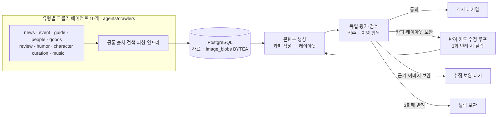

# me;nu 에이전트 안내

상위 에이전트 역할은 유형별 크롤러 10개, 콘텐츠 생성 에이전트 1개, 평가·검수 에이전트 1개로 총 12개입니다. 유머 크롤러는 커뮤니티 유머와 출처가 확인된 제작 비하인드·메이킹 자료를 수집합니다. `information`, `humor`, `image`는 유형별 크롤러가 공통으로 사용하는 수집·처리 모듈이지 별도 상위 크롤러 역할이 아닙니다. 상위 그래프가 생성과 검수를 연결하며, 수집 보완은 크롤링 단계로, 카피·레이아웃 수정은 생성 단계로 되돌립니다.

## 에이전트별 책임

| 에이전트 | 입력 | 책임 | 파일 위치 |
|---|---|---|---|
| 유형별 크롤러 10개 | 유형별 승인 출처 | 유형별 역할·출처 allowlist·품질 규칙 적용, 후보를 미검증 상태로 DB 적재. 유머는 커뮤니티 유머와 제작 비하인드·메이킹을 함께 담당 | `crawlers/{news,event,guide,people,goods,review,humor,character,curation,music}.py` |
| 공통 수집 모듈 | 공개 RSS/API/HTML 목록 및 후보 원문 | 어댑터별 출처 조회·파싱·후보 구조화 및 출처별 실행 결과 집계 | `discovery.py`, `sources/` |
| 이미지 처리 | 후보와 동일한 공식/편집/참고 HTML 페이지 | 기존 이미지 처리기를 재사용해 robots/출처/권리/다운로드 정책 적용 및 이미지 메타데이터 저장. 유머·리뷰·큐레이션에는 후보 페이지 이미지를 섞지 않음 | `image/`, `collect-page` |
| 콘텐츠 생성 | 검증된 DB 자료 | 3~10장 카피와 근거 ID를 작성하고 전체 이미지 표시를 우선해 레이아웃 | `content_generation/` 및 상위 `generation.py`, `layout_engine.py` |
| 평가·검수 | 생성 초안·근거·이미지 메타데이터 | 규칙 검사 + 독립 LLM 언어 검수, 통과·반환·보완·보관 판정 | `reviewer/` |

## 운영 규칙

전체 실행은 crawl-type 명령으로 시작합니다. 해당 유형의 크롤러가 후보를 적재한 뒤 기존 원문 검증·이미지 처리·request_id 기반 생성·독립 검수 그래프까지 연결하며, 통과 자료만 피드 대기열에 둡니다. discover는 후보 출처를 점검할 때만 쓰는 수집 전용 명령입니다.

- 출처·사실·권리·이미지 잘림 등 치명 오류는 총점으로 상쇄할 수 없습니다.
- 이미지 전체 노출은 `contain`/`contain_blur`와 100% 스케일을 기본으로 합니다. 검수 코드가 확대·오프셋·프레임 초과·주요 피사체 잘림을 발견하면 즉시 수정 반환합니다.
- 한 카드뉴스 안에서 카드별 이미지 비율·투명 배경·텍스트 길이에 따라 상단/하단 와이드, 세로 포스터 좌우, 블러/팔레트 배경, 투명 누끼를 섞습니다. 투명 배경이 실제로 확인된 이미지에만 누끼 처리를 적용합니다.
- 콘텐츠 생성 전 서로 다른 고해상도 공식 이미지가 최소 3개인지 확인하고, 생성 후에는 카드마다 고유 이미지 1개씩 배정합니다. 원본 이미지 수가 부족하거나 반복이 감지되면 카피 재생성이 아니라 크롤러로 돌려보냅니다.
- 일본어 등 외국어가 핵심인 공식 이미지에는 카드 안에 자연스러운 한국어 설명이 필요합니다.
- Language dimensions use a shared 0?5 scale; scores below the configured minimum of 2 are sent to the copy editor.
- Score thresholds are 68/100 overall and 55/100 per card. Blockers remain non-compensable; warnings are logged without blocking approval.
- API 없는 fixture 시험은 구조 검증일 뿐이며 실제 피드 승인으로 취급하지 않습니다.
- 유형 크롤러는 서로 다른 출처 역할·필수 신호·페이지 이미지 정책을 가지며, 공통 LangGraph 실행기를 공유합니다. 필수 신호는 캡처 진단용이며 그 자체로 사실을 승인하거나 후보를 무조건 폐기하지 않습니다. CLI는 출처별 시도/성공/빈 결과/실패와 후보 수를 구분해 출력합니다.
- 현재 검수 입력에는 이미지 원본 픽셀이 아니라 수집된 설명·OCR 텍스트·출처·레이아웃 데이터가 전달됩니다. 실제 렌더 이미지의 시각적 잘림 QA는 별도 렌더러 기반 검증이 필요합니다.

자세한 점수표와 라우팅은 [`docs/AGENT_ARCHITECTURE.md`](../../../docs/AGENT_ARCHITECTURE.md), 카드 가드레일은 [`docs/CARD_GUARDRAILS.md`](../../../docs/CARD_GUARDRAILS.md)를 확인하세요.

유형별 출처 매핑, 실행 방법, 실제 수집 시험 결과는 [`docs/TYPE_CRAWLER_AGENTS.md`](../../../docs/TYPE_CRAWLER_AGENTS.md)를 확인하세요.
