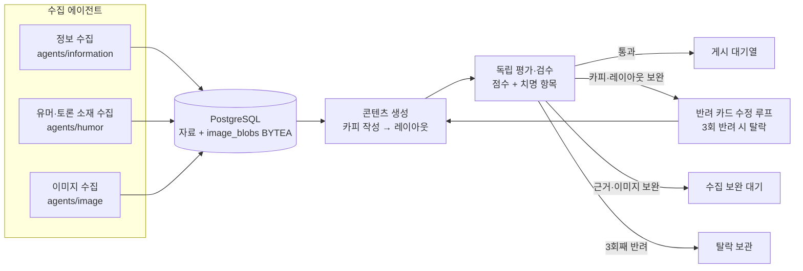

# me;nu 에이전트 안내

서비스 구성은 수집 에이전트 3개, 콘텐츠 생성 에이전트 1개, 평가·검수 에이전트 1개입니다. 상위 그래프가 작업을 연결하며, 수집 보완은 크롤링 단계로, 카피·레이아웃 수정은 생성 단계로 되돌립니다.

## 에이전트별 책임

| 에이전트 | 입력 | 책임 | 파일 위치 |
|---|---|---|---|
| 정보 수집 | 공식 발표·공개 페이지 | 사실, 날짜, 장소, 조건 및 출처를 구조화 | `information/agent.py`, `prompt.py` |
| 유머·토론 소재 수집 | 커뮤니티·트렌드 신호 | 소재·논점 후보와 원문 링크를 저장; 확인되지 않은 주장은 사실로 승격하지 않음 | `humor/agent.py`, `prompt.py` |
| 이미지 수집 | 공식 출처 후보 | 이미지 후보 다운로드, 출처·권리 상태·설명·메타데이터 기록 | `image/agent.py`, `download.py`, `prompt.py` |
| 콘텐츠 생성 | 검증된 DB 자료 | 3~10장 카피와 근거 ID를 작성하고 전체 이미지 표시를 우선해 레이아웃 | `content_generation/` 및 상위 `generation.py`, `layout_engine.py` |
| 평가·검수 | 생성 초안·근거·이미지 메타데이터 | 규칙 검사 + 독립 LLM 언어 검수, 통과·반환·보완·보관 판정 | `reviewer/` |

## 운영 규칙

- 출처·사실·권리·이미지 잘림 등 치명 오류는 총점으로 상쇄할 수 없습니다.
- 이미지 전체 노출은 `contain`/`contain_blur`와 100% 스케일을 기본으로 합니다. 검수 코드가 확대·오프셋·프레임 초과·주요 피사체 잘림을 발견하면 즉시 수정 반환합니다.
- 한 카드뉴스 안에서 카드별 이미지 비율·투명 배경·텍스트 길이에 따라 상단/하단 와이드, 세로 포스터 좌우, 블러/팔레트 배경, 투명 누끼를 섞습니다. 투명 배경이 실제로 확인된 이미지에만 누끼 처리를 적용합니다.
- 콘텐츠 생성 전 서로 다른 고해상도 공식 이미지가 최소 3개인지 확인하고, 생성 후에는 카드마다 고유 이미지 1개씩 배정합니다. 원본 이미지 수가 부족하거나 반복이 감지되면 카피 재생성이 아니라 크롤러로 돌려보냅니다.
- 일본어 등 외국어가 핵심인 공식 이미지에는 카드 안에 자연스러운 한국어 설명이 필요합니다.
- 검수는 카드별 자연스러움, 번역 자연스러움, 독자 명료성, 카드 흐름을 각각 0~5점으로 평가합니다. 어느 하나라도 3점 미만이면 수정 반환합니다.
- 전체 85/100, 카드별 75/100 미만은 통과하지 않습니다. 페이지가 특정된 카피 반려는 해당 카드만 수정하고 나머지 카피는 보존합니다. 반려 3회째에는 탈락 보관합니다.
- API 없는 fixture 시험은 구조 검증일 뿐이며 실제 피드 승인으로 취급하지 않습니다.
- 현재 검수 입력에는 이미지 원본 픽셀이 아니라 수집된 설명·OCR 텍스트·출처·레이아웃 데이터가 전달됩니다. 실제 렌더 이미지의 시각적 잘림 QA는 별도 렌더러 기반 검증이 필요합니다.

자세한 점수표와 라우팅은 [`docs/AGENT_ARCHITECTURE.md`](../../../docs/AGENT_ARCHITECTURE.md), 카드 가드레일은 [`docs/CARD_GUARDRAILS.md`](../../../docs/CARD_GUARDRAILS.md)를 확인하세요.
