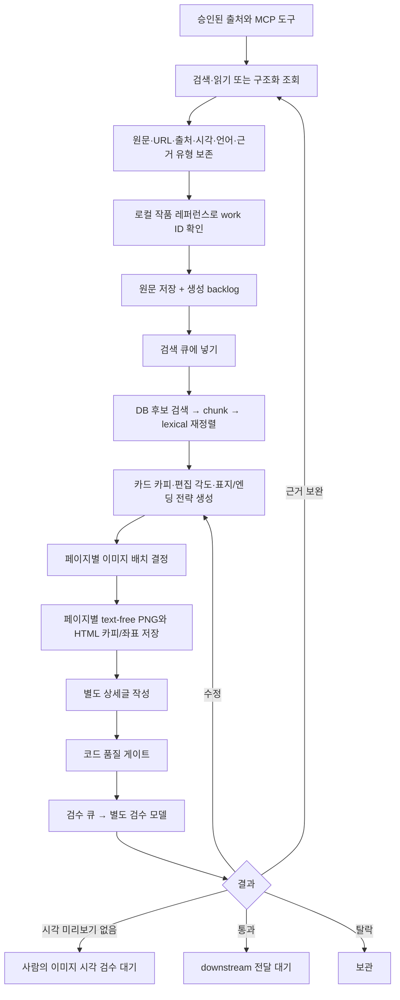

# ani_rag 프로젝트 안내

2026-11-08 기준 구현 상태를 쉬운 말로 정리한다. 이 문서는 구현 여부와 실행 조건을 구분한다.

## 한 문장으로

`ani_rag`는 character, guide, people, music, humor, curation, review의 원문과 근거를 따로 모으고, 관련 근거를 다시 찾아 콘텐츠 초안을 만든 뒤 별도 검수로 보내는 프로젝트다. news/event/goods 같은 기간형 수집은 `ani_me;nu`에 남긴다.

두 프로젝트의 마지막 업무 순서는 비슷하다. `ani_rag`에는 그 흐름을 독립 코드로 구현했지만, 기존 기간 프로젝트의 레이아웃 그래프, 실제 시각 검수, 이미지 파일 저장까지 동일하게 갖춘 상태는 아니다.

## 폴더 구조

```text
ani_rag/
├─ config/
│  ├─ sources.candidates.json     # 살펴볼 출처 후보. 승인 목록이 아님
?  ?? sources.evergreen.json      # one non-executable Frieren draft; zero approved sources
├─ data/reference/                # 기존 작품 레퍼런스의 로컬 스냅샷
├─ docs/
│  ├─ PORT_MANIFEST.md            # ani_me;nu 생성/검수 말투·렌더·정책의 포팅 기록
│  ├─ ERD_DATASET_MAPPING.md      # RAG 자료와 ERD 필드 대응
│  ├─ GENERATION_REVIEW_PORT.md   # 기간형 생성/검수와 비교 및 미완료 범위
│  ├─ MCP_CONNECTION_SETUP.md     # Firecrawl/Wikidata endpoint와 승인 전제
│  └─ PROJECT_GUIDE.md            # 현재 문서
└─ src/ani_rag/
   ├─ agents/
   │  ├─ mcp_crawler/             # URL형·구조화 MCP 수집 역할
   │  ├─ content_generation/      # 카피·상세글·이미지 배치·PNG 역할
   │  └─ reviewer/                # 독립 문구·근거·시각 검수 역할
   ├─ models.py, profiles.py      # 원문 근거와 7개 유형의 데이터 계약/정책
   ├─ settings.py, adapter.py     # 출처 allowlist와 URL MCP 경계
   ├─ collector.py                # URL 검색·읽기 응답을 근거 문서로 정리
   ├─ structured_mcp.py           # entity/property형 결과를 구조화 근거로 정리
   ├─ catalog.py                  # 로컬 작품 ID 확인
   ├─ retrieval.py                # 검색 결과 chunking 및 lexical ranking
   ├─ content.py, model_services.py, prompts.py
   │                               # 공유 데이터 계약, 역할별 구현의 조립 호환
   ├─ quality.py, review.py       # 결정론적 검사와 검수 분기 계약
   ├─ queues.py, workers.py       # 큐 상태와 한 건씩 처리하는 worker
   ├─ rendering.py                # 콘텐츠 생성 폴더 렌더러 호환 import
   ├─ runtime.py                  # 세 역할의 한 건 처리 조립; 실행 시작은 호출자 책임
   └─ storage/
      ├─ schema.sql               # 임시 SQLite 스키마 초안
      ├─ sqlite_core.py           # 원문/큐/retrieval 후보 저장소
      └─ sqlite_workflow.py       # 초안/검수 기록/등록 이미지 저장소
```

## 자료 한 건이 흐르는 순서



이 그림은 목표 경로와 구현된 경계를 함께 나타낸다. 원문/큐/검색/초안/검수 저장 어댑터와 생성·검수 one-item worker는 코드로 있다. 공개 MCP endpoint의 도구 목록만 확인했으며 `ani_rag` 런타임 연결과 출처 검색은 아직 없다. DB도 열지 않았고 스키마를 적용하지 않았다.

### 단계별 설명

1. **MCP connection:** project-local Firecrawl/Wikidata aliases and Streamable HTTP transport are configured; both live tool lists were confirmed. Firecrawl read one official character page, but its response did not attest redirects, so the source remains draft.
2. **근거 정리:** `EvidenceDocument`가 원문 제목과 본문/발췌, URL, 출처 ID, 확인 시각, 발행 시각(있을 때), 근거 유형, 수집 방식, 원문 언어, 작품 연결 상태를 보존한다. review 의견·커뮤니티 반응·큐레이션 집계는 사실과 다른 evidence type으로 남긴다.
3. **작품 ID:** `catalog.py`는 `data/reference/` 스냅샷으로 확인한다. 애매하면 unresolved/ambiguous로 둔다. 새로운 ID를 만들어 붙이지 않는다.
4. **RAG 검색:** 저장 자료 중 content type/작품/seed 범위에 맞는 후보를 가져와 본문과 excerpt를 chunk로 나누고 lexical 점수로 순위를 매긴다. 벡터 임베딩 검색은 아직 없다.
5. **초안 생성:** 카피라이터가 표지·중간·엔딩 카피와 편집 각도를 작성하고, 별도 호출로 자세히 보기 상세글을 작성한다. 각 주장에는 검색된 evidence/chunk ID를 연결한다. 이미지 배치 디렉터는 등록 이미지 미리보기를 보고 페이지별 배경/강조를 고른다. 렌더러는 원본 그림을 자르지 않는 페이지별 text-free PNG와 HTML 카피/좌표를 별도로 저장한다.
6. **검수:** 생성 worker는 검수 없이 캐러셀과 상세글을 저장하고 검수 큐에 넣는다. 별도 검수 에이전트는 페이지 순서와 글의 가독성을 확인해 `pass`, `revise`, `reject_archive` 중 하나를 반환한다. 현재 저작권·이미지 권리·사실성 점수는 통과 차단 기준이 아니다.
7. **다음 큐:** 미리보기나 vision-capable reviewer가 없으면 시각 검수를 통과한 척하지 않고 사람 검수 대기로 둔다. 수정은 생성 큐, 근거 요청은 수집 큐, 탈락은 보관 상태로 간다. 프론트엔드는 페이지별 PNG와 HTML copy/layout 좌표를 읽어 캐러셀을 표시하고, 자세히 보기 화면은 상세글→출처→AI 고지를 조립해야 한다. 화면/API는 아직 연결되지 않았다.

## ID를 쉽게 구분하면

| 필드 | 뜻 | 현재 처리 |
|---|---|---|
| `content_type` | RAG lane 구분 (`character`, `music` 등) | 수집·검색·초안에서 사용 |
| `menu_work_id` | 기존 작품 레퍼런스의 작품 ID | 확인된 값만 보존 |
| `topic_id` | ERD의 topic 분류 테이블을 가리키는 숫자 ID | topic master가 없어 추측하지 않음 |
| `subtopic_id` | 세부 topic/tag 테이블을 가리키는 숫자 ID | 기준 catalog가 없어 추측하지 않음 |
| `entity_id` | ERD entity 테이블 안의 개별 작품/인물 등의 내부 ID | `menu_work_id`와 같은 값으로 간주하지 않음 |

따라서 RAG 수집과 초안 생성에는 기존 `content_type`과 확인된 `menu_work_id`를 쓴다. 숫자 topic/subtopic/entity ID는 정본 catalog와 crosswalk가 준비된 뒤 ERD에 반영할 때 해결한다.

## 현재 실행 상태와 준비물

**코드로 준비된 것:** 데이터 계약, 출처 allowlist 검사, collection adapter 계약, 작품 resolver, 원문·큐·초안·검수 저장 adapter, lexical retrieval, 구조화 생성기/검수기, 품질 gate, generation/review worker의 `run_once()`, 생성·검수 runtime 조립 함수.

**실행 전에 필요한 것:**

- ani_rag 실행 호스트에 설정된 Firecrawl/Wikidata MCP alias, adapter transport 및 승인 host
- 개별 출처의 검토와 명시적 allowlist 승인
- 전용 RAG DB와 승인된 스키마 적용, 그 DB에 대한 caller-owned 연결
- 저장된 evidence. 이미지 후보가 없으면 text-only gradient PNG fallback을 사용한다.
- 호출자가 제공할 generation/review 모델 key와 model 설정
- 이미지 픽셀 검수와 렌더 PNG 저장/배포 연결
- worker를 한 건씩 호출할 supervisor 또는 운영 실행 방식
- ERD 적재에 필요한 topic/subtopic/entity master와 ID crosswalk

`runtime.py` accepts a caller-owned SQLite connection and does not open a database or apply DDL. No workers, DB, model API, or CLI were run. One draft source exists, but zero sources are approved and evidence storage/image setup is not ready for content generation.
