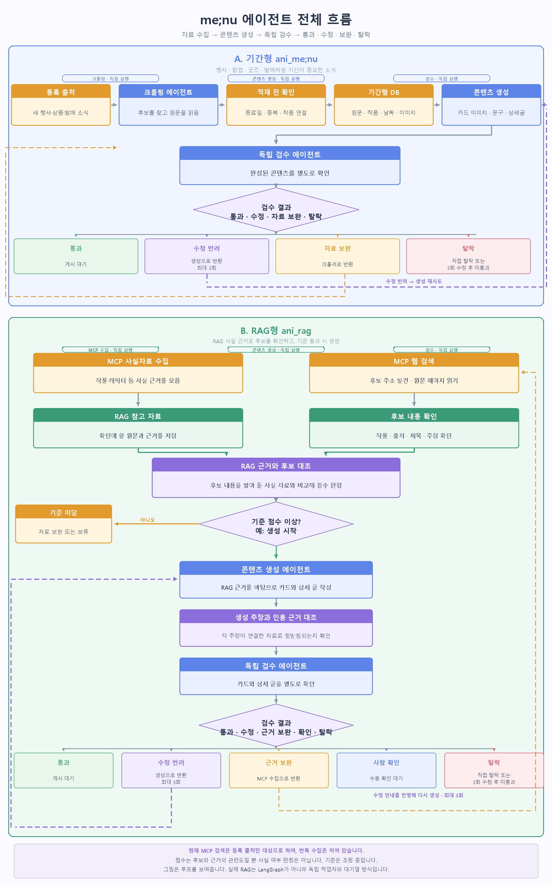

# me;nu 에이전트 구조



## 한눈에 보기

me;nu에는 수집 방식이 다른 두 경로가 있습니다. 두 경로 모두 **자료 수집 → 콘텐츠 생성 → 독립 검수** 순서로 움직입니다.

| 기간형 `ani_me;nu` | RAG형 `ani_rag` |
|---|---|
| 행사, 팝업, 굿즈, 발매 소식 | 작품, 캐릭터, 인물, 음악, 회차 등 오래 쓰는 정보 |
| 출처 사이트를 계속 살펴보고 새 글을 수집 | MCP로 사실 근거를 모아 RAG에 쌓고, MCP 웹 수집으로 새 후보를 찾음 |
| 기간형 DB → 생성 → 검수 | RAG 근거와 새 후보 대조 → 점수 통과 시 생성 → 검수 |

두 경로는 각자 DB와 작업 대기열을 사용합니다. 크롤링·생성·검수 작업자는 각각 반복 실행하며, 다른 작업자의 완료를 기다리지 않습니다. 자료는 DB와 단계별 대기열을 통해 다음 작업자에게 넘어갑니다.

## 1. 기간형 에이전트

기간이 중요한 소식을 다룹니다. 출처에서 새 글을 찾아 원문과 날짜를 읽고, 기간이 지난 일정·중복 글·작품 연결을 확인한 뒤 작품과 이미지 정보를 기간형 DB에 저장합니다. 생성 에이전트는 DB 자료로 카드와 상세 글을 만들고, 별도 검수 에이전트가 결과를 확인합니다.

```text
등록 출처
  → 크롤링 에이전트
  → 종료일·중복·작품 확인
  → 기간형 DB
  → 콘텐츠 생성 에이전트
  → 검수 에이전트
      ├─ 통과 → 게시 대기
      ├─ 수정 → 생성 에이전트로 반환
      ├─ 자료 보완 → 크롤링 에이전트로 반환
      └─ 탈락 → 탈락 보관
```

크롤링, 생성, 검수는 별도 작업자입니다. 각자 자기 대기열을 반복 확인하고, 한 작업자가 비어 있어도 다른 작업자는 계속 움직입니다.

## 2. RAG 에이전트

RAG는 **사실을 대조할 참고 자료 창고**입니다. MCP로 작품·캐릭터·인물 정보를 모아 RAG에 쌓고, 별도의 MCP 웹 검색 작업자가 새 후보의 주소를 찾아 원문을 읽습니다. 작품과 출처를 확인한 뒤 후보의 내용을 RAG 참고 자료와 대조합니다.

```text
MCP로 사실 근거 수집 → RAG 참고 자료로 저장

MCP 웹 검색 → 후보 주소 발견 → 원문 읽기·작품·출처 확인
  → 후보 내용과 RAG 참고 자료 대조·점수 판정
  → 기준 점수 통과?
      ├─ 예 → 콘텐츠 생성 → 생성 주장과 인용 근거 확인 → 독립 검수
      └─ 아니오 → 자료 보완 또는 보류
                         ↑
      수정 반려 → 생성으로 되돌아감 (최대 3회)
```

기준 점수를 넘은 후보만 생성합니다. MCP 수집, 콘텐츠 생성, 검수는 각각 독립된 작업자로 반복 실행합니다. 검수에서 문구 수정이 오면 생성으로 되돌아가며, 최대 3회 다시 생성한 뒤에도 통과하지 못하면 탈락 보관합니다. 근거가 부족하면 MCP 자료 보완으로, 사람이 확인해야 하면 수동 확인으로 보냅니다. 바로 탈락 판정을 받은 콘텐츠도 보관합니다.

### 검수 결과

- **통과:** 게시 대기 상태로 전달
- **수정:** 검수 의견을 붙여 콘텐츠 생성으로 반환
- **근거 보완:** MCP 수집과 RAG 대조 단계로 반환
- **사람 확인:** 자동 판정을 멈추고 수동 확인 대기
- **탈락:** 사유와 함께 보관

## 3. 콘텐츠 출력

- 카드 이미지는 글자 없이 만듭니다. 카드 문구는 화면에서 HTML로 올립니다.
- 상세 글 끝에는 출처를 적고, 그 다음에 AI 활용 생성 안내를 둡니다.
- 검수 통과 결과만 게시 대기 상태로 전달합니다.

## 4. 실제 코드와 목표 흐름의 차이

- 그림은 RAG 수집부터 점수 판정, 생성, 검수까지 이어지는 목표 흐름입니다. 현재 RAG의 반복 수집은 켜져 있지 않습니다.
- 현재 MCP 검색은 등록된 출처 범위 안에서 동작합니다. 인터넷 전체를 제한 없이 검색하는 기능은 아닙니다.
- 현재 검색 점수는 후보와 참고 자료의 단어 관련도를 보는 값입니다. 사실이 맞다는 보증은 아니며, 최종 통과 기준도 조정 중입니다.
- RAG는 생성 주장마다 인용 근거를 연결하고 검수자가 근거를 확인하도록 되어 있지만, 모든 사실 오류를 자동으로 막는 단계가 완성됐다고 볼 수는 없습니다.
- 그림은 LangGraph처럼 되돌아가는 흐름을 보여줍니다. 실제 RAG 코드는 LangGraph가 아니라 따로 도는 작업자와 대기열을 사용합니다.
- 두 경로는 각자 DB를 사용합니다. 통과 콘텐츠를 백엔드에 전달하는 연결 방식은 별도로 정해야 합니다.
