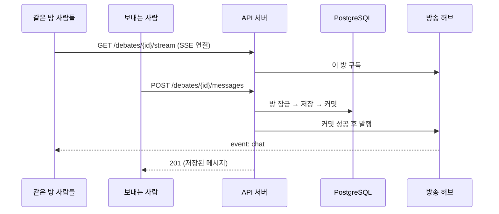
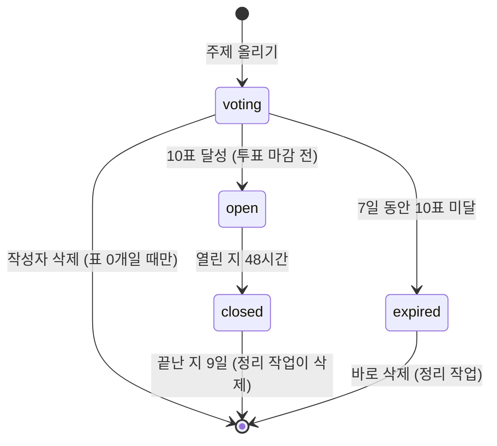

# 토론방 백엔드 설계 (초안)

2026-11-19 (Asia/Seoul). 팀 회의에서 정한 대략적 규칙과 디자인 초안을 바탕으로 한 **백엔드 설계**다. 팀 승인·배포를 뜻하지 않는다. 같은 날 담당자와 [9. 결정 기록](#9-결정-기록)의 항목을 확정했고, 모든 규칙 값은 한 곳(설정)에서 바꿀 수 있게 만든다. 예전 첨부 ERD의 `debate_*` 테이블은 다른 기획이었으므로 참고하지 않고 새로 설계했다. 하단 메뉴 등 화면 구성은 디자인 확정 후 별도로 다룬다.

진행 상황: 1단계(규칙 설정·모델·migration·기능 스위치) 완료. migration은 `a67ddf3dc55f`(토론방 표 9개)와 `94d2da693c10`(알림 종류 `debate_opened`)이고 서비스 target을 `94d2da693c10`으로 올렸다. 이 브랜치가 합쳐져 배포되면 서버 DB에 빈 토론 표가 생기며, 기능 스위치가 꺼져 있어 동작은 바뀌지 않는다. 아직 어떤 서버 DB에도 적용하지 않았으므로 배포 전까지는 이 migration 파일을 고쳐 쓴다.

## 1. 기능 요약 (회의 기준)

- 회원이 토론 주제를 올리면 7일 동안 개설 투표를 받는다. 10표가 되면 그 순간 토론방이 열린다. 7일 안에 10표가 안 되면 소멸한다.
- 토론방은 열린 뒤 48시간 동안 유지되고 자동으로 끝난다.
- 투표권은 1인 최대 3개이고 1시간마다 1개씩 찬다. 자기 주제에도 투표할 수 있고, 한 주제에는 1인 1표다.
- 토론방은 'A vs B' 형태다. 실시간 채팅, 진영 선택, 우세 비율 표시가 있다.
- 끝난 토론방은 '지난 토론방'에 결과만 남는다. 채팅 내역은 남기지 않는다.
- 내가 투표한 주제가 열리면 알림을 받는다.

## 2. 실시간 방식 결정

### 2.1 후보 비교

| 방식 | 보내기 / 받기 | 새로 필요한 것 | 좋은 점 | 걸리는 점 |
| --- | --- | --- | --- | --- |
| **SSE + 일반 요청 (채택)** | POST / SSE 스트림 | 스트림 API 1개, 방송 허브 | 기존 세션·CSRF·오류 형식·입력 검증을 그대로 쓴다. 끊기면 브라우저가 스스로 다시 연결하고 `Last-Event-ID`로 놓친 메시지를 받아온다. 평범한 HTTP라 Caddy 통과와 테스트가 쉽다 | 보내기는 매번 요청 1번이다(HTTP/2에서는 같은 연결을 써서 체감 차이 없음). 네이티브 앱을 만들면 작은 라이브러리가 필요하다 |
| 웹소켓 (FastAPI 내장) | 소켓 / 소켓 | 소켓 API, 메시지 형식, 인증·출처 검사, 재연결·복구 규칙 | 양방향이고 메시지당 부가 데이터가 가장 적다. 1초에 여러 번 오가는 신호에 유리하다 | CORS·CSRF 보호가 자동으로 걸리지 않아 Origin 검사를 직접 해야 한다. 오류·검증·속도 제한을 소켓용으로 다시 만들어야 한다. 재연결·누락 복구를 서버와 프론트 모두 직접 구현해야 한다 |
| Socket.IO (Node.js 서버) | 소켓 / 소켓 | Node 서버와 배포, 세션 검사 재구현 | 방, 자동 재연결, 응답 확인 같은 편의 기능이 있다 | 서버와 언어가 하나 더 생긴다(실서비스 CPU 0.5개를 나눠 씀). 세션 검사와 토론 규칙을 두 언어로 관리해야 한다. 전용 클라이언트가 필요하다 |
| python-socketio | 소켓 / 소켓 | 라이브러리, 자체 프로토콜 | Node 없이 Socket.IO 기능을 쓴다 | 프로토콜이 한 겹 더 생긴다. 서버를 늘리면 고정 연결(sticky session) 설정이 필요하다. 지금 규모에는 과하다 |
| 외부 실시간 서비스 (Firebase, Ably, Pusher 등) | SDK / SDK | 계정·요금, 접속 토큰 발급 API | 연결 관리가 필요 없고 확장이 쉽다 | 채팅 내용이 외부 업체로 가므로 개인정보 처리위탁·국외 이전 고지를 검토해야 한다. 비용과 업체 의존이 생긴다 |
| 짧은 주기 폴링 | POST / 2~3초마다 GET | 없음 | 가장 쉽다 | 최대 수 초 지연된다. 요청이 폭증해 DB 연결 2개로는 버티지 못한다 |

### 2.2 SSE는 단방향이라 느리지 않은가

느리지 않다. '단방향'은 그 연결로는 서버에서 브라우저 쪽으로만 흐른다는 뜻이지 속도와는 관계없다.

- **받기**: 서버가 이미 열려 있는 연결에 바로 쓴다. 웹소켓과 똑같이 즉시 도착한다.
- **보내기**: 일반 POST 한 번이다. Caddy는 HTTPS에서 HTTP/2를 쓰므로 POST가 스트림과 같은 연결 안에서 오간다. 새로 연결을 맺는 시간이 없고, 차이는 요청 머리글 수백 바이트 정도다.
- 실제 지연의 대부분은 네트워크 왕복과 DB 저장이다. 메시지를 저장해야 하는 이상 웹소켓도 똑같이 걸린다.
- 사람이 손으로 치는 채팅(초당 몇 개)에서는 차이를 느낄 수 없다. 웹소켓이 확실히 나은 경우는 게임이나 공동 편집 커서처럼 1초에 수십 번 주고받을 때다.
- Claude·OpenAI API가 답변을 실시간으로 흘려보낼 때 쓰는 방식도 SSE다.

### 2.3 채택 이유 (이 코드베이스 기준)

1. **보안 장치 재사용**: 보내기가 기존 POST라서 세션 쿠키, `X-CSRF-Token`, Origin 검사, `{code, message}` 오류 형식, 422 입력 검증이 그대로 적용된다.
2. **모바일 재연결**: 휴대폰은 화면이 꺼지거나 망이 바뀌면 연결이 자주 끊긴다. SSE는 브라우저가 자동으로 다시 연결하면서 마지막으로 받은 번호(`Last-Event-ID`)를 보내 주므로, 서버는 그 뒤 메시지만 다시 보내면 된다.
3. **새 런타임 없음**: Python 서버 하나로 끝난다. Node 서버를 따로 띄우면 CPU 0.5개·메모리 512MB를 나눠 써야 하고 세션 검사를 다시 만들어야 한다.
4. **갈아끼우기 쉬움**: 저장·규칙·방송 허브를 전달 방식과 분리한다. 나중에 '입력 중 표시'처럼 잦은 신호가 꼭 필요해지면 같은 허브를 쓰는 웹소켓 API만 추가하면 된다.

## 3. 실시간 구조



### 3.1 방송 허브

| 단계 | 방식 | 쓰는 조건 |
| --- | --- | --- |
| 1차 | 서버 프로세스 메모리 | API 프로세스가 1개(`--workers 1`)이고 토론 기능을 한 환경에서만 켤 때 |
| 2차 | PostgreSQL `LISTEN/NOTIFY` | 프로세스가 2개 이상이거나, 같은 DB를 쓰는 Checking·main API 둘 다에서 토론 기능을 켤 때 |

- `compose.main.yaml`의 main API는 Checking DB를 함께 쓴다. 두 서버 모두에서 기능을 켜면 메모리 허브로는 서로의 메시지가 실시간으로 전달되지 않는다. 그래서 1차에서는 **한 환경에서만** 켠다.
- 2차는 Redis Pub/Sub보다 `LISTEN/NOTIFY`를 권한다. 커밋된 경우에만 전달되고 커밋 순서대로 도착하며 새 인프라가 필요 없다. 현재 Redis는 세션 전용 구성이다. 대가는 API 프로세스당 연결 풀 밖의 DB 연결 1개다.
- 발행은 반드시 커밋이 성공한 뒤에 한다. 롤백된 메시지가 화면에 보이는 일을 막는다.

### 3.2 스트림 API: `GET /api/v1/debates/{debateId}/stream`

- 로그인·온보딩한 회원이면 누구나 보고 채팅할 수 있다. 진영 선택과 채팅은 별개다. 읽기 전용이라 CSRF는 필요 없고, 다른 사이트는 CORS 때문에 내용을 읽을 수 없다.
- 처리 순서 (3단계 구현: `backend/app/services/debate_room_service.py`, `debate_hub.py`)
  1. 인증하고 방 상태를 확인한다(진행 중이 아니면 409).
  2. 허브 구독을 **먼저** 등록한다(1인 한도를 넘으면 429).
  3. 놓친 메시지를 DB에서 읽는다. 기준 번호는 자동 재연결의 `Last-Event-ID` 머리글과 프론트가 붙이는 `?after=<마지막 번호>` 중 큰 값이다. 100개 이하면 하나씩 다시 보내고, 넘으면 `resync` 이벤트로 화면이 채팅을 새로 불러오게 한다.
  4. **DB 연결을 풀에 돌려준다.** 현재 FastAPI(0.141)는 스트리밍 응답이 끝날 때까지 `get_db` 같은 yield 의존성을 닫지 않는다. 실서비스 DB 연결은 2개(여유분 0)라서, 돌려주지 않으면 스트림 2개만 열려도 API 전체가 멈춘다.
  5. 허브에서 오는 이벤트를 보낸다. 20초마다 빈 신호(`: ping`)를 보내 연결을 유지한다. 화면이 이미 가진 번호(3의 기준 번호까지)와 방금 다시 보낸 번호는 건너뛴다. 번호 크기만으로 거르지 않는 까닭은 거의 동시에 저장된 두 채팅의 방송 순서가 드물게 바뀔 수 있어서다(화면이 번호순으로 정렬한다).
  6. 응답이 어떻게 끝나든(정상 종료·끊김·응답이 시작되기 전에 떠남) 구독을 푼다(`DebateStreamResponse`). 본문의 정리 코드는 본문이 한 번이라도 돌아야 실행되기 때문이다. 그래도 남은 구독은 15초 뒤 다음 구독 때 치운다.
- 이벤트 (기본 이벤트 이름 `message`와 헷갈리지 않게 채팅은 `chat`으로 부른다)

| event | id | 내용 |
| --- | --- | --- |
| `chat` | 메시지 번호 | `messageId, side, nickname, body, createdAt, isMine` + 새 채팅이면 `messageCount`(그 채팅까지 센 방의 채팅 수, 다시 보낼 때는 없음). `side`는 보낸 순간의 진영이고, 고르지 않았으면 null |
| `sides` | 없음 | `sideA{label, count, percent}, sideB{…}, participantCount`. 진영이 실제로 바뀐 경우에만 보낸다 |
| `resync` | 없음 | 놓친 채팅이 100개를 넘음. 화면은 채팅을 새로 불러온다 |
| `closed` | 없음 | `{debateId}`. 방 종료. 보낸 뒤 서버가 스트림을 닫는다. 화면은 토론을 다시 불러와 결과를 보여준다 |
| `session-expired` | 없음 | 로그인 세션 만료. 보낸 뒤 닫는다 |

- 다른 회원의 번호(user id)는 보내지 않는다. `isMine`은 연결마다 서버가 계산한다.
- 받는 쪽이 느려 대기열(100개)이 차면 그 연결을 끊는다. 브라우저가 다시 연결하면서 놓친 메시지를 받아간다.
- 1인당 동시 스트림은 3개까지다(탭 여러 개).
- 처음 연결할 때와 20초마다 보내는 빈 신호에 `retry: <밀리초>`를 실어 재연결 간격을 연결마다 다르게 정한다. 간격은 1초 + 무작위(흩는 폭)이고, 흩는 폭은 서버의 연결 수에 맞춘다: 연결이 적으면 1~3초, 연결 1개당 10ms씩 넓혀 700개 이상이면 1~8초. 모두 같은 간격이면 서버를 다시 시작했을 때 모든 브라우저가 같은 순간에 다시 붙어 DB 연결 앞에 줄이 막히고([3.5](#35-부하-시험-2026-11-23)), 사람이 적을 때 간격을 길게 잡으면 기다림만 늘어나서다. 처음 들어올 때, '다시 연결' 버튼, 뒤로 가기로 돌아올 때는 화면이 새 연결을 바로 열어서 이 간격을 기다리지 않는다.
- 방이 끝나기 직전에 받아 둔 채팅이 있으면 그것을 다 보낸 뒤 `closed`를 보낸다.
- 서버가 스트림을 끝내도 브라우저(EventSource)는 위 간격 뒤 다시 붙는다. 그래서 화면은 `closed`·`session-expired`를 받으면 직접 연결을 닫는다. 다시 붙더라도 끝난 방은 409, 끝난 세션은 401이라 거기서 멈춘다.
- 로컬 확인(DB 연결 2개·여유분 0, 실서버): 스트림 6개를 연 채로 보통 요청 20개를 동시에 보내도 0.25초 안에 모두 200. 연결을 끊으면 1초 안에 자리를 돌려준다. `main.py`의 미들웨어를 지나도 스트림이 막힘 없이 흐른다.

### 3.3 구현 직후 Checking에서 확인할 것

- `main.py`의 `@api.middleware("http")`를 지나도 스트림이 흐르고 연결 종료가 감지되는지: 로컬에서는 확인했다(3.2 끝). 실제 서버에서도 같은지 본다.
- Caddy는 `text/event-stream` 응답을 버퍼 없이 바로 흘려보낸다. 실제 서버에서 지연 없이 오는지 확인한다. 응답에는 `X-Accel-Buffering: no`를 붙였다.
- 브라우저와 Caddy 사이가 HTTP/2인지. HTTP/1.1이면 도메인당 연결 6개 제한 때문에 탭을 여러 개 열 때 문제가 된다.
- 배포·재시작 때 열린 스트림 때문에 종료가 늘어지지 않게 API 실행 명령에 uvicorn `--timeout-graceful-shutdown`(예: 10초)을 붙인다. uvicorn은 열린 연결이 끝나기를 기다린 **뒤에** 앱 종료 단계(lifespan)를 실행하므로, 앱 종료 단계에서 허브가 스트림을 닫는 방법으로는 해결되지 않는다. 끊긴 브라우저는 1~8초(연결 수에 따라) 뒤 새 서버에 다시 붙으며 놓친 채팅을 받는다.
- 로그인 세션은 발급 후 30분이면 끝나고 연장되지 않는다. 스트림은 세션 만료 시각에 `session-expired`를 보내고 닫는다. 다른 기기에서 로그아웃해도 이미 열린 스트림은 그 세션 만료 시각까지 이어진다(보내기는 바로 401). 세션 정책 자체는 이 설계 범위 밖이다.

### 3.4 프론트 연결 방법

구현: `frontend/lib/debate/api.ts`(`subscribeDebate`), `frontend/components/debate/debate-room.tsx`(`OpenRoom`).

- 연결: `new EventSource(url, { withCredentials: true })`로 열고 `chat`, `sides`, `resync`, `closed`, `session-expired` 이벤트를 듣는다.
- 첫 화면: 이전 채팅 API로 최근 50개를 받은 **뒤** `?after=<그 마지막 번호>`를 붙여 스트림을 연다. 그사이 올라온 채팅은 서버가 먼저 보내 준다. 겹치는 메시지는 `messageId`로 중복을 없애고 번호순으로 정렬한다. 더 이전 채팅은 '이전 채팅 더 보기'로 cursor를 따라 받는다.
- 보내기: 기존 API 호출(CSRF 포함)로 보낸다. 응답으로 받은 내 메시지와 스트림으로 온 같은 메시지는 번호로 중복을 없앤다.
- 연결 상태를 머리 부분에 보여준다(연결 중·실시간·다시 연결 중·연결 끊김). 잠깐 끊기면 브라우저가 알아서 다시 붙는다. 서버가 받아 주지 않아 멈추면(401·409·429) 토론을 다시 불러와 이유를 확인한다: 끝난 방이면 결과 화면, 로그인이 끝났으면 공통 처리가 로그인 화면으로 보내고, 그 밖(동시 연결 수 초과 등)은 '다시 연결' 버튼을 보여준다.
- `resync`를 받으면 최근 채팅으로 목록을 새로 채운다(그사이 실시간으로 온 것은 남긴다).
- 다른 주소로 떠날 때(`pagehide`) 연결을 직접 닫고, 뒤로 가기로 돌아오면(`pageshow`) 마지막 번호부터 다시 연다. 크롬은 떠난 페이지를 얼려 두는 동안(뒤로 가기 저장소) 연결을 열어 두어서, 닫지 않으면 1인 연결 한도를 차지한다(로컬에서 확인).
- 채팅 본문은 반드시 텍스트로 표시한다(HTML로 넣지 않는다).

### 3.5 부하 시험 (2026-11-23)

실서비스 API(`compose.main.yaml`)와 같은 제한을 건 도커 컨테이너(CPU 0.5개, 메모리 512MB, DB 연결 2개·여유분 0, uvicorn 프로세스 1개)에 시험 도구 컨테이너가 같은 도커 네트워크로 붙었다. DB는 로컬 토론 DB를 복사한 시험 전용 DB. 한 방에 실시간 연결 N개를 열고 초당 채팅 약 5개를 30초 보내면서, 채팅이 모든 연결에 도착하기까지 걸린 시간과 그동안 다른 API(토론 상세·목록·투표권) 응답 시간을 쟀다. 시험 도구는 4개 프로세스로 나눠 연결을 읽었다.

| 한 방 연결 수 | 처음 코드 | 개선 A (토론 코드) | 개선 A + 공통 미들웨어 교체 |
| --- | --- | --- | --- |
| 100 | 도착 보통 0.02초 · 느린 5% 0.06초, CPU 10% | | |
| 500 | 보통 0.05초 · 느린 5% 0.64초, CPU 34% | 0.04초 · 0.25초, CPU 28% | 0.03초 · 0.06초, CPU 20% |
| 1000 | 보통 2.8초 · 느린 5% 4.4초, CPU 꽉 참, 다른 API 2.4초 | 3.2초, CPU 꽉 참 | 0.12초 · 0.43초, CPU 37%, 다른 API 0.07초 |
| 2000 | 보통 6.8초, CPU 꽉 참, 다른 API 6.3초 | 5.8초, CPU 꽉 참 | 7.1초, CPU 꽉 참 |

(CPU는 코어 1개 기준이라 한도가 50%다.)

- 모든 경우에 채팅이 빠지거나 연결이 끊긴 일은 없었다. 메모리는 연결 하나에 약 0.07MB라(2000개에 260MB) 문제가 아니다. **CPU가 한계다.** CPU가 차면 채팅이 몇 초씩 늦고, 같은 프로세스의 다른 모든 API도 함께 느려진다.
- 연결이 수백 개 한꺼번에 몰리면(서버 재시작 직후 다시 붙기 등) 연결마다 하는 로그인 확인·방 확인 DB 조회가 DB 연결 2개 앞에 줄을 서고, CPU가 바쁘면 요청 하나가 DB 연결을 붙잡는 시간이 길어져 일부가 30초 대기 끝에 500으로 실패했다(2000개를 몇십 초에 열 때 42~143개). DB 잠금 대기는 없었다.
- 개선 A (반영함, `debate_room_service.py`): 채팅 하나의 SSE 글을 받는 쪽 종류(보낸 사람·다른 사람)별로 한 번만 만들어 같은 방 연결이 나눠 쓴다. 밀린 연결은 쌓인 이벤트를 한 번에 묶어 보낸다. 재연결 간격을 연결 수에 맞춰 무작위로 흩는다(적으면 1~3초, 많으면 최대 1~8초).
- 공통 미들웨어 교체 (제안, 팀 공통 파일이라 서버 담당과 상의): `main.py`의 `@api.middleware("http")`(`v1_response_contract`, BaseHTTPMiddleware 방식)는 스트리밍 응답의 조각마다 한 번 더 옮겨 담는다. 같은 일을 하는 순수 ASGI 미들웨어로 바꾸면 위 표처럼 연결 1000개까지 여유가 생긴다. 다른 API의 동작(415 검사, `Cache-Control`)은 같다.
- 정리하면 서버 1대(CPU 0.5개)가 편하게 버티는 한 방 동시 접속은 지금 약 500명, 미들웨어를 바꾸면 약 1000명이다(초당 채팅 5개 기준. 부담은 '접속자 수 × 초당 채팅 수'에 비례한다). 베타 규모에서는 넉넉하다. 더 큰 방이 생기면 서버 전체 연결 수 상한이나 방별 채팅 속도 제한을 둔다.
- 함께 발견: `requirements.txt`가 버전을 고정하지 않아 도커 이미지에는 만드는 때의 최신판(FastAPI 0.165, Starlette 1.10)이 깔린다(로컬은 0.141/1.7). 스트림이 DB 연결을 돌려주는 방식(3.2의 4)은 두 버전 모두에서 확인했다.

## 4. 상태 흐름



- 응답에 쓰는 상태는 '저장된 상태 + 지금 시각'으로 계산한다. 예를 들어 저장은 `voting`이어도 투표 마감 시각이 지났으면 `expired`로 본다. 정리 작업이 늦게 돌아도 사용자는 항상 맞는 상태를 본다.
- 정리 작업([5.3](#53-정리-작업-python--m-appjobsfinalize_debates))이 저장된 상태를 따라잡고 끝난 방의 채팅을 지운다.
- **7일 안에 10표를 못 받은 주제(`expired`)는 바로 삭제된다.** 지난 토론방에 남기지 않는다. 마감 시각이 지나면 정리 작업이 지우기 전이라도 목록·검색·내 주제·상세·투표(404)에서 바로 빠진다.
- **48시간이 끝난 방(`closed`)만** 끝난 뒤 9일(`DEBATE_RESULT_RETENTION_DAYS`) 동안 지난 토론방에 어느 진영이 이겼는지 보여 준다(채팅은 남기지 않는다). 9일이 지나면 정리 작업이 돌기 전이라도 바로 빠진다. 상태처럼 시각으로 계산하는 것이다.
- (2026-11-23 바로잡음: 처음에는 소각 주제도 지난 토론방에 9일 남겼는데, 회의 규칙은 '자동 삭제'였다.)

## 5. 데이터 설계

이름 규칙: 기존 `topic`은 '분야'(애니 등)를 뜻하고 API의 `topicId`도 분야 번호다. 토론 주제에는 `topic`을 쓰지 않고 테이블·API·필드를 모두 `debate`로 통일한다. 기존 `chat`(AI 대화)과도 나눈다.

### 5.1 테이블

**`debate`**: 주제 후보부터 지난 토론방까지 한 줄로 관리한다.

| 칼럼 | 타입 | 설명 |
| --- | --- | --- |
| `debate_id` | bigint PK | |
| `topic_id` | bigint FK → `topic` | 분야. 목록은 기존 피드·저장처럼 분야별로 본다 |
| `author_user_id` | bigint FK → `user_account`, NULL 허용 | 탈퇴 회원 삭제 때 NULL로 바꾸고 토론 기록은 남긴다 |
| `title` | varchar(60) | |
| `description` | varchar(200), NULL 허용 | |
| `side_a_label`, `side_b_label` | varchar(20) | 선택지 이름. 예: 나루토 / 사스케, 된다 / 못 된다. 입력은 12자까지 받는다 (6.1 아래 설명) |
| `status` | varchar(10) | `voting`, `open`, `closed`, `expired` |
| `vote_count` | int | 개설 투표 수 |
| `side_a_count`, `side_b_count` | int | 진영별 인원 |
| `message_count` | int | 채팅 수. 메시지를 지운 뒤에도 기록으로 남는다 |
| `voting_ends_at` | timestamptz | 올린 시각 + 7일 |
| `opened_at`, `closes_at` | timestamptz, NULL 허용 | 개설 시각, 개설 + 48시간 |
| `created_at`, `updated_at` | timestamptz | 정리 작업이 상태를 바꾼 시각은 `updated_at`에 남는다 |

DB 규칙(CHECK): 상태 4가지만, 숫자는 0 이상, 제목·선택지 이름은 빈 값 금지, 양쪽 이름은 서로 달라야 한다. 열린 적 없는 주제(`voting`, `expired`)에는 방 시각이 없고 열린 방(`open`, `closed`)에는 `opened_at < closes_at`가 반드시 있다. NULL과의 비교는 CHECK를 통과하므로 `closes_at IS NOT NULL`을 따로 적는다.

**`debate_work`**: 주제에 연결한 작품(0~3개). PK `(debate_id, entity_id)`, `topic_id`, `position`(화면 순서). `(debate_id, topic_id)`와 `(entity_id, topic_id)`를 함께 가리켜 주제와 다른 분야의 작품은 붙지 않는다. 기존 `tap_entity`와 같은 방식이다. 연결된 작품은 지울 수 없다(RESTRICT).

**`debate_vote`**: 개설 투표. PK `(debate_id, user_id)`로 1인 1표를 보장한다. `created_at`.

**`debate_vote_ticket`**: 투표권. `user_id` PK, `balance`(0~3), `refilled_at`(충전 기준 시각). 줄이 없으면 3개로 본다. 이 줄은 '그 회원 전용 자물쇠'로도 쓴다([6.3](#63-잠금-순서)).

**`debate_side`**: 진영 선택. PK `(debate_id, user_id)`, `side`(`a` 또는 `b`), `chosen_at`, `updated_at`.

**`debate_member`**: 토론방 참여(2026-11-23 추가). PK `(debate_id, user_id)`, `history_after_message_id`(참여한 순간 그 방의 마지막 채팅 번호, 없으면 0), `joined_at`. 카카오톡 오픈채팅처럼 이 번호 뒤의 채팅만 보인다. 방을 나가면 줄을 지우고(고른 진영도 함께 지운다), 다시 참여하면 새 번호로 다시 만든다. 카드의 'N명 참여 중'은 이 표의 줄 수다. 인덱스 `(user_id, joined_at)`은 '참여 중인 방' 목록용이다. 아직 배포 전이라 별도 migration 없이 토론방 표 revision(`a67ddf3dc55f`)에 더했다.

**`debate_message`**: 채팅. `message_id` bigserial PK, `debate_id`, `user_id`, `side`(보낸 순간의 진영, 고르지 않았으면 비어 있음), `body` varchar(300), `created_at`. 방이 끝나면 정리 작업이 지운다.

**`debate_notification`**: 알림과 토론의 연결. `notification_id` PK FK → `notification`, `debate_id`, `user_id`, `(debate_id, user_id)` 유일.

**`debate_search_log`**: 실제로 실행된 토론 검색 한 번에 한 줄. `search_text`, `topic_id`, 고른 작품 `picked_entity_id`, 맞은 작품 `matched_entity_ids`, `result_count`, `data_source`, `searched_at`. 누가 검색했는지는 남기지 않는다. 자유 태그가 필요한지 베타 데이터로 판단하려고 둔다. 홈 검색의 `search_log`와 같은 방식이다.

### 5.2 기존 테이블 변경은 최소로

- `notification`에는 칼럼을 추가하지 않는다. 알림함 조회가 `select(Notification)`으로 모든 칼럼을 읽기 때문에, 코드가 먼저 배포되고 migration이 아직 적용되지 않은 환경에서는 알림함이 바로 깨진다. 그래서 연결은 `debate_notification`에 둔다.
- `ck_notification_type`에 `debate_opened`만 추가한다. 기존 조회에는 영향이 없다.
- 회원 탈퇴 정리: 투표·진영·메시지·투표권은 회원과 함께 지우고(CASCADE), `debate.author_user_id`는 NULL로 바꾼다. 회원 삭제는 탈퇴 30일 뒤에 일어나므로, 그때는 그 회원이 참여한 투표·방이 이미 끝나 있어 집계 숫자가 어긋나지 않는다.

### 5.3 정리 작업: `python -m app.jobs.finalize_debates`

기존 `app/jobs` 명령처럼 기본은 미리보기이고 `--apply`를 붙여야 저장하며 `--expected-database`가 필수다. 서버에서 10분마다 실행한다. 구현은 `backend/app/services/debate_finalize_service.py`, 명령은 `backend/app/jobs/finalize_debates.py`.

```
python -m app.jobs.finalize_debates --expected-database <DB 이름> --apply
{"mode": "apply", "retention_days": 9, "expired": 0, "closed": 2, "deleted_messages": 9, "purged_debates": 0}
```

- 투표 마감이 지난 `voting`(7일 안에 10표 미달)은 바로 지운다(`expired`에 개수). 투표도 함께 지워지고 쓴 투표권은 돌려주지 않는다.
- 방 종료 시각이 지난 `open` → `closed`. 닫힌 방에 남은 `debate_message`를 모두 지운다. 채팅 수(`message_count`)와 진영 수는 남겨서 결과 화면에 쓴다.
- 끝난 지 보관 기간(기본 9일)이 지난 방은 `debate` 줄을 통째로 지운다. 투표·진영·참여·관련 작품·개설 알림 연결(`debate_notification`)은 외래 키(CASCADE)로 함께 지워진다. 알림함의 개설 알림 글(`notification`)은 남고 '토론방 보러 가기' 연결(`debateId`)만 없어진다.
- 모두 조건을 건 `UPDATE`·`DELETE` 한 번씩이다. API가 같은 토론 줄을 잠그고 있으면(10번째 표, 채팅 저장) 기다렸다가 조건을 다시 확인하므로 마감 순간과 겹쳐도 안전하다. 여러 번 돌아도 결과가 같다.
- 결과에는 개수만 출력한다. 토론 기능 스위치와 상관없이 그 DB의 토론 표를 정리한다(같은 DB를 쓰는 서버 중 한 곳에서만 예약하면 된다).

## 6. 규칙과 동시성

### 6.1 규칙 값

규칙 값은 설정으로 두고 기본값은 아래 표를 따른다. Checking 시험 때는 환경변수로 줄여서(예: 2표, 방 30분) 빠르게 확인할 수 있다.

| 규칙 | 기본값 |
| --- | --- |
| 개설 기준 | 10표 이상, 달성 즉시 개설 |
| 투표 기간 / 방 유지 | 7일 / 48시간 |
| 투표권 | 최대 3개, 1시간마다 1개. 3개가 차 있을 때는 충전 시계가 멈춘다 |
| 투표 취소 | 투표 중일 때만 가능, 투표권을 돌려준다(최대 3개) |
| 소멸된 주제에 쓴 투표권 | 돌려주지 않는다 |
| 1인 진행 중 주제 | 1개. 투표 중이거나 토론방이 열린(48시간) 주제를 센다. 토론 중에도 새 주제를 못 올린다 (2026-11-24, 남용 방지) |
| 주제 삭제 | 작성자만, 투표 중일 때(토론방이 열리기 전). 표가 있어도 된다 (2026-11-23, D-06) |
| 진영 | 채팅과 별개로 언제든 고르고 바꿀 수 있다. 마감 순간의 인원으로 승패를 정하고, 같으면 무승부, 0명이면 결과 없음 |
| 채팅 | 토론방에 참여한 사람만(진영을 안 골라도 됨, 2026-11-23 결정 14), 1~300자, 10초에 5개까지 |
| 정원 | 없음. 구경은 누구나 할 수 있다. 부하 시험 후 필요하면 상한을 둔다 |
| 관련 작품 | 작품 목록에서 0~3개. 목록에 없는 작품이어도 주제는 올릴 수 있다. 자유 태그는 1차에서 뺀다 |
| 실시간 연결 | 1인 동시 3개, 20초마다 연결 유지 신호 |
| 지난 토론방 결과 보관 | 끝난 뒤 9일. 지나면 목록에서 빠지고 정리 작업이 지운다 |

설정 이름: `DEBATE_ENABLED`, `DEBATE_VOTE_THRESHOLD`, `DEBATE_VOTING_PERIOD_MINUTES`, `DEBATE_ROOM_DURATION_MINUTES`, `DEBATE_VOTE_TICKET_MAX`, `DEBATE_VOTE_TICKET_REFILL_MINUTES`, `DEBATE_ACTIVE_PER_USER`, `DEBATE_MESSAGE_RATE_COUNT`, `DEBATE_MESSAGE_RATE_WINDOW_SECONDS`, `DEBATE_STREAM_PER_USER`, `DEBATE_STREAM_HEARTBEAT_SECONDS`, `DEBATE_RESULT_RETENTION_DAYS`. 글자 수 상한(제목 60, 설명 200, 채팅 300)은 칼럼 크기와 같아서 설정이 아니라 모델 상수다. 선택지 이름만 입력 상한(`SIDE_LABEL_INPUT_MAX`, 12자)을 칼럼(20자)보다 작게 둔다. 진영 버튼 한 줄에 6자쯤 들어가서 12자면 대부분 두 줄 안에 들기 때문이다 (2026-11-24 결정, 입력 검사만 줄여서 migration 없음).

### 6.2 투표권 계산

매시간 도는 작업 없이 조회할 때 계산한다.

```text
충전 횟수 = (지금 - refilled_at) ÷ 1시간, 소수점 버림
현재 개수 = min(3, balance + 충전 횟수)
기준 시각 = refilled_at + 충전 횟수 × 1시간
다음 충전 = 현재 개수 < 3 이면 기준 시각 + 1시간, 아니면 없음

쓸 때:   현재 개수가 0이면 거절(다음 충전 시각 안내)
         balance = 현재 개수 - 1
         refilled_at = 현재 개수가 3이었으면 지금(이때부터 시계 시작), 아니면 기준 시각
돌려줄 때: balance = min(3, 현재 개수 + 1), refilled_at = 기준 시각
```

### 6.3 잠금 순서

같은 데이터를 동시에 바꾸는 경우를 막기 위해 줄 잠금(`SELECT … FOR UPDATE`)을 쓴다. 서로 기다리다 멈추는 교착을 막으려고 잠금 순서를 항상 **① 내 투표권 줄 → ② 토론 줄**로 고정한다.

| 동작 | 잠금 | 막는 문제 |
| --- | --- | --- |
| 주제 올리기 | ① | 동시에 두 번 눌러 진행 중 주제가 2개 생김 |
| 투표 | ① → ② | 연타로 투표권을 3개 넘게 씀, 두 명이 동시에 10번째 표를 넣어 개설 처리가 두 번 일어남 |
| 투표 취소 | ① → ② | 취소와 개설이 겹침 |
| 진영 선택 | ② | 진영 인원 집계가 어긋남 |
| 메시지 | ② | 방 종료 직후 메시지 저장. 같은 방 메시지 번호 순서와 커밋 순서를 일치시킴 |

### 6.4 10번째 표

한 트랜잭션에서 처리한다. 표 저장 → `vote_count` 증가 → 10 이상이면 `open`, `opened_at`, `closes_at` 설정 → 투표한 사람과 작성자에게 `debate_opened` 알림 생성(중복 방지) → 커밋. 개설 순간의 수신자는 최대 11명이라 요청 안에서 바로 넣어도 된다. 알림 설정(앱 안 알림 끔)은 기존 새 글 알림과 같은 규칙을 따른다.

## 7. API 초안

모두 `/api/v1` 아래에 있고 로그인·온보딩이 필요하다. 바꾸는 요청에는 `X-CSRF-Token`이 필요하다. 응답 JSON은 camelCase, 오류는 `{code, message}`, 목록은 기존처럼 `cursor`를 쓴다. 2단계에서 D-01~08, D-13~17을 구현했다(`backend/app/api/v1/debates/router.py`, `backend/app/services/debate_service.py`). 3단계에서 D-09~12를 구현했다(`debate_room_service.py`, `debate_hub.py`). 기능 스위치가 켜진 서버에서만 등록된다.

| # | Method | Path | 설명 |
| --- | --- | --- | --- |
| D-01 | POST | `/debates` | 주제 올리기 `{topicId, title, description?, sideA, sideB, workIds[]}` (작품 0~3개). 투표 중이거나 토론 중인 내 주제가 있으면 409 `DEBATE_ACTIVE_LIMIT` |
| D-02 | GET | `/debates?topicId=&status=voting&sort=recent\|votes&entityId=` | 주제 투표 목록. '곧 열릴 주제'는 `sort=votes`, 작품 칩은 `entityId` |
| D-03 | GET | `/debates?topicId=&status=open&entityId=` | 지금 열린 토론방 |
| D-04 | GET | `/debates?topicId=&status=ended&entityId=` | 지난 토론방: 48시간이 끝난 방만, 끝난 뒤 9일까지 |
| D-05 | GET | `/debates/{debateId}` | 상세: 상태, 비율, 작성자 닉네임, 참여 인원, 내 투표·진영·참여, 결과 |
| D-06 | DELETE | `/debates/{debateId}` | 내 주제 삭제. 작성자만, 투표 중일 때(토론방이 열리기 전)만. 받은 표도 함께 지우고 투표한 사람(작성자 포함)에게 투표권을 1개씩 돌려준다(최대치를 넘지 않음). 열렸거나 끝난 주제는 409 `DEBATE_DELETE_NOT_ALLOWED` (2026-11-23 사용자 지시로 '표 0개일 때만'에서 바꿈). 남의 주제는 상태와 상관없이 404 — 잠그기 전에 작성자부터 확인해서 아무 줄도 잠그지 않는다. 지우는 사이 표가 세 번 연달아 바뀌면 409 `DEBATE_BUSY` |
| D-07 | PUT | `/debates/{debateId}/vote` | 투표. 이미 했으면 투표권을 쓰지 않고 그대로 200 |
| D-08 | DELETE | `/debates/{debateId}/vote` | 투표 취소 |
| D-09 | PUT | `/debates/{debateId}/side` | 진영 고르기·바꾸기 `{side: "a" \| "b"}`. 바뀐 토론 요약을 돌려준다. 같은 진영을 다시 골라도 200. 참여한 사람만 |
| D-10 | GET | `/debates/{debateId}/messages?cursor=&limit=` | 이전 채팅 `{items, nextCursor}`. 참여한 뒤의 최근 50개(최대 100)를 오래된 순으로, 더 이전은 cursor로. 열린 방, 참여한 사람만 |
| D-11 | POST | `/debates/{debateId}/messages` | 채팅 보내기 `{body}` (앞뒤 공백을 지운 1~300자) → 201 저장된 메시지. 참여한 사람만 |
| D-12 | GET | `/debates/{debateId}/stream?after=` | 실시간 스트림(SSE, [3.2](#32-스트림-api-get-apiv1debatesdebateidstream)). 참여한 사람만, 놓친 채팅도 참여한 뒤의 것만 |
| D-13 | GET | `/users/me/debate-tickets` | 내 투표권 `{balance, max, nextRefillAt}` |
| D-14 | GET | `/users/me/debates` | 내가 올린 주제(내 주제 관리) |
| D-15 | GET | `/users/me/debate-votes` | 내가 준 투표 |
| D-16 | GET | `/debates/search?topicId=&q=&record=&pickedEntityId=` | 검색 입력창 하나: `{works[], debates[]}`. 작품 후보(최대 5개)와, 제목·선택지·연결 작품 이름·별칭에 글자가 들어간 토론(최대 30개)을 함께 준다. `topicId` 필수 |
| D-17 | GET | `/debates/works?topicId=&q=` | 주제 올리기 화면의 작품 고르기. 회원용 작품 검색(`/me/taste/works`, 임시)과 같은 서비스를 쓴다. 검색어가 비면 빈 목록 |
| D-18 | PUT | `/debates/{debateId}/membership` | 토론방 참여. 이미 참여 중이면 그대로 200. 열린 방에서만 |
| D-19 | DELETE | `/debates/{debateId}/membership` | 토론방 나가기. 참여와 고른 진영을 지우고(진영 비율에서 빠짐) 그 사람의 실시간 연결을 끊는다. 보낸 채팅은 남는다. 참여 중이 아니어도 200. 열린 방에서만 |
| D-20 | DELETE | `/debates/{debateId}/side` | 진영 취소 (2026-11-23 채팅방 시안의 '투표 취소'). 고른 진영을 지우고 비율에서 뺀 토론 요약을 돌려준다. 고른 진영이 없어도 200. 참여한 사람만, 열린 방에서만. 바뀌면 sides 이벤트 |

- 목록 응답은 `{items, nextCursor}`다. 다음 쪽(cursor)은 '투표 중·최신순'과 '지난 토론방'에만 있다. '개설 임박순'은 표 수가 계속 바뀌고 '지금 열린 방'은 수가 적어서 `limit`(최대 50)까지만 준다.
- `topicId`는 목록에서 선택이다. 주면 그 분야만, 안 주면 전체를 보여준다. 주제 올리기와 검색에서는 필수다.
- 검색 화면: 글자를 치면 D-16을 부른다. 위에는 작품 칩, 아래에는 토론 목록을 보여준다. 작품 칩을 누르면 `entityId`로 목록을 거른다. 캐릭터 이름은 보통 제목·선택지 이름에 있어 글자 검색으로 찾는다.
- 검색 기록은 사용자가 검색을 확정했을 때(엔터 또는 작품 칩 선택)만 `record=true`로 남긴다. 글자를 칠 때마다 남기지 않는다.
- 팀 규칙대로 정식 API 번호(API-xxx)는 계약 승인 뒤에 붙인다. 위 D-번호는 임시다.
- 토론 요약의 `joined`는 내가 참여 중인지, `joinedAt`은 참여한 시각(참여 중이 아니면 null, 나갔다가 다시 참여하면 새 시각)이다. '참여 중인 방'을 최근에 참여한 순서로 보여 줄 때 쓴다 (2026-11-24 추가).
- 투표·취소 응답(`{debate, tickets, opened}`)에는 바뀐 토론 요약과 내 투표권을 함께 돌려준다. 그래서 투표 취소(DELETE)는 다른 삭제처럼 204가 아니라 200이다. 주제 삭제는 204다.
- 알림함(API-107)의 `type`에 `debate_opened`가 추가되고 항목에 `debateId`가 붙는다(다른 알림은 null). 토론 기능이 꺼진 서버는 토론 표를 읽지 않고 이 알림도 보여 주지 않는다.
- 개설 알림은 활동 중이고 앱 안 알림을 끄지 않은(`notification_setting.in_app_enabled`) 회원에게만 만든다. 제목은 토론 주제다(2026-11-24, 알림함에서 어떤 방이 열렸는지 바로 보이게). 본문은 투표자는 '투표한 주제가 10표를 모아 토론방이 열렸어요. …', 작성자는 '내가 올린 주제가 …'다. 알림 상세에는 그 토론방 카드가 함께 보이고 카드에서 바로 참여한다.

주요 오류 코드:

| 상태 | code | 상황 |
| --- | --- | --- |
| 404 | `DEBATE_NOT_FOUND` | 없는 토론. 7일 안에 10표를 못 받은 주제, 끝난 지 9일이 지난 방도 여기에 해당 |
| 403 | `DEBATE_NOT_JOINED` | 토론방에 참여하지 않고 채팅·진영·실시간 연결을 쓰려 함 |
| 409 | `DEBATE_NOT_VOTING`, `DEBATE_NOT_OPEN` | 투표하거나 채팅할 수 없는 상태 |
| 409 | `DEBATE_VOTE_TICKETS_EMPTY` | 투표권 없음. 다음 충전 시각을 함께 준다 |
| 409 | `DEBATE_ACTIVE_LIMIT` | 투표 중이거나 토론 중인 내 주제가 이미 있음 |
| 409 | `DEBATE_DELETE_NOT_ALLOWED` | 토론방으로 열렸거나 끝난 주제라 지울 수 없음 |
| 429 | `DEBATE_MESSAGE_RATE_LIMITED` | 10초에 5개 초과 |
| 429 | `DEBATE_STREAM_LIMIT` | 동시 스트림 3개 초과 |

## 8. 기능 스위치와 배포 안전

- 설정 `DEBATE_ENABLED`(기본 `false`). 꺼져 있으면 토론 API를 등록하지 않고(OpenAPI에서도 숨김), 알림함도 토론 테이블을 조회하지 않는다.
- migration은 두 개로 나눴다. 처음엔 `47c1a8d6b302` 다음이었고, 2026-11-24 Checking의 문의 답변(`83a2f9c7d104`)·관리자 공지(`b7d4e2a9c601`) 뒤로 다시 이었다(배포 전). `a67ddf3dc55f`는 토론방 표 9개(2026-11-23 참여 표 `debate_member` 추가, 배포 전이라 같은 revision에 더함), `94d2da693c10`은 알림 종류 `debate_opened` 허용이다. 알림 종류 변경은 PostgreSQL 전용 문장이라, SQLite에서 올리고 내리는 시험과 섞지 않으려는 것이다.
- 테스트가 'head는 서비스 target 하나'를 요구하므로, 팀의 기존 방식대로 `SERVICE_SCHEMA_REVISION`과 배포 Compose 3종(Checking·deploy·labs)의 `alembic upgrade` 대상, Checking 배포 검사 스크립트를 `94d2da693c10`으로 올렸다. 이 브랜치가 합쳐져 배포되면 빈 토론 표가 생기지만, 기능 스위치가 꺼져 있어 동작은 바뀌지 않는다. main API(`compose.main.yaml`)는 migration을 하지 않고 Checking DB를 함께 쓴다.
- 어떤 환경에서 기능을 켤 때는 그 환경 DB에 migration이 적용됐는지 먼저 확인한다.
- 기능이 꺼진 상태에서는 새 테이블이 없어도 기존 기능이 그대로 돌아가야 한다([5.2](#52-기존-테이블-변경은-최소로)).

## 9. 결정 기록

2026-11-19 담당자와 확정했다. 규칙 값은 설정이라 베타 결과에 따라 바꿀 수 있다.

| # | 질문 | 결정 |
| --- | --- | --- |
| 1 | 토론을 분야(topic)별로 나눌지 | `topic_id` 칸을 지금 넣는다. 목록에서 거르는 건 선택. 작품도 분야에 묶여 있어 자연스럽다 |
| 2 | 디자인에 있는 정원 10명 | 두지 않는다. 부하는 정원보다 전체 접속자와 메시지 속도로 정해지므로 속도·연결 수 제한으로 대비한다. 부하 시험([3.5](#35-부하-시험-2026-11-23)) 결과 서버 1대가 한 방 약 500명(미들웨어 교체 시 약 1000명)까지 편하게 버틴다 |
| 3 | 투표 취소 시 투표권 | 돌려준다(최대치까지) |
| 4 | 진영 바꾸기 | 가능. 마감 순간 인원으로 승패. 진영 선택은 채팅과 별개라 진영을 안 골라도 채팅할 수 있다 (토론 중 의견이 바뀔 수 있어서) |
| 5 | 1인 진행 중 주제 1개, 삭제는 표 0개일 때만 | 그대로 (뒤에 삭제는 D-06에서, '진행 중'의 범위는 #18에서 바뀜) |
| 6 | 개설 알림을 작성자에게도 | 보낸다 |
| 7 | 채팅 길이·속도 제한 | 300자, 10초에 5개 ("3초에 1개"처럼 간격을 정하면 짧게 몰아치는 대화가 막힌다) |
| 8 | 관련 작품 | 작품 목록에서 0~3개. 자유 태그는 1차에서 빼고 검색 기록을 보고 다시 판단한다. 나중에 넣어도 기존 데이터를 고칠 필요가 없다 |
| 9 | 검색 | 입력창 하나에서 작품 칩과 토론 목록을 함께 보여준다 |
| 10 | 채팅 삭제 시점 | 방 종료 후 다음 정리 작업(10분 안) |
| 11 | 실시간 방식 | SSE + 일반 POST. 1차 허브는 서버 메모리, 여러 서버에서 켤 때 `LISTEN/NOTIFY`. Redis는 쓰지 않는다 |
| 12 | 간단한 설명 칸 | 선택 항목으로 남겨둔다. 뺄지는 디자인 확정 때 정한다 |
| 13 | 지난 토론방 결과 보관 | 48시간이 끝난 방만 끝난 뒤 9일 보여 주고 삭제(설정값). 7일 안에 10표를 못 받은 주제는 지난 토론방 없이 바로 삭제. 보관 기간이 몇 일이든 하루에 끝나는 수와 사라지는 수는 같아진다. 기간이 정하는 것은 '목록에 늘 떠 있는 수(하루 종료 수 × 일수)'와 '놓친 사람이 결과를 볼 수 있는 기간'이고, 일주일에 한두 번 들어오는 사람도 볼 수 있게 7일보다 조금 긴 9일로 정했다 |

2026-11-23 디자인 반영 때 추가로 정했다.

| # | 질문 | 결정 |
| --- | --- | --- |
| 14 | 토론방 참여 | '토론 참여하기'로 참여한 사람만 채팅·진영 고르기를 한다. 카카오톡 오픈채팅처럼 참여한 뒤의 채팅만 보인다. 뒤로 가기로 나갔다 와도 그대로이고, '방 나가기'를 누르면 채팅 기록이 사라진다(다시 참여하면 그때부터) |
| 15 | 방을 나가면 진영은 | 함께 취소한다. '참여 중 인원'과 진영 수가 어긋나지 않고, 승패도 마감 때 남아 있는 사람 기준이 된다. 나간 사람이 보낸 채팅은 다른 사람 화면에 남는다 |
| 16 | 카드의 작성자 | 닉네임을 보여 준다(얼굴은 프로필 사진 기능 전까지 마스코트). 탈퇴했거나 지워진 회원은 '알 수 없음'. 채팅 닉네임도 같다 |
| 17 | 참여 전 주소로 바로 들어오면 | 채팅 없이 방 정보와 '토론 참여하기'만 보여 준다(시안 전 임시, 써 보고 정한다) → 2026-11-24 참여 화면을 없앴다. 참여는 카드에서만 하고(개설 알림 상세에도 그 방 카드가 있다), 참여하지 않은 채 방 주소로 바로 들어오면 실시간 토론방 탭으로 보낸다 |

2026-11-24 담당자와 정했다.

| # | 질문 | 결정 |
| --- | --- | --- |
| 18 | 내 주제가 토론방으로 열린 48시간 동안 새 주제를 올릴 수 있는지 | 못 올린다. 남용을 막으려고 한 사람이 주제를 하나씩만 연다. 투표 중이거나 토론 중인 내 주제가 있으면 409 `DEBATE_ACTIVE_LIMIT`. 화면의 '내가 올린 주제'는 버튼 대신 "토론이 끝나면 새 주제를 올릴 수 있어요"를 보여 준다 |
| 19 | '참여 중인 방' 목록 | 베타 동안은 새 API 없이 열린 방 목록(D-03, 최대 50개)에서 참여한 방만 고르고, `joinedAt`으로 최근에 참여한 방부터 보여 준다. 열린 방이 많아지면 실시간 탭(같은 50개 한도)과 함께 다시 본다 |

남은 질문: 디자인의 '소각된 주제는 다시 투표' 문구의 뜻(1차 범위에서 제외).

로그인 세션은 모든 서버에서 발급 후 30분 고정이고 연장되지 않는다. 서비스 전체 정책이라 이 설계 범위 밖이며, 토론방 구현 후 서버 담당에게 '쓰는 동안 자동 연장(슬라이딩 만료) + 최대 수명 + 연장 시 세션 번호 교체'를 제안한다. 도입되면 토론방 스트림도 연결 중에는 사용 중으로 보고 함께 연장한다.

이후 범위: 신고·금칙어·관리자 숨김·방 강제 종료, 폰 푸시, 비슷한 주제 추천, 2차 허브(`LISTEN/NOTIFY`), 자유 태그(검색 기록을 보고 판단).

## 10. 구현 순서

기능 하나마다 백엔드를 만들고 바로 화면을 붙여 브라우저로 확인한다.

1. 규칙 설정·모델·migration·기능 스위치 (API 없음) — **완료**
2. 투표 흐름 API(D-01~08, D-13~17) + 개설 알림 → 투표 화면 — **완료**. 테스트 `tests/test_debate_api.py`. 화면은 진짜 API를 쓴다(가짜 데이터는 개발 서버에서 `NEXT_PUBLIC_DEBATE_DATA_SOURCE=mock` 일 때만, 열린 토론방의 채팅은 3단계에서 붙였다)
3. 방 API(D-09~12) + 메모리 허브 + SSE → 토론방 화면 — **완료**. 테스트 `tests/test_debate_realtime.py`(허브, 스트림 본문, 진영·채팅·속도 제한, 다시 연결과 놓친 채팅, DB 연결 반납)
4. 정리 작업 + 지난 토론방 → 지난 토론방 화면 — **완료**. 테스트 `tests/test_debate_finalize.py`(상태 저장·채팅 삭제·미리보기·다시 돌리기, 9일 보관과 삭제·연쇄 삭제, 다른 DB 거절). 로컬 PostgreSQL에서 끝난 방 2개를 닫고 채팅 9개를 지운 것을 확인했다
5. Checking에서 실시간 확인([3.3](#33-구현-직후-checking에서-확인할-것)), 부하 시험 → README API 표 갱신

테스트는 기존 일회용 SQLite 흐름(`tests/test_reports.py` 방식)으로 규칙을 확인하고, 동시 투표처럼 잠금이 필요한 확인은 PostgreSQL 전용 테스트로 따로 둔다. 1단계 확인은 `tests/test_debate_db.py`(migration과 모델이 같은 표를 만드는지, 규칙·연쇄 삭제·되돌리기 보호)다.

## 11. 로컬에서 화면으로 확인하기

카카오 키가 없는 로컬에서는 기존 데모 로그인으로 세션을 만든 뒤 `/pivot`으로 넘어간다. 쿠키가 같은 `localhost`에 저장되어 로그인이 이어진다.

1. 백엔드 `.env`: 토론 migration을 적용한 로컬 DB, `ENABLE_DEV_API=true`, `ENABLE_DEV_AUTH_BYPASS=false`, `DEBATE_ENABLED=true`. 기존 로컬 DB와 섞이지 않게 별도 DB를 쓴다.
2. 프론트 `.env.local`: `NEXT_PUBLIC_API_BASE_URL=http://localhost:8000`, `NEXT_PUBLIC_PIVOT_ENABLE_LOCAL_API=true`, `NEXT_PUBLIC_CONSUMER_DATA_MODE=api`, `NEXT_PUBLIC_ENABLE_LOCAL_DEMO_LOGIN=true`, 토론 화면은 기본이 진짜 API 다. 가짜 데이터 화면은 개발 서버(`next dev`)에서 `NEXT_PUBLIC_DEBATE_DATA_SOURCE=mock` 을 직접 켤 때만 나오고, 배포용 빌드는 이 값과 상관없이 항상 진짜 API 를 쓴다(2026-11-23: 회원이 가짜 토론방을 보지 않게).
3. `http://localhost:3000/consumer/login`에서 로그인 카드를 누르면 새 데모 계정으로 로그인된다. 이어서 열리는 예전 온보딩 화면(`/consumer/onboarding`)은 영화 분야 기준이라 애니 분야만 있는 DB에서는 "온보딩 선택지를 불러오지 못했습니다"가 뜬다. 로그인은 이미 된 상태이므로 무시한다.
4. 주소창에 `http://localhost:3000/pivot/consent`를 넣으면 온보딩(동의 → 프로필 → 취향)을 거쳐 홈으로 간다. 온보딩을 마친 계정은 자동으로 홈으로 간다.
5. 다른 사람 역할은 시험 스크립트 `backend/scripts/debate_local_actors.py`로 한다. 개발용 가입·로그인으로 시험 계정(`debate-actor-NN@example.com`)을 만들고 온보딩까지 마친 뒤 움직인다. 로컬 주소에서만 실행된다.
   - `python scripts/debate_local_actors.py seed`: 예시 주제 3개를 올리고 표를 채운다(하나는 9표라 브라우저에서 10번째 표를 넣으면 바로 열린다).
   - `python scripts/debate_local_actors.py vote --debate <번호> --count 9`: 시험 계정 9명이 그 주제에 투표한다.
   - `python scripts/debate_local_actors.py topic --title … --side-a … --side-b …`: 시험 계정이 주제를 올린다.
   - `python scripts/debate_local_actors.py chat --debate <번호> --count 4 --messages 20`: 열린 토론방에서 시험 계정 4명이 진영을 고르고 3초마다 채팅한다(가끔 진영도 바꾼다). 브라우저 토론방에 실시간으로 보인다.
   - `python scripts/debate_local_actors.py listen --debate <번호>`: 시험 계정으로 실시간 스트림을 열어 오는 이벤트를 그대로 찍는다(Ctrl+C로 끝).
6. 정리 작업: `python -m app.jobs.finalize_debates --expected-database me_nu_debate`(미리보기) → 확인 뒤 `--apply`. 로컬에는 예약해 두지 않았으므로 필요할 때 직접 돌린다. 돌리지 않아도 화면은 시각으로 계산해서 맞게 보인다.
