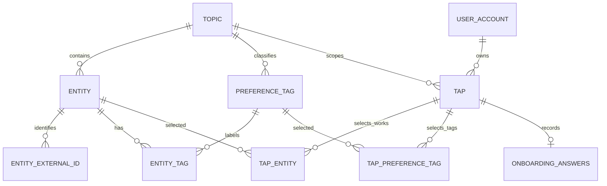

# 온보딩 V2 구현 명세: 작품 → 장르·소재 → 소비 유형

설계일: 2026-10-27. 구현 기준일: **2026-10-28 (Asia/Seoul)**. 통합 작업 폴더 `C:\Users\USER\.codex\worktrees\service-integration\me_nu`의 DB 모델·migration·API·실작품 카탈로그·Pivot 프론트를 반영했다. [프론트 연결 검증](ONBOARDING_FRONTEND_INTEGRATION_2026-10-28.md)은 격리된 로컬 API와 DB에서 수행했으며 **원격 배포와 실제 OAuth 공급자 검증은 아직 하지 않았다.** `v2`는 온보딩 답변 형식의 버전이며 API 경로는 `/api/v1`을 유지한다.

생년월일 수집·저장·연령 확인 정책은 **통합 완료 후 결정**한다. 이번 V2 migration은 환경별 생년월일 컬럼 유무와 기존 값을 바꾸지 않는다. 현재 로컬 API의 `birthDate` 거절 계약도 유지한다. 후속 프론트 연결에서는 Pivot 프로필을 닉네임만 수집하도록 바꾸고 생년월일 입력·필수 검사·전송을 보류했다. 새 Pivot 경로의 기존 422 불일치는 해소했으며, 레거시 Consumer 경로와 생년월일 유틸리티는 그대로 두었다. 원격 배포·환경 설정은 변경하지 않았다.

**2026-10-29 Q2 변경:** 원격 Checking `b0ff38d`의 Topic 전체 활성 칩·작품 힌트·종류별 최대 7개 조건을 보존하고 장르와 소재 각각 최소 1개를 추가했다. 이번 변경은 코드·문서 변경이며 서비스 배포를 실행하지 않았다. 기존 DB 구조·답변·에이전트·생년월일 정책은 변경하지 않는다.

## 1. 질문과 저장 의미

| 단계 | 구현 계약 | 서버 검증 |
| --- | --- | --- |
| Q1 | 좋아하는 애니 작품 검색 후 1~5개 선택 | 고유한 양의 정수 작품 ID. 활성·같은 Topic 작품만 허용하며 장르/소재 연결 여부와 무관. |
| Q2 | 장르와 소재 각각 1~7개 선택 (Q1 작품에 붙은 칩은 힌트) | 같은 Topic의 활성 칩의 고유한 양의 정수 태그 ID. 장르·소재 각각 최소 1개·최대 7개, 총 최소 2개. |
| Q3 | “어떻게 덕질하세요?”에서 정확히 1개 선택 | 기존 Q1의 6개 코드를 `consumptionType`으로 재사용. |

Q2는 장르와 소재를 각각 하나 이상 골라야 한다. 장르만 2개 또는 소재만 2개는 거절하며 한 종류의 마지막 선택을 해제하면 다음 버튼이 비활성화된다. 켜진 칩이면 Q1 작품과 무관하게 선택할 수 있고 종류별 7개까지다(추천 실험에서 7개까지는 3개와 차이가 없고 10개는 순위 점수가 떨어졌다). 중복 ID·자유 입력·꺼진 칩은 허용하지 않는다. 작품과 태그 배열은 집합 의미로 취급하며 완료 응답은 ID 오름차순으로 반환한다.

| `consumptionType` | 표시 의미 |
| --- | --- |
| `world` | 설정과 세계관을 파고든다 |
| `relationships` | 캐릭터의 관계성과 감정선에 빠진다 |
| `ost` | 관련 OST를 찾아듣는다 |
| `goods` | 굿즈를 모으거나 구매 정보를 찾는다 |
| `events` | 팝업·전시·이벤트 등을 찾아간다 |
| `news` | 새로운 소식을 빠르게 확인한다 |

기존 Q2의 `releases/characters/restock/events`는 V2 질문에 포함하지 않는다. 기존 답변은 V1로 보존한다. 새 작품·태그를 기존 `q1_choice/q2_choice` 문자열에 넣지 않으며, Q2를 `tap_topic` 구독이나 피드 필터로 자동 변환하지 않는다. Q3는 알림·마케팅 동의 및 콘텐츠의 `content_type`과 별개다.

## 2. 구현된 DB 구조

신규 6개 테이블, `tap`의 Topic 복합 UNIQUE, `onboarding_answers`의 버전 필드를 추가했다. **온보딩 V2 변경 당시** 전체 ORM은 37개 테이블, FK 66개, CHECK 50개, UNIQUE 제약 19개, 인덱스 45개였다. 후속 [캐러셀 DB·API 변경](CAROUSEL_DB_API_INTEGRATION_2026-10-28.md)에서 `content_slide`를 추가하므로 이 수치를 현재 전체 스키마 통계로 사용하지 않는다. 실제 환경의 적용 상태와 ORM 구조는 구분하며 최신 DDL은 [current_schema.sql](erd/current_schema.sql)을 따른다.

| 테이블 | 주요 컬럼·키 | 역할 |
| --- | --- | --- |
| `entity` | `entity_id` PK, `topic_id` FK, `entity_type='anime'`, `name`, `aliases` JSONB, `image_url`, `release_year`, `media_format`, `is_active`, 생성·수정 시각 | 작품 검색 사전. 작품 ID는 콘텐츠 글 ID와 다르다. |
| `entity_external_id` | PK `(provider,external_id)`, `entity_id` FK, UNIQUE `(entity_id,provider)` | 내부 작품 ID와 외부 공급자 ID 매핑. 이름이나 외부 번호를 내부 PK로 사용하지 않는다. |
| `preference_tag` | `tag_id` PK, `topic_id` FK, `kind` (`genre/theme`), `code`, `display_name`, `sort_order`, `is_active`, 생성·수정 시각 | 검토한 한국어 장르·소재 사전. UNIQUE `(topic_id,kind,code)`. |
| `entity_tag` | PK `(entity_id,tag_id)`, `topic_id` | 작품별 장르·소재 연결. |
| `tap_entity` | PK `(tap_id,entity_id)`, `topic_id`, `source='onboarding'`, `created_at` | 사용자가 Q1에서 선택한 작품. 관람 완료·평점·선택 순위를 뜻하지 않는다. |
| `tap_preference_tag` | PK `(tap_id,tag_id)`, `topic_id`, `created_at` | 사용자가 Q2에서 명시적으로 선택한 태그. |
| `onboarding_answers` | 기존 `tap_id` PK/FK, `schema_version`, nullable `q1_choice/q2_choice`, `consumption_type`, `created_at` | V1 답변과 V2 소비 유형을 구분한다. |

`entity`, `preference_tag`, `tap`의 `(PK,topic_id)` UNIQUE와 연결 테이블의 복합 FK가 다른 Topic의 작품·태그·Tap 연결을 차단한다. 회원은 기존 `tap.user_id`로 결정한다. 새 API는 요청에서 `userId`나 임의 `tapId`를 받지 않는다.

Tap 물리 삭제 시 답변과 작품·태그 선택은 CASCADE된다. 작품·태그 사전 참조는 RESTRICT이며 비활성화로 기존 선택을 보존한다. 카탈로그 변경 이후 이미 저장한 취향을 자동 삭제하지 않는다. Q1/Q2의 행 개수와 현재 칩 조건은 완료 트랜잭션의 서비스 검증이 담당하고, PK는 중복 연결을 막는다.



그림의 `0..N`은 기존 회원·일반 Tap도 포함한 물리 구조다. 신규 V2 완료에는 작품 1~5개, 태그 1개 이상(종류별 7개까지)의 서비스 조건이 적용된다. Topic 일치는 위의 복합 FK로 강제한다.

| 답변 버전 | `q1_choice/q2_choice` | `consumption_type` | 선택 연결 |
| --- | --- | --- | --- |
| V1 | 기존 허용값 두 개 필수 | NULL | 기존 회원에게 작품·태그를 추정해 채우지 않음 |
| V2 | 둘 다 NULL | 6개 코드 중 하나 필수 | `tap_entity`, `tap_preference_tag`에 저장 |

`schema_version`은 NOT NULL·서버 기본값 1이다. 기존 행과 새 컬럼을 모르는 구 API의 INSERT는 V1로 유지된다. V2는 명시적으로 2를 저장한다. enum CHECK와 버전별 NULL 조합 CHECK가 혼합 상태를 차단한다. 기존 회원의 `onboarding_completed_at`, OAuth 식별자, 동의와 로그인 상태를 보존하고 재온보딩을 강제하지 않는다.

## 3. API 계약

새 공개 API 2개를 추가하고 완료 API를 확장했다. **온보딩 V2 연결 당시** 등록 수는 공개 V1 35개 + 상태 확인 3개, 개발 API 사용 시 6개 추가 / 총 44개였다. 후속 캐러셀 이미지 GET과 활동 기록 POST(API-033)를 더한 현재 등록 수는 **공개 V1 37개 + 상태 확인 3개**, 개발 API 사용 시 **6개 추가 / 총 46개**이며 [최신 표](API_V1_1_LOCAL_ALIGNMENT.md)를 따른다. 라우트 등록과 실제 배포·실계정 검증은 별개다.

### 3.1 작품 검색

`GET /api/v1/onboarding/works`

- 로그인된 `onboarding_pending` 세션 필요. 완료 회원은 `409 ONBOARDING_ALREADY_COMPLETED`, 다른 로그인 세션 상태는 `409 STATE_CONFLICT`, 미인증은 401이다.
- 필수 query `topicId`: 양의 정수. 비활성·없는 Topic은 `404 TOPIC_NOT_FOUND`.
- 선택 query `q`: 최대 200자. 앞뒤 공백을 제거하며 누락·빈 문자열·공백만 있는 값은 `items:[]`, `nextCursor:null`.
- `name`과 `aliases` 배열의 각 문자열을 대소문자 구분 없이 부분 검색한다. `%`, `_`, 역슬래시는 와일드카드가 아닌 문자로 검색한다.
- 선택 query `limit`: 기본 20, 범위 1~50. 검색 페이지 크기이며 Q1 최대 선택 개수와 다르다.
- 선택 query `cursor`: 최대 2,048자. 작품 `entity_id` 오름차순으로 이어 간다. cursor는 검색 리소스·Topic·정규화한 검색어에 바인딩된다. 다른 Topic·검색어에 재사용하거나 잘못된 cursor를 보내면 `422 INVALID_CURSOR`다. `limit`은 다음 페이지에서 바꿀 수 있다.
- 활성 작품만 반환한다. Q2가 작품의 장르·소재 연결에 묶이지 않으므로 검색된 작품은 모두 `selectable:true`, `unavailableReason:null`이다. 두 필드는 기존 화면 호환을 위해 남긴다.

응답의 `items[]` 필드:

| 필드 | 의미 |
| --- | --- |
| `entityId`, `name`, `aliases` | 내부 작품 ID, 작품명, 별칭 배열 |
| `imageUrl`, `releaseYear`, `mediaFormat` | nullable 이미지 주소·출시 연도·형식. 동명 작품 구분에 사용 |
| `selectable` | 현재 온보딩 선택 가능 여부. 검색된 활성 작품은 항상 true |
| `unavailableReason` | 항상 null. 예전 값 `PREFERENCE_TAGS_NOT_READY`는 더 쓰지 않는다 |

응답 최상위는 `items`, `nextCursor`다. 결과가 없으면 빈 배열을 반환하며 검색만으로 사용자 선택을 저장하지 않는다.

### 3.2 장르·소재 칩 목록과 힌트

`POST /api/v1/onboarding/preference-options`

`onboarding_pending` 세션과 `X-CSRF-Token`이 필요하다. 요청은 `{topicId,entityIds:[...]}`이며 추가 필드는 거절한다. `topicId`와 배열의 ID는 양의 정수이며 bool·문자열·소수·BIGINT 범위 밖 값을 거절한다. 작품은 1~5개, 중복 불가다.

선택 작품 각각이 같은 Topic 소속의 활성 작품이어야 한다. 장르·소재 연결이 없는 작품도 된다. 유효하지 않은 작품이 하나라도 있으면 `422 VALIDATION_ERROR`, `fields[].field="entityIds"`를 반환한다. 조회는 선택·동의·온보딩 답변을 저장하지 않는다.

다음 ID는 응답 구조를 설명하는 예시이며 실제 API에서 조회한 ID를 사용한다.

```json
{
  "entityIds": [101, 102],
  "genres": [
    {"tagId": 201, "kind": "genre", "code": "action", "label": "액션", "sourceEntityIds": [101, 102]},
    {"tagId": 202, "kind": "genre", "code": "romance", "label": "로맨스", "sourceEntityIds": []}
  ],
  "themes": [
    {"tagId": 301, "kind": "theme", "code": "school", "label": "학원", "sourceEntityIds": [102]}
  ],
  "minSelections": 2,
  "minGenreSelections": 1,
  "minThemeSelections": 1,
  "maxSelections": null,
  "maxSelectionsPerKind": 7
}
```

응답은 같은 Topic의 켜진 칩 전체이며 각 종류 안에서 `sort_order`, `tag_id` 순으로 정렬한다. `sourceEntityIds`는 그 칩이 붙은 선택 작품 ID이고, 붙은 작품이 없으면 빈 배열이다. 화면은 이 값으로 고른 작품과 관련된 칩을 힌트로 먼저 보여 줄 수 있다. 칩은 장르·소재 각각 `maxSelectionsPerKind`(7)개까지 고를 수 있다. 작품↔칩 연결은 `model/catalog/work_chips.csv`(시리즈 안에서 그 칩이 붙은 편들의 인기 합이 절반 이상일 때 연결)를 [작품 목록 명령](../backend/app/seeds/menu_works.py)으로 넣는다. Pivot 화면은 Q1을 바꾸면 Q2 선택을 비우고 다시 조회한다. 장르와 소재 각각 1~7개를 화면과 서버에서 검사하며, 선택 작품과 연결되지 않은 활성 칩도 고를 수 있다. 작품 힌트를 이용한 별도 정렬·강조는 이번 최소 선택 조건 변경에 포함하지 않는다.

### 3.3 완료와 V1 호환

`POST /api/v1/onboarding/complete`

필수 최상위 필드는 기존 `nickname`, `accountType:"user"`, `consents`, `topicId`, `answers`다. 닉네임·정책 동의 검증, pending 세션·CSRF, 성공 201, 세션 교체 규칙을 유지한다. `topicId`는 V1·V2 모두 strict 양의 BIGINT이며 bool·문자열·실수·범위 초과를 거절한다. Topic ID와 정책 버전은 조회 API의 실제 값을 사용한다.

새 답변 형식:

```json
{
  "answers": {
    "version": 2,
    "favoriteEntityIds": [101, 102],
    "preferenceTagIds": [201, 301],
    "consumptionType": "world"
  }
}
```

- `version`은 정수 2만 허용한다. 문자열 `"2"`나 실수 `2.0`은 거절한다.
- `favoriteEntityIds`: 고유한 양의 정수 1~5개. `preferenceTagIds`: 고유한 양의 정수 총 2개 이상, 실제 활성 칩의 kind 기준으로 장르·소재 각각 최소 1개·최대 7개. bool·문자열·실수·BIGINT 범위 밖 값은 거절한다.
- `consumptionType`: 위 6개 문자열 중 정확히 1개. 누락·배열·다른 값은 거절한다.
- 버전 없는 `answers:{q1,q2}`는 기존 V1 요청·응답으로 유지한다. 명시적인 `version:1`, V2 필드와 기존 Q1/Q2 혼합, 버전 없는 V2 필드는 거절한다.
- `birthDate`, `profileImageId`, `subtopicIds`는 null도 포함해 422다. 생년월일 정책을 새로 확정한 것이 아니라 기존 로컬 API 계약을 유지한 것이다.

완료 응답의 `user`, `onboardingCompleted`, `activeTopic` 구조는 유지한다. `answers`는 제출한 버전의 의미를 반환하며 V2의 ID 배열은 정렬된다. Q2를 구독으로 저장하지 않으므로 `activeTopic.subtopicIds=[]`다. 완료 뒤 `GET /api/v1/auth/session`으로 교체된 세션과 CSRF를 다시 확인한다.

트랜잭션 순서:

1. 회원 행을 `FOR UPDATE`로 잠그고 이미 로드된 객체도 갱신하여 중복 완료를 재검사한다.
2. 현재 정책·필수 동의·활성 Topic을 검증한다.
3. V2 작품과 제출 태그를 현재 사전에서 다시 조회하고 공유 잠금으로 보호한다.
4. 제출 태그가 같은 Topic의 활성 칩인지, 장르·소재 각각 1~7개인지 검사한다. 위반 시 `422 VALIDATION_ERROR`, `fields[].field="answers.preferenceTagIds"`로 거절하며 회원·선택·동의·세션의 부분 저장을 하지 않는다. 조회 이후 작품·태그가 비활성화되면 완료 요청을 거절할 수 있다.
5. 회원 프로필·완료 시각, Tap, 답변, 작품·태그 선택, 동의, 기본 알림 설정을 저장하고 flush한 뒤 기존 세션을 폐기·교체한다.
6. DB 저장 실패 시 전체 rollback과 미발급 세션 정리를 수행한다. Redis와 PostgreSQL을 묶는 분산 트랜잭션은 아니므로 이전 세션 폐기 이후 장애 시 재로그인이 필요할 수 있다.

입력 오류는 `422 VALIDATION_ERROR`와 `fields[]`로 반환한다. `answers.favoriteEntityIds`, `answers.preferenceTagIds`, `answers.consumptionType`, `answers.version` 등 실제 경로를 사용하며 union 내부 분기명은 노출하지 않는다. 배열 원소의 형식 오류에는 `answers.favoriteEntityIds.0`처럼 원소 위치가 붙을 수 있다. 정책 충돌·중복 완료·인증·CSRF·Topic 오류는 기존 계약을 유지한다.

## 4. 생년월일과 분리한 migration 경로

온보딩 revision은 **`e3a7b9c2d451`**, 부모는 **`c0e5f3b8a124`**, branch label은 **`onboarding_v2`**다. 생년월일 삭제 `d2f6a9c4e731`을 부모로 사용하지 않는다. 현재 `codex/backend-labs-service` 후보에는 d2 파일을 포함하지 않으며 아래 단일 서비스 경로만 있다. 원본 작업 공간의 d2 파일이나 과거 DB 적용 이력을 변경한 것은 아니다.

```text
c0e5f3b8a124
  └─ e3a7b9c2d451  onboarding_v2 — 온보딩 도입 revision
     └─ f4b8c1d9a620  캐러셀 DB/API
        └─ 150a601074af  추천 연결 표 4개 — 유일한 head와 명시적 적용 대상
```

온보딩만 도입한 당시 업그레이드 대상은 `e3a7b9c2d451`이었다. 현재 서비스 전체의 명시적 target은 캐러셀 `f4b8c1d9a620`에 추천 연결 표 4개를 더한 **`150a601074af`**이며 e3를 포함한다. [캐러셀 migration 안내](CAROUSEL_DB_API_INTEGRATION_2026-10-28.md#2-db-변경과-명시적-migration-대상)에 따라 대상 환경을 확인한다. 이 후보는 단일 head지만 적용 대상을 고정하기 위해 `upgrade head/heads` 대신 150a를 명시한다. 아래 표는 **d2 파일이 있던 과거 통합 작업 공간에서 e3를 도입했을 당시**의 기록이며, 현재 후보가 d2 적용 DB의 자동 업그레이드를 지원한다는 뜻이 아니다.

| 시작 상태 | 온보딩 전용 업그레이드 후 |
| --- | --- |
| c0 또는 그 이전이며 생년월일 컬럼이 있는 DB | e3 서비스 분기로 업그레이드, 생년월일 컬럼·기존 값 보존 |
| 이미 d2가 적용되어 생년월일 컬럼이 없는 DB | e3와 d2 두 revision 상태, 생년월일 컬럼을 재생성하거나 값을 추정하지 않음 |

현재 `compose.deploy.yaml`, `compose.labs.yaml`의 migration 서비스와 `run_local_oauth.py`의 준비 경로는 e3·f4를 포함하는 150a를 명시한다. 이미 d2가 적용된 DB는 후보에 해당 revision 파일이 없으므로 별도 이력 검토가 필요하다. readiness 판정과 migration 실행 가능 여부는 서로 다르다. 이 구성 변경 자체는 원격 migration 실행이나 배포 완료를 뜻하지 않는다.

모델에 없는 `user_account.birth_date`가 autogenerate의 DROP 후보로 섞이지 않도록 [migration_policy.py](../backend/app/db/migration_policy.py)의 `include_schema_object`를 Alembic의 온라인·오프라인 설정에 연결했다. 생성된 migration은 온보딩 범위와 생년월일 DDL 부재를 별도로 검토해야 한다.

V2 답변 또는 사용자 작품·태그 선택이 남아 있으면 downgrade는 스키마 변경 전에 오류로 중단한다. V2를 임의의 기존 Q1/Q2로 바꾸거나 사용자 선택을 삭제하지 않는다. 보호 대상이 없어 downgrade를 진행하면 신규 사전 테이블도 제거되므로 카탈로그 보존이 필요한 환경은 먼저 내보내야 한다.

## 5. 검토한 카탈로그의 적재 도구

[onboarding_catalog.py](../backend/app/seeds/onboarding_catalog.py)는 **로컬 JSON을 입력**받으며 외부 작품 API를 자동 수집하지 않는다. 후속 작업으로 [실작품 시작 카탈로그](../backend/app/seeds/onboarding_catalog_starter.json)를 추가했다. 실제 작품 30개(시리즈 27·독립 영화 3), 장르 10개·소재 28개, 작품–태그 연결 140개이며 기존 에이전트 `menu_work_id`와 매핑한다. [선정 기준·작품별 출처](ONBOARDING_CATALOG_SOURCES_2026-10-28.md)에 국내 정식명·연도·포스터의 추가 확인 범위를 기록했다. 전체 작품 데이터셋이나 운영 배포 완료를 뜻하지 않는다.

[onboarding_catalog_demo.json](../backend/app/seeds/onboarding_catalog_demo.json)은 `[DEMO]` 이름과 `provider:"demo"`로 표시한 **가상 작품 2개·태그 4개의 합성 fixture**로 별도 유지한다. Pivot의 demo/preview도 실서비스 API와 분리되어 있으며 실서비스 검색 오류를 가상 작품으로 대체하지 않는다.

JSON 최상위는 `topicCode`, `demo`, `tags`, `works`다. 기존 활성 Topic이 있어야 하며 도구가 Topic·회원·동의·구독·답변을 만들지 않는다.

| 영역 | 필드·검증 |
| --- | --- |
| 태그 | `kind`, `code`, `displayName`, 선택 `sortOrder`·`isActive`. `(kind,code)` 고유, 표시명에 한국어 포함 필수. |
| 작품 | `provider`, `externalId`, `name`, `tags`, 선택 `aliases`·`imageUrl`·`releaseYear`·`mediaFormat`·`isActive`. `(provider,externalId)` 고유, 작품명에 한국어 포함 필수. |
| 작품별 태그 | `{kind,code}` 배열. 문서의 태그 선언을 참조하고 중복 불가. 빈 매핑 작품은 검색에서 선택 불가가 됨. |
| 별칭·이미지 | 별칭은 공백 제거 후 빈 값·중복 불가. `imageUrl`은 HTTP(S), 자격정보 포함 불가. |
| 정수·boolean | 연도·정렬값과 활성 여부는 strict 타입 검증. 알 수 없는 필드는 거절. |

한국어 포함 검사는 명칭의 정확성이나 노출 적절성을 자동 검토한 결과가 아니다. 실제 명칭·분류·스포일러 등의 검토는 적재 전에 별도로 수행한다. 작품은 외부 ID로 찾아 갱신하며 제목으로 합치지 않는다. 태그는 Topic·kind·code로 식별한다. 문서에 포함한 작품의 태그 목록은 **그 작품의 전체 매핑을 대체**하고, 문서에서 빠진 다른 작품·태그는 그대로 둔다. 현재 저장된 사용자 선택은 바꾸지 않는다. 다른 Topic으로 외부 ID가 충돌하면 중단한다.

기본 실행은 DB 읽기 전용 미리보기이며 신규·변경 작품/태그와 연결 추가·제거 수를 출력한다. `--apply`가 있어야 하나의 트랜잭션으로 저장한다. 실패 시 전체 rollback하며 적용끼리는 advisory lock으로 직렬화한다. 기존 작품을 ID순으로 잠근 다음 기존 태그를 ID순으로 잠가 완료 API와 잠금 순서를 맞추고, 대기 중 변경된 속성·매핑을 다시 읽는다.

CLI 옵션:

| 옵션 | 의미 |
| --- | --- |
| `--file` | 필수. 검토한 UTF-8 JSON 경로 |
| `--expected-database` | 필수. 연결 DB명과 정확히 일치해야 함. `postgres`, `template0`, `template1` 불가 |
| `--database-url` | 선택. 앱 환경설정 대신 명시한 연결 사용; 도구는 URL을 출력하지 않음 |
| `--development` | 명시적 `--database-url`을 로컬 개발 DB로 선언. URL을 지정하지 않으면 사용 불가 |
| `--demo` | 문서의 `demo:true`와 함께 사용. 루프백 PostgreSQL·URL query 없음·개발 API 활성 조건 필요 |
| `--apply` | 전체 변경 저장. 없으면 읽기 전용 미리보기 |

다음은 **backend 작업 디렉터리에서 실행하는 사용 예시**이며 이 문서 갱신으로 실행한 명령이 아니다. 먼저 적용 대상 DB와 e3 migration, 활성 `anime` Topic을 확인한다. URL·비밀값은 문서나 커밋 파일에 저장하지 않는다.

```powershell
# 앱 설정에 지정된 개발 DB명이 me_nu_oauth_local인지 검사하는 미리보기
python -m app.seeds.onboarding_catalog --file app/seeds/onboarding_catalog_demo.json --expected-database me_nu_oauth_local --demo

# 같은 확인을 거쳐 가상 카탈로그 저장
python -m app.seeds.onboarding_catalog --file app/seeds/onboarding_catalog_demo.json --expected-database me_nu_oauth_local --demo --apply
```

runner는 `me_nu_oauth_local`을 프로세스 안에서 선택하므로 별도 importer 프로세스가 자동으로 같은 DB를 선택하는 것은 아니다. `--expected-database` 불일치는 중단 사유이며 원본 DB로 우회하지 않는다. 명시적 연결을 쓸 때는 `--database-url`을 별도로 지정하고 합성 데이터에는 `--development --demo`를 함께 사용한다. 실작품 JSON은 `demo:false`와 검토한 공급자 식별자를 사용하며 `--demo`를 붙이지 않는다.

## 6. 검증 기록과 범위

2026-10-28 백엔드 전체 테스트는 **868 passed, 2 skipped, 경고 1개**로 완료했다. 새 PostgreSQL 테스트 8개도 이 집계에 포함된다. skip 2개는 `TEST_REDIS_URL`을 설정하지 않은 실제 Redis 통합 테스트이며, Redis 대역을 사용하는 기존 API 회귀는 통과했다. 경고는 Starlette/AnyIO의 사용 중단 예정 별칭이다.

다음은 2026-10-28 변경 전 검증 이력이며 현재의 종류별 1~7개 조건과 구분한다. 당시 온보딩 API 관련 다섯 파일은 총 193개이며 `test_onboarding_v2.py`는 91개다. 작품 1개와 장르 또는 소재 1개만으로 완료하는 최소 선택, 고정 최대 개수 없이 유효 태그를 모두 선택하는 조건도 확인했다.

```powershell
python -m pytest tests/test_onboarding_v2.py tests/test_onboarding_answers.py tests/test_oauth_postgres_flow.py tests/test_redis_auth_api.py tests/test_auth_api.py -q -o faulthandler_timeout=30
```

일반 테스트의 DB URL은 사용하지 않는 테스트 주소로 고정하고 실제 OAuth·Redis를 비활성화했다. DB·공급자 대역과 메모리 SQLite를 사용했으며 Windows asyncio의 로컬 소켓 제약 때문에 승인 검토를 거친 제한 밖 실행으로 검증했다.

확인한 범위는 엄격한 ID 타입·선택 수·중복·누락·버전 혼합 거절, 별칭·문자 검색·cursor 범위, pending 인증·CSRF, 후보 조회의 선택 미저장, 현재 카탈로그 재검증, 모든 유효 태그 선택, Q3 6개 값, V2 저장·세션 교체·실패 전체 rollback, 기존 V1/Redis 흐름과 생년월일 거절 유지다.

별도로 만든 `pgvector/pgvector:pg17` 임시 컨테이너의 `onboarding_test` DB에서 [PostgreSQL 테스트 8개](../backend/tests/test_onboarding_v2_postgres.py)를 실행했다. 각 테스트는 임의 이름의 독립 schema를 만들고 정리한다. 일반 서비스 DB 주소와는 별도인 `ONBOARDING_TEST_DATABASE_URL`을 사용하며 루프백·정확한 테스트 DB명·query 없음 조건을 검증한다.

- 생년월일 컬럼이 있는 c0 DB와 이미 d2를 적용한 DB 모두에서 e3 적용 후 기존 값·V1 답변·동의를 보존하고 구 API INSERT가 동작한다.
- 보호 대상 없는 V2 분기의 downgrade와, V2 답변/선택이 있을 때 downgrade 중단을 확인했다.
- PostgreSQL JSONB 별칭 검색, 문자 `%`·`_` 검색, 후보 합집합, 실제 V2 저장·세션 교체를 확인했다.
- 비활성 후보 거절, 저장 실패 시 전체 rollback, 동시 완료의 회원·답변 중복 방지, 교차 Topic FK 거절을 확인했다.
- 가상 카탈로그 미리보기의 무변경과 반복 적재 시 작품 ID 유지·중복 방지를 확인했다. 적재 도구의 별도 회귀는 35개다.

전체 실행 명령은 backend 디렉터리의 `python -m pytest -q -rs --tb=short`다. 첫 실행에서 기존 사용자 ORM의 컬럼 수 기대값 14가 실제 13과 다른 오래된 테스트를 발견해 수정했고, 최종 전체 재실행이 위 결과다. 생년월일 모델·API 동작을 추가 변경하지 않았다. `export_current_schema.py --check`와 `git diff --check`도 통과했다.

기존 로컬/Labs/운영 DB에 migration이나 seed를 적용하지 않았다. 실제 OAuth 공급자·브라우저·원격 배포 검증은 이번 범위에 포함하지 않는다.

## 7. 프론트 연결과 남은 통합 작업

1. 실작품 시작 카탈로그 30개를 준비하고 임시 DB에서 적재·반복 적재를 검증했다. 국내 정식명 추가 확인 5개, 미확인 연도 20개, 포스터 30개 및 작품 범위 확장은 후속이다. 원문 태그를 검토 없이 사용자 칩으로 노출하지 않는다.
2. Pivot 작품 검색/선택, 동적 후보·다중 선택, 기존 Q1을 옮긴 Q3, 뒤로 가기와 후보 변경 처리, V2 제출/응답·세션 검증을 연결했다. 생년월일 입력·전송은 새 흐름에서 보류한다. 로컬 모바일·데스크톱 브라우저 확인과 원격 서버 적용은 별개다.
3. 실제 정책 문안·버전과 공급자 인증을 사용하여 브라우저 신규 가입 및 기존 회원 로그인을 검증한다. 그 결과로 신규 V1 제출 허용 종료 시점을 정한다.
4. 생년월일 정책은 통합 후 별도로 결정한다. e3 적용과 함께 d2를 자동 적용하거나 삭제된 값을 임의로 복구하지 않는다.
5. 추천 연결은 후속이다. 내부 작품 ID↔AniList/MAL 외부 ID, `tagId`↔추천 특징 코드, Q3 가중치 adapter를 정의해야 한다. 좋아하는 작품을 가짜 관람 이력·평점으로 바꾸지 않는다. 현재 피드는 최신순이며 V2 저장이 추천 피드 완성을 뜻하지 않는다.

## 8. 구현 근거

- [카탈로그·선택 모델](../backend/app/models/onboarding_catalog.py), [버전별 답변 모델](../backend/app/models/onboarding_answers.py), [온보딩 migration](../backend/alembic/versions/e3a7b9c2d451_add_onboarding_v2_catalog.py)
- [요청·응답 DTO](../backend/app/schemas/onboarding.py), [라우터](../backend/app/api/v1/onboarding/router.py), [완료 서비스](../backend/app/services/onboarding_service.py)
- [카탈로그 서비스](../backend/app/services/onboarding_catalog_service.py), [카탈로그 조회](../backend/app/repositories/onboarding_catalog_repository.py), [회원 행 잠금](../backend/app/repositories/onboarding_repository.py)
- [적재 도구](../backend/app/seeds/onboarding_catalog.py), [가상 fixture](../backend/app/seeds/onboarding_catalog_demo.json), [V2 회귀 테스트](../backend/tests/test_onboarding_v2.py)
- [migration 정책](../backend/app/db/migration_policy.py), [로컬 OAuth runner](../backend/scripts/run_local_oauth.py), [배포 Compose](../compose.deploy.yaml), [Labs Compose](../compose.labs.yaml)
