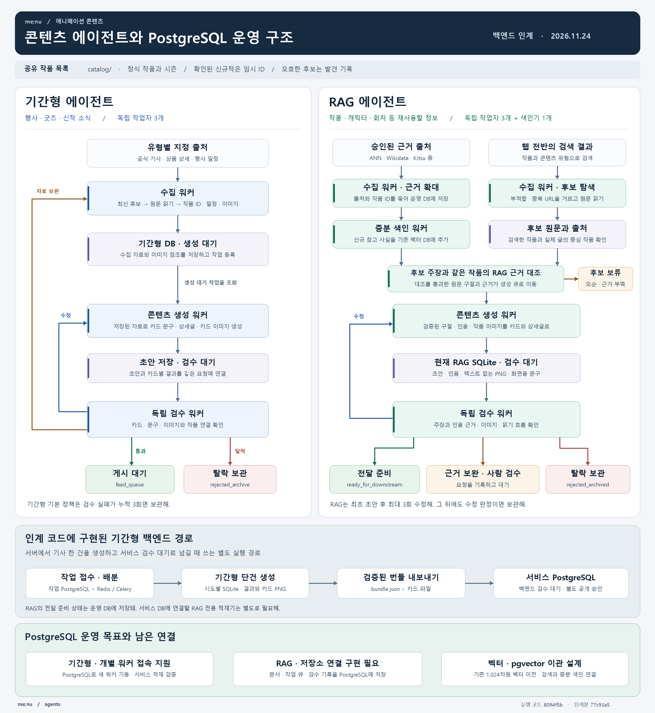

# me;nu 콘텐츠 에이전트 운영 가이드

**인계 기준 · 2026-11-24**　|　브랜치 `codex/ani-menu-agent-pr`　|　코드 `8094f5b`　|　데이터 인계 `77c93a5`

## 운영 DB는 PostgreSQL

기간형과 RAG형의 **운영 저장소는 PostgreSQL**로 정한다. Git LFS에 담긴 두 SQLite 파일은 RAG 데이터 이관과 결과 대조에 쓴다. 벡터 저장·검색은 PostgreSQL 확장인 **pgvector**를 사용하는 설계다.

| 영역 | 인계 코드에서 쓸 수 있는 부분 | 운영 전 연결할 부분 |
| --- | --- | --- |
| 기간형 | 개별 수집·생성·검수 워커는 PostgreSQL 작업 DB에 접속할 수 있다. 서버에는 검수된 기사 번들을 서비스 DB로 가져오는 경로가 있다. | 기본 감독 스크립트와 서버 단건 생성기는 SQLite를 지정한다. 세 워커를 PostgreSQL 설정으로 띄우고, 사용할 서비스 적재 경로에서 원문·일정·카드·판정이 저장되는지 검증한다. |
| RAG형 | 근거·초안·검수 기록과 기존 임베딩을 인계했다. 현재 워커와 색인기는 SQLite 파일을 직접 연다. | 문서 저장·큐·검수 기록을 PostgreSQL에 연결하고, 벡터 조회·증분 색인과 통과 콘텐츠의 서비스 적재를 구현한다. DB 주소만 지정해 실행할 수 있는 RAG용 PostgreSQL 진입점은 아직 없다. |
| 이미지 | 카드 PNG, 별도 화면 문구, 원본 파일의 ID·출처·해시가 있다. | 대상 서버에서 원본 파일을 읽는 위치와 DB의 참조를 연결한다. 이미지 파일을 볼륨에 둘지 객체 저장소에 둘지는 PostgreSQL 선택과 별도의 배치 결정이다. |

아래 그림에서 화살표는 자료와 판정이 전달되는 방향이다. 생성·검수 워커는 각각 자기 큐에서 작업을 가져간다. 수집 워커는 출처와 예정된 작업을 확인하고, RAG 색인기는 DB의 체크포인트 뒤에 추가된 근거를 읽는다. 예를 들어 이미 저장된 초안은 크롤러의 다음 수집이 끝나기 전에도 검수할 수 있다.



## 1. 작품 ID와 콘텐츠 산출물

| 자료 | 저장 위치와 역할 |
| --- | --- |
| 정식 작품·시즌 | 두 에이전트 모두 저장소 루트 `catalog/menu_works.csv`, `catalog/menu_work_entries.csv`를 읽는다. 작품 번호는 `menu_work_id`다. |
| 신규 작품·모호한 후보 | 확인된 새 작품은 `catalog/agent_works.csv`에 임시 ID와 작품 정보를 기록한다. 식별이 모호한 후보는 `catalog/discovered_works.csv`에 발견 기록을 남긴다. 정식 번호는 팀 카탈로그가 관리한다. |
| 임시 번호 | Kitsu ID가 있으면 `1_000_000 + int(kitsu_id)`. 없으면 정규화한 제목의 UTF-8 바이트를 사용해 `2_000_000 + crc32(...) % 1_000_000_000`으로 정한다. 계산 전에 기존 정식·임시 등록을 대조한다. |
| 경로 설정 | `ME_NU_WORK_CATALOG_DIR`는 정식 목록, `ME_NU_WORK_REGISTRY_DIR`는 임시 등록·발견 기록 디렉터리다. 기본은 둘 다 루트 `catalog/`다. 등록 경로를 정식 목록과 분리하면 외부 ID 연결용 `menu_work_external_entries.csv`도 분리된 등록 디렉터리에서 찾으므로 함께 배치한다. 바꿀 때는 **양쪽 워커 프로세스 환경**에 동일하게 주입하고 등록 디렉터리에 쓰기 권한을 준다. |
| 에이전트별 보조 자료 | 별칭과 외부 ID 등은 각 프로젝트의 `data/reference/`도 사용한다. RAG의 팀 전용 캐릭터·주제가 CSV, 정보사전 원본은 별도 팀 인계본에 있다. `work_characters.csv`가 빠지면 이름으로 작품을 찾는 보조 경로가 줄어든다. |
| 카드와 상세글 | 카드 배경 PNG에는 서비스 문구를 굽지 않는다. 머리글·제목·본문·배치 데이터는 따로 전달해 프런트에서 겹쳐 보여준다. 상세글 끝에는 원문·이미지 출처와 AI 활용 고지를 표시한다. 같은 콘텐츠의 중복 이미지와 서로 다른 콘텐츠의 중복 표지를 확인한다. |

작품 식별과 임시 등록의 구현은 두 패키지가 각각 가지고 있다. [기간형 작품 목록](https://github.com/Por0ri/me-and-nu/blob/8094f5bae7aa3f06d1b747e1dc6db7a1cde3b41f/agents/ani_me%3Bnu/src/ani_menu_agent/work_catalog.py) · [RAG 작품 목록](https://github.com/Por0ri/me-and-nu/blob/8094f5bae7aa3f06d1b747e1dc6db7a1cde3b41f/agents/ani_rag/src/ani_rag/catalog.py) · [RAG 임시 등록 규칙](https://github.com/Por0ri/me-and-nu/blob/8094f5bae7aa3f06d1b747e1dc6db7a1cde3b41f/agents/ani_rag/src/ani_rag/work_registry.py)

## 2. 기간형 · 신작, 행사, 굿즈

| 워커 | 읽는 것 | 저장하는 것과 다음 단계 |
| --- | --- | --- |
| `crawl` | `config/sources.json`과 `config/source_type_map.json`에 연결된 `news`, `event`, `goods` 출처의 목록과 상세 원문 | 발행일이 확인되는 후보는 최신순으로 우선한다. 원문, 작품 ID, 출처·이미지, 행사·판매·예약·발매 일정을 확인해 저장하고 같은 `request_id`로 생성 작업을 등록한다. 중복·만료·작품 미확정은 사유를 남긴다. |
| `generate` | `pipeline_jobs`의 생성 작업과 DB에 저장된 근거·이미지 | 카드 문구와 상세글을 만들고, 작품과 맞는 이미지를 배치한다. 초안을 `generated_pending_review`로 저장하고 검수 작업을 등록한다. 최종 통과 판정은 검수 워커가 한다. |
| `review` | 완성된 초안, 카드, 이미지, 근거, 기존 수정 지시 | 통과는 `feed_queue`, 탈락은 `rejected_archive`에 남긴다. 고칠 만한 문구·카드 구성은 지시와 함께 생성 큐로, 수집 자료 보완은 수집 경로로 보낸다. |

**워커 안의 실행 순서.** 생성 워커는 LangGraph에서 카드 카피, 배치, 필요 시 이미지 보완·렌더링, 상세글 작성으로 진행한다. 수정 지시가 오면 카피·이미지·배치·상세글 중 담당 단계로 다시 진입할 수 있다. 검수 워커는 별도 검수 그래프를 실행한다. 두 그래프 사이의 초안과 판정 결과는 작업 큐와 DB에 남는다. [생성 그래프](https://github.com/Por0ri/me-and-nu/blob/8094f5bae7aa3f06d1b747e1dc6db7a1cde3b41f/agents/ani_me%3Bnu/src/ani_menu_agent/agents/content_generation/graph.py)

**일정 예시.** “11월 25일 예약 시작”만 확인됐으면 예약 시작일을 저장하고 종료일은 비워 둔다. 기사 발행일, 행사일, 상품 발매일은 별개다. SQLite의 `raw_document_schedule`과 `content_schedule` 뷰에서 원문·콘텐츠별 일정을 확인할 수 있다. 만료된 일정의 생성 제외는 에이전트가 판단하고, 게시된 항목을 어느 시점에 피드에서 내릴지는 서비스가 담당한다.

**검수 범위.** 기간형은 캐러셀 2~10장, 중복 이미지·작품 불일치, 내부 메모 노출, 한국어 문구와 흐름, 명백한 유해 표현을 중심으로 점검한다. 운영자는 통과 점수를 개별 사실 확인이나 이미지 이용 허가의 증명으로 사용할 수 없다.

**반려와 재시도.** 기본 정책은 검수 실패 누적 3회에 보관하며, 비용 한도로 먼저 보관될 수도 있다. 원문 재조회, 작업 처리 예외에 대한 재시도, 카피의 수정 횟수는 서로 다른 기록이다. 검수 API를 쓸 수 없어서 대기한 항목과 최종 탈락도 구분한다. 기본 수집 `--batch-limit 200`은 한 회차의 목록 처리 상한이다. 감독 프로세스는 STOP 표식을 관찰하며 워커 종료 여부를 확인한다. [기간형 런처](https://github.com/Por0ri/me-and-nu/blob/8094f5bae7aa3f06d1b747e1dc6db7a1cde3b41f/agents/ani_me%3Bnu/scripts/run_continuous_generation.py) · [큐 처리와 판정](https://github.com/Por0ri/me-and-nu/blob/8094f5bae7aa3f06d1b747e1dc6db7a1cde3b41f/agents/ani_me%3Bnu/src/ani_menu_agent/pipelines/workers/runtime.py)

## 3. RAG형 · 작품에 관한 재사용 가능한 근거

수집 워커 하나가 **근거를 넓히는 일**과 **글감을 찾는 일**을 모두 담당한다. 여기에 생성 워커, 검수 워커, 기존·신규 근거를 검색 가능하게 만드는 색인기가 각각 별도 프로세스로 붙는다.

| 흐름 | 실제 동작 |
| --- | --- |
| 근거 확대 | `config/sources.evergreen.json`의 출처와 `config/automatic_plans.json`의 반복 계획을 사용한다. ANN Encyclopedia, Wikidata 캐릭터, Kitsu, FlyingDog, Anime Trending, Anime Corner, Anime Corner Interviews가 계획에 있다. URL형 출처는 Firecrawl MCP, 구조화된 Wikidata 항목은 전용 MCP 어댑터로 읽는다. 출처·URL·근거 구절·작품 연결을 운영 DB에 보존한다. |
| 벡터 색인 | `vector_indexer`가 시작 시 증분 갱신을 시도하고 매 작업 종료 후 기본 300초를 기다린다. 체크포인트 뒤의 `reference_fact` 문서가 대상이다. 1,200자·겹침 120자 규칙과 `text_hash`로 기존 벡터를 재사용한다. 모델은 `text-embedding-3-small`, 1,024차원이다. 웹 후보·초안·검수 기록 전체를 주기적으로 재임베딩하는 구조는 아니다. |
| 웹 후보 발견 | 작품과 유형으로 Firecrawl MCP 웹 검색을 한다. 후보 도메인은 위 7개 근거 출처에 한정되지 않는다. 7개 유형은 `character`, `guide`, `people`, `music`, `humor`, `curation`, `review`다. 기본 계획은 작품 ID 순으로 검색을 배치해 7일에 분산하며 검색 결과의 제목·요약·URL로 부적합·중복 후보를 먼저 솎는다. 게시일 최신순이 RAG의 핵심 선별 기준은 아니다. |
| 원문과 근거 대조 | 후보 상세 페이지를 읽고 실제 작품을 다시 확인한다. 동일 작품의 독립 근거를 검색할 때 후보 원문 URL 자체는 제외한다. 자동 계획의 검색 점수 하한 `0.20`은 근거를 고르는 기준일 뿐이다. 원문의 핵심 주장·인용까지 대조하며 모순이 확인된 후보는 막는다. |
| 생성 | 단독으로 글이 되는 핵심 주장 하나, 핵심 주장과 추가 근거, 또는 근거와 발언자가 확인된 직접 인터뷰 인용 등으로 글이 성립하는지 본다. 검증된 원문 구절·인용 가능한 근거·작품 이미지가 생성기에 전달된다. 원문을 확인한 승인 출처 자료도 자체 대조 경로를 거쳐 생성으로 이어질 수 있다. |
| 독립 검수 | 작성한 주장·인용·카드 가독성·이미지를 규칙과 모델로 확인한다. 통과하면 초안 상태가 `ready_for_downstream`이 된다. RAG 카드는 `rag_rendered_card.image_png`에 저장되며, `data/image_assets/`는 카드 구성에 쓰인 원본 이미지 폴더다. |

**RAG 검수 후 분기**

| 판정 | 실제 상태 및 처리 |
| --- | --- |
| 통과 | `ready_for_downstream`. 백엔드가 받아갈 수 있는 상태다. |
| 수정 | `revision_requested`. 원래 초안 ID와 수정 지시를 생성 큐로 보낸다. 최초 초안 뒤 최대 3회 수정하며, 이미 3회 수정한 초안에 또 수정 판정이 나면 `rejected_archived`가 된다. |
| 근거 보완 | `evidence_requested`. 수집 큐에 `blocked`로 요청을 남긴다. 운영자가 적절한 출처와 요청을 연결해야 하므로 이 상태만으로 유료 재수집이 시작되지는 않는다. |
| 사람의 이미지 검토 / 탈락 | 라우팅 계약은 `awaiting_manual_visual_review`와 `rejected_archived`도 처리한다. 모든 보류를 탈락으로 집계하면 실제 검수 결과와 달라진다. |

**유료 호출 조절.** 후보 평가·생성·검수 작업이 4건 이상이거나 실제로 처리할 수정이 2건 이상이면 새 웹 검색을 쉰다. 수정이 2건 이상이면 신규 후보의 유료 본문 읽기도 미루고, 생성 워커는 가능한 수정부터 처리한다. 전체 작업이 2건 이하이고 수정이 1건 이하로 내려가면 새 검색을 재개한다. 이때에도 진행 중인 작업이나 개별 보완 요청은 처리될 수 있다. [반복 계획](https://github.com/Por0ri/me-and-nu/blob/8094f5bae7aa3f06d1b747e1dc6db7a1cde3b41f/agents/ani_rag/config/automatic_plans.json) · [웹 후보 대조](https://github.com/Por0ri/me-and-nu/blob/8094f5bae7aa3f06d1b747e1dc6db7a1cde3b41f/agents/ani_rag/src/ani_rag/web_discovery.py) · [생성·검수 워커](https://github.com/Por0ri/me-and-nu/blob/8094f5bae7aa3f06d1b747e1dc6db7a1cde3b41f/agents/ani_rag/src/ani_rag/workers.py) · [판정 경로](https://github.com/Por0ri/me-and-nu/blob/8094f5bae7aa3f06d1b747e1dc6db7a1cde3b41f/agents/ani_rag/src/ani_rag/review.py)

## 4. PostgreSQL 운영 연결 및 이관 순서

### 기간형의 PostgreSQL 실행 경로

**개별 워커의 작업 DB.** `ANI_MENU_DATABASE_BACKEND=postgresql`, `ANI_MENU_DATABASE_URL`을 세 프로세스 환경에 지정하고, `agents/ani_me;nu`에서 아래 명령을 각각 독립 서비스로 실행할 수 있다. 저장소가 psycopg 연결과 큐 점유를 지원한다. SQLite 전용 `run_continuous_generation.py`는 자식 환경을 SQLite로 지정하므로 이 방식에서는 개별 CLI를 사용한다.

```sh
uv run ani-menu pipeline-worker --stage crawl --content-types news,event,goods
uv run ani-menu pipeline-worker --stage generate
uv run ani-menu pipeline-worker --stage review
```

여기서 선택하는 DB는 **에이전트 작업 DB**다. `AgentRepository`에는 SQLite에서만 실행하는 ERD 테이블 초기화와 원문·콘텐츠·상태 추가 저장 분기가 있다. PostgreSQL 주소를 넣었다고 서비스 스키마의 `content`·카드·출처·판정 기록까지 모두 채워지는 것은 아니다. 팀 서비스 DB와 분리한 환경에서 해당 경로의 적재 결과를 확인해야 한다. [저장소 및 DB 선택 구현](https://github.com/Por0ri/me-and-nu/blob/8094f5bae7aa3f06d1b747e1dc6db7a1cde3b41f/agents/ani_me%3Bnu/src/ani_menu_agent/storage.py)

**이미 제공되는 기간형 백엔드 경로.** `compose.worker.yaml`과 생성용 `compose.generation.yaml`이 별도 작업 PostgreSQL과 Redis/Celery를 사용한다. 단건 생성 워커는 시도별 `agent.sqlite3`에서 실행하고, 검수된 결과를 `export-staging`으로 내보내 `bundle.json`과 PNG를 만든다. 백엔드에서는 `app.seeds.carousel_contents`로 먼저 dry-run하고, 실제 적재 시 서비스의 `pending_review`를 거쳐 운영자 공개 절차로 넘어간다. 이 경로의 작업 DB 변수는 `CONTENT_JOB_DATABASE_URL`, 백엔드 서비스 DB 변수는 `DATABASE_URL`이다. 자동 출처 탐색은 별도의 `compose.discovery.yaml` 구성을 쓴다. [서버 실행·내보내기 가이드](https://github.com/Por0ri/me-and-nu/blob/8094f5bae7aa3f06d1b747e1dc6db7a1cde3b41f/worker/README.md) · [시도별 실행기](https://github.com/Por0ri/me-and-nu/blob/8094f5bae7aa3f06d1b747e1dc6db7a1cde3b41f/worker/menu_worker/real_generation.py) · [서비스 적재기](https://github.com/Por0ri/me-and-nu/blob/8094f5bae7aa3f06d1b747e1dc6db7a1cde3b41f/backend/app/seeds/carousel_contents.py)

### RAG의 PostgreSQL 연결 범위

서비스용 Compose는 `pgvector/pgvector:pg17` 이미지를 쓰고 서비스 스키마에는 `CREATE EXTENSION IF NOT EXISTS vector`가 있다. 별도 작업 DB의 이미지는 `postgres:17-alpine`이다. RAG를 연결할 대상 DB에서 `SELECT extversion FROM pg_extension WHERE extname = 'vector';`로 확장 활성화를 확인한다. 워커의 저장·검색 어댑터 연결은 별도 항목이다. [서비스 Compose](https://github.com/Por0ri/me-and-nu/blob/8094f5bae7aa3f06d1b747e1dc6db7a1cde3b41f/compose.yaml) · [서비스 스키마](https://github.com/Por0ri/me-and-nu/blob/8094f5bae7aa3f06d1b747e1dc6db7a1cde3b41f/docs/erd/current_schema.sql)

**검수 결과의 서비스 적재.** `ready_for_downstream` 초안을 읽어 작품·출처·카드 순서·문구·레이아웃·PNG·검수 근거를 서비스 입력 형식에 매핑하는 적재 연결이 필요하다. 현재 기간형 번들 적재기는 `producer=ani_menu_agent`를 확인한다. RAG DB 파일을 그 적재기에 그대로 건네는 명령은 제공하지 않는다. 같은 작업이 재전달돼도 서비스 콘텐츠와 카드가 한 번만 등록되도록 원래 초안 ID와 서비스 콘텐츠 ID의 대응을 유지한다.

**근거·큐·벡터의 운영 저장소.** 운영 DB의 문서·인용·작품 연결·큐와 재시도 이력·초안·판정, 벡터 DB의 `chunk_id`·`document_id`·`text_hash`·`embedding_vector.vector_f32`·체크포인트를 함께 이관해야 한다. 큐의 작업 점유·중복 방지, 같은 작품·출처로 제한하는 근거 검색, 신규 참고자료의 증분 색인 경로를 대상 저장소에 연결한다. 이미지 파일을 볼륨이나 객체 저장소에 두면 서버에서 읽을 수 있는 경로/키와 SHA-256 대응도 유지해야 한다. 기존 벡터는 같은 모델·차원 조건에서 변환해 사용할 수 있다. [RAG 저장 스키마](https://github.com/Por0ri/me-and-nu/blob/8094f5bae7aa3f06d1b747e1dc6db7a1cde3b41f/agents/ani_rag/src/ani_rag/storage/schema.sql) · [근거 검색 구현](https://github.com/Por0ri/me-and-nu/blob/8094f5bae7aa3f06d1b747e1dc6db7a1cde3b41f/agents/ani_rag/src/ani_rag/retrieval.py)

### 이관 작업과 완료 판정

| 순서 | 작업 | 확인할 결과 |
| --- | --- | --- |
| 1 | 인계본을 복원하고 파일 해시와 작품 목록 버전을 고정한다. 기간형 기존 데이터 이전이 필요하면 해당 DB도 별도로 지정한다. | 인계한 파일 2,800개의 해시 일치. 기준 원문 수, 작품 연결, 초안 상태, 큐 상태를 읽어 둔다. |
| 2 | RAG 문서·작품·인용·초안·검수·큐를 PostgreSQL에 적재한다. 이미지 경로는 서버가 읽는 파일 경로 또는 키로 매핑한다. | 기존 ID로 원문과 카드, 검수 이유, 원본 이미지까지 조회된다. 인계본의 고유 이미지 경로 2,769개가 실제 파일과 연결된다. 실행 중이던 큐 항목은 중복 산출물 유무를 확인한다. |
| 3 | `embedding_vector.vector_f32`에서 4,096바이트를 리틀엔디언 float32 1,024개로 해석해 pgvector의 `vector(1024)`로 적재한다. `text_hash`로 조각과 벡터를 연결한다. | 인계 기준 고유 벡터 **706,246개**, 검색 조각 **736,622개**. 동일 작품·질의로 근거 문서 ID와 인용 구절을 대조한다. 코사인 **거리**를 반환하는 쿼리는 기존 **유사도**와 같은 방향으로 변환한 뒤 하한을 적용한다. |
| 4 | 수집·생성·검수의 큐 점유와 저장을 연결하고, 색인기는 운영 DB의 신규 참고 사실을 읽어 증분 저장하도록 연결한다. | 같은 작업을 둘이 동시에 처리하지 않고 재시작해도 초안이 중복되지 않는다. 새 근거가 들어오면 기존 벡터를 유지하면서 체크포인트가 전진한다. |
| 5 | 기간형과 RAG형 각각 통과 샘플 한 건을 서비스 검수 대기까지 전달한다. | 작품 ID, 원문·이미지 출처, 카드 순서·PNG·문구, 검수 판정이 맞고 같은 결과를 재전달해도 한 건으로 남는다. 서비스 공개는 운영자의 별도 승인 단계다. |

표의 수치는 인계 스냅샷을 대조할 때의 기준이다. PostgreSQL 이관 및 서버 실운영 검증은 별도 수행 대상이다.

## 5. 이관 원본 복원과 데이터 대조

저장소 루트에서 Git LFS로 세 조각을 내려받고 새 디렉터리에 복원한다. `restore.py`는 2,800개 파일의 SHA-256을 검사한다. 아래 명령은 워커를 시작하지 않는다.

```sh
git lfs pull --include="agents/ani_rag/handoff/2026-11-24/me-nu-rag.tar.gz.*" --exclude=""
python agents/ani_rag/handoff/2026-11-24/restore.py ../me-nu-rag-snapshot
```

| 복원 루트 아래 경로 | 용도 |
| --- | --- |
| `agents/ani_rag/data/ani_rag_live_20261111.sqlite3` | 운영 DB. 원문, 작품 연결, 근거, 이미지 메타데이터, 큐, 생성·검수 결과 |
| `agents/ani_rag/output/ani_rag_evidence_vectors_20261119.sqlite3` | 벡터 DB. 근거 조각, 고유 임베딩, 모델·차원, 원본 DB 경로, 증분 체크포인트 |
| `agents/ani_rag/data/image_assets/` | 파일 2,798개. 디렉터리 구조가 이미지 참조의 일부다. |

인계 스냅샷에는 원문 642,226건, 색인된 조각 736,622개, 고유 임베딩 706,246개가 있다. 고유 이미지 경로는 2,769개다. 같은 파일을 가리키는 DB 행이 있어 이미지 자산 행 수(2,773개)와 다르다. 압축 묶음은 약 4.04GB, 복원 결과는 약 7.25GiB다. 팀 보조 사전 CSV와 이전 작품 순환 상태를 이어갈 때 쓰는 `automatic_schedule_state_rotation7d.json`은 별도 인계 자료다. [스냅샷과 복원 설명](https://github.com/Por0ri/me-and-nu/tree/77c93a58bf92b8be8cf16ae0aba76def105dc050/agents/ani_rag/handoff/2026-11-24)

### SQLite 비교 워커를 다른 경로에서 띄울 때만 적용할 설정

PostgreSQL로 직접 이관할 때는 인계 DB의 경로 값을 수정할 필요가 없다. 원본을 읽어 대상 DB에 서버 이미지 키와 색인 체크포인트를 기록한다. 아래 두 절차는 이관 전후 결과를 비교하려고 **SQLite 사본에서 기존 워커도 실행**하는 경우에만 해당한다.

1. **기존 이미지 파일 경로.** 인계본의 `rag_image_asset.local_path` 2,773행은 모두 이전 Windows PC의 절대경로다. 각 행의 `image_assets/` 뒤 상대 경로를 서버 이미지 루트 아래에 붙여 파일을 찾고 `content_sha256`을 대조한다. 검증된 행의 `local_path`만 서버 운영 사본에서 치환한다. `asset_id`, 작품 연결, 파일 해시는 유지한다. 인계본에서는 고유 경로 2,769개 모두 이 규칙으로 실물과 대응했다. `-ImageDirectory`는 신규 저장 위치를 정하며 기존 행은 다시 쓰지 않는다.
2. **벡터 DB가 가리키는 운영 DB.** 복원 시 검증된 두 파일이 같은 스냅샷의 한 쌍인지 확인하고 날짜·모델·차원·체크포인트를 대조한다. **벡터 DB**의 `index_metadata`에서 `key='source_database'`인 행의 `value`만 **서버 운영 DB의 절대경로**로 맞춘다. 인계본의 `last_source_raw_document_id`는 `642229`로, 운영 DB의 마지막 `reference_fact` 문서 ID와 같다. 모델·차원·체크포인트와 실제 벡터 값은 유지한다. 이 조건이면 경로 이동 때문에 기존 임베딩을 다시 계산할 필요가 없다.

실제 이전 순서는 **복원 해시 확인 → 이미지 상대경로별 파일·해시 검증 → 서버 사본 경로 변경 → 원본·색인 체크포인트 대조 → 워커 기동**이다. 예를 들어 기존 값이 Windows의 `…\data\image_assets\kitsu_anime_catalog\…`이고 서버 이미지 루트가 `/srv/menu/rag/data/image_assets`라면, 그 아래 `kitsu_anime_catalog/…`를 붙인다. 파일명만으로 찾으면 서로 다른 하위 폴더를 구별할 수 없다.

이 경로 변경은 워커 시작 전 서버용 쓰기 사본에 적용한다. 원본 인계 파일은 복원 기준으로 보관한다. 작업 계획과 대기 작업도 DB에 들어 있다. 인계 시점에는 수집 `pending` 5건과 생성 `running` 1건이 있었다. 워커는 `pending`이나 재시도 시각이 된 `retry_wait`를 가져간다. 남아 있는 `running`은 이전 프로세스가 종료됐는지, 같은 작업의 산출물·시도 기록이 있는지 대조한 뒤 복구 여부를 판단한다. [이미지 파일 열기](https://github.com/Por0ri/me-and-nu/blob/8094f5bae7aa3f06d1b747e1dc6db7a1cde3b41f/agents/ani_rag/src/ani_rag/storage/sqlite_workflow.py) · [벡터 DB의 원본 경로·체크포인트 확인](https://github.com/Por0ri/me-and-nu/blob/8094f5bae7aa3f06d1b747e1dc6db7a1cde3b41f/agents/ani_rag/scripts/update_vector_evidence_index.py)

## 6. 이관 검증용 SQLite 워커 실행

이 절은 인계 데이터로 기존 동작을 재현할 때 사용한다. PostgreSQL 운영 워커의 연결 범위와 실행 방법은 4절을 따른다. 두 프로젝트 모두 Python 3.12와 `uv`를 사용한다. 다음 실행 예시는 프로젝트마다 별도의 프로세스 환경과 쓰기 가능한 데이터 볼륨을 전제로 한다. 실제 시작 명령은 유료 API를 호출할 수 있다.

### 기간형 · 감독 스크립트로 세 워커 실행

아래는 Windows PowerShell 예시다. 저장소 루트에서 진입한다. `$env:PERIOD_BASELINE`은 **예시 셸 변수**이며 사전에 서버에 전달한 유효한 기간형 SQLite 기준 파일의 절대경로를 담는다. `$env:PERIOD_DB`에는 쓰기 가능한 운영 DB 경로를 지정한다. 에이전트 자격증명은 프로세스 환경 또는 이 프로젝트의 `.env`에 `OPENAI_API_KEY`, 사용할 모델은 `ANI_MENU_MODEL`로 설정한다.

```powershell
Set-Location -LiteralPath 'agents/ani_me;nu'
uv sync --frozen --python 3.12
if (-not $env:PERIOD_DB) { throw 'PERIOD_DB 경로가 필요합니다.' }
if (-not $env:PERIOD_BASELINE -or -not (Test-Path -LiteralPath $env:PERIOD_BASELINE -PathType Leaf)) {
    throw 'PERIOD_BASELINE에 기존 기간형 기준 DB를 지정하세요.'
}
uv run python scripts/run_continuous_generation.py --root output/server-run --database "$env:PERIOD_DB" --baseline "$env:PERIOD_BASELINE"
```

다른 터미널을 같은 프로젝트 폴더에서 열어 아래 명령을 사용한다. `worker.log`에 시작 PID와 비정상 종료·재기동 기록이 남고, `output/server-run/workers/`에 역할별 로그가 쌓인다. 같은 로그 루트의 `STOP`을 만들면 현재 처리 중인 작업을 마치고 종료한다. 다시 시작할 때는 새로운 실행 루트를 쓰거나, 기존 종료가 끝났는지 확인한 뒤 이전 STOP 표식을 정리한다.

```powershell
Get-Content -LiteralPath 'output/server-run/worker.log' -Tail 20
Get-Content -LiteralPath 'output/server-run/workers/review.log' -Tail 20
# 세 워커를 종료할 때만 실행
New-Item -ItemType File -Path 'output/server-run/STOP' -Force
```

### RAG · Windows에서 네 프로세스 관리

새 PowerShell을 저장소 루트에서 연다. `$snap`은 복원한 **검증용 SQLite 사본**의 RAG 디렉터리를 가리킨다. 저장 위치가 바뀌었다면 5절의 경로 정합성을 먼저 맞춘다. `OPENAI_API_KEY`와 `ANI_MENU_MODEL`은 필수다. 유료 Firecrawl 계정 키는 `ANI_RAG_FIRECRAWL_API_KEY`로 주입한다. MCP 엔드포인트는 `config/mcp_servers.json`에 있다.

```powershell
$snap = (Resolve-Path -LiteralPath '../me-nu-rag-snapshot/agents/ani_rag').Path
Set-Location -LiteralPath 'agents/ani_rag'
uv sync --frozen --python 3.12
$rag = @{
    Database       = (Join-Path $snap 'data/ani_rag_live_20261111.sqlite3')
    VectorDatabase = (Join-Path $snap 'output/ani_rag_evidence_vectors_20261119.sqlite3')
    ImageDirectory = (Join-Path $snap 'data/image_assets')
}
.\scripts\manage_workers.ps1 -Action start @rag
.\scripts\manage_workers.ps1 -Action status @rag
```

종료할 때 같은 변수로 `.\scripts\manage_workers.ps1 -Action stop @rag`를 실행한다. `status`와 `stop`에도 시작할 때의 DB 경로 쌍이 필요하다. 로그는 프로젝트의 `output/automatic_workers/`, PID와 종료 표식은 `data/plans/workers/`에 있다. 기존 순환 위치를 별도 전달받았다면 `-ScheduleState`로 지정한다.

### RAG · Linux 서버에서 역할별로 실행

`manage_workers.ps1`은 Windows 프로세스 조회를 사용한다. Linux에서는 `agents/ani_rag`에서 `uv sync --frozen --python 3.12`를 한 뒤 기존 Python 진입점을 각 서비스 프로세스에 지정한다. 아래의 `RAG_DATA_ROOT`는 예시 셸 변수다. 각 서비스 환경에서 복원한 운영 사본의 절대경로와 API 키·모델을 지정한다.

```sh
# 각 서비스에서 공통으로 설정
: "${RAG_DATA_ROOT:?복원한 agents/ani_rag 절대경로를 지정하세요}"
DB="$RAG_DATA_ROOT/data/ani_rag_live_20261111.sqlite3"
VEC="$RAG_DATA_ROOT/output/ani_rag_evidence_vectors_20261119.sqlite3"
IMG="$RAG_DATA_ROOT/data/image_assets"

# 아래 네 줄은 각각 별도 서비스/터미널의 실행 명령이다.
.venv/bin/python -u scripts/run_worker.py --role crawler --db "$DB" --vector-db "$VEC" --image-dir "$IMG"
.venv/bin/python -u scripts/run_worker.py --role generation --db "$DB" --vector-db "$VEC" --image-dir "$IMG"
.venv/bin/python -u scripts/run_worker.py --role review --db "$DB" --image-dir "$IMG"
.venv/bin/python -u scripts/run_vector_indexer.py --source-db "$DB" --vector-db "$VEC" --interval-seconds 300
```

각 역할은 `SIGTERM`으로 정상 종료할 수 있다. 프로세스가 떠 있다는 것과 첫 작업에 성공했다는 것은 별도로 확인한다. 특히 색인기는 갱신 실패 시 오류를 기록하고 다음 회차에 재시도하므로 `vector_indexer.stderr.log` 또는 서비스 로그에서 원본 경로 오류를 먼저 확인한다. [Windows 관리자](https://github.com/Por0ri/me-and-nu/blob/8094f5bae7aa3f06d1b747e1dc6db7a1cde3b41f/agents/ani_rag/scripts/manage_workers.ps1) · [RAG 작업자](https://github.com/Por0ri/me-and-nu/blob/8094f5bae7aa3f06d1b747e1dc6db7a1cde3b41f/agents/ani_rag/scripts/run_worker.py) · [증분 색인기](https://github.com/Por0ri/me-and-nu/blob/8094f5bae7aa3f06d1b747e1dc6db7a1cde3b41f/agents/ani_rag/scripts/run_vector_indexer.py)

## 7. 이관 전후 동작 확인

아래 쿼리는 인계 코드와 SQLite 스냅샷의 비교 기준이다. PostgreSQL 이관 후에는 실제 매핑한 스키마·테이블에서 같은 지표를 대조한다. SQLite CLI에서 `sqlite3 -readonly <DB파일>`로 **해당 DB**를 열고 아래 조회를 사용한다. 운영 사본이 쓰이는 중이라면 일반 SQLite 읽기 전용 연결을 사용한다.

```sql
-- 기간형 작업 DB
SELECT stage, status, COUNT(*) AS jobs
FROM pipeline_jobs WHERE lane = 'time_sensitive'
GROUP BY stage, status ORDER BY stage, status;

-- RAG 운영 DB
SELECT queue_name, status, COUNT(*) AS jobs
FROM rag_queue_job GROUP BY queue_name, status ORDER BY queue_name, status;
SELECT status, COUNT(*) AS drafts
FROM rag_content_draft GROUP BY status ORDER BY status;
SELECT MAX(raw_document_id) AS latest_reference
FROM rag_document WHERE evidence_type = 'reference_fact';

-- RAG 벡터 DB
SELECT key, value FROM index_metadata
WHERE key IN ('source_database', 'model', 'dimensions',
              'last_source_raw_document_id', 'incremental_updated_at');
```

| 확인하고 싶은 것 | 볼 곳 |
| --- | --- |
| 수집기가 실제로 자료를 넣는지 | 기간형은 `crawl.log`와 같은 요청의 생성 작업 등록을 확인한다. RAG는 원문·출처 읽기 기록과 후보 대조 결과를 확인한다. 검색 결과 수, 저장 원문 수, 검수 통과 수를 따로 센다. |
| 이미지가 이전 서버 경로를 가리키는지 | `rag_image_asset.local_path`로 임의의 기존 이미지를 열어 `content_sha256`을 대조한다. 생성된 카드 실물은 `rag_rendered_card`에서 확인한다. |
| 벡터 검색과 확대가 되는지 | 이미 근거가 있는 작품 하나로 검색해 원문·인용 조각·작품 ID를 대조한다. 새 `reference_fact`가 들어간 뒤 색인 체크포인트와 `incremental_updated_at`이 따라오는지 본다. 새 근거가 없으면 체크포인트 값은 같을 수 있다. |
| 콘텐츠가 팀원에게 전달 가능한지 | 기간형은 `feed_queue`, RAG는 `rag_content_draft.status='ready_for_downstream'`로 확인한다. 서비스 공개 여부는 백엔드에서 별도로 본다. |
| 병목이 어디인지 | 큐의 작업 상태와 초안의 검수 상태를 별도로 읽는다. 후보 보류, 근거 요청, 수정 대기, 최종 탈락은 다른 결과다. RAG 검색이 잠시 쉬면 수정·검수 대기량과 유료 크롤링 제한 로그도 확인한다. |
